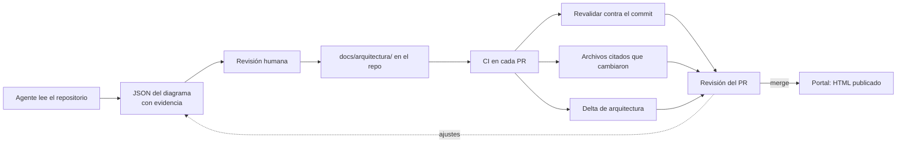

# Documentación viva: cómo mantener la arquitectura de los repositorios de mis equipos verificada contra el código

_2026-11-16 · 14 min de lectura_

Todo equipo de ingeniería tiene un diagrama de arquitectura que alguna vez fue correcto. Se dibujó para una revisión de diseño o para un onboarding, quedó en una wiki y, unos meses después, nadie sabe si todavía representa al sistema. Desde el rol de Engineering Manager, ese problema tiene costos concretos: onboardings más lentos, revisiones de diseño que discuten sobre supuestos desactualizados y dependencias entre equipos que se descubren durante un incidente. Este artículo describe el enfoque que aplico para que la documentación de arquitectura de los repositorios de mis equipos de ingeniería y plataforma se mantenga viva: diagramas como código, generados con un agente, anclados a un commit, revalidados en cada cambio y revisados en los pull requests. La herramienta central es Archify, un proyecto open source que convierte descripciones y repositorios en diagramas interactivos verificados.

## Por qué la documentación de arquitectura se muere

La documentación no se vuelve obsoleta por falta de voluntad, sino por diseño. Vive lejos del código, no tiene dueño claro y nada avisa cuando deja de ser cierta. Un diagrama en una herramienta de dibujo no se rompe cuando alguien renombra un módulo; simplemente queda mal, sin que nadie lo note hasta que alguien lo usa para tomar una decisión.

Mi conclusión, como responsable de equipos que mantienen decenas de repositorios, es que el problema no se resuelve pidiendo más disciplina. Se resuelve cambiando tres propiedades de la documentación: que **viva en el repositorio**, junto al código que describe; que **sea verificable**, de modo que un cambio en el código pueda romperla de forma visible; y que **forme parte del flujo de trabajo**, es decir, que se revise en los mismos pull requests que el código.

Durante años, la tercera propiedad era la difícil: generar y actualizar diagramas a mano tenía un costo que nadie quería pagar en cada PR. Los agentes de código cambiaron esa ecuación. Un agente puede leer un repositorio y producir un primer diagrama en minutos. El riesgo pasa a ser otro: que ese diagrama sea plausible pero incorrecto. Por eso la verificación importa más que la generación.

## Qué es Archify

[Archify](https://github.com/tt-a1i/archify) es una skill para agentes de código (Claude Code, Codex, Cursor, OpenCode y otros) acompañada de una CLI sin dependencias externas. El agente no dibuja: escribe una representación intermedia en JSON con tipos y esquema, y la CLI la valida, la renderiza y produce un único archivo HTML interactivo que se puede abrir sin instalar nada.

_Archify en datos (verificado en el repositorio el 16 de noviembre de 2026, commit a7ed6fd)_

| Aspecto | Situación |
|---|---|
| Licencia | Apache 2.0 |
| Actividad | Repositorio creado en abril de 2026; unas 97.000 estrellas y alrededor de 90 contribuidores. Versión estable 3.2.0 (18 de octubre de 2026) |
| Tipos de diagrama | Arquitectura, workflow, secuencia, flujo de datos, ciclo de vida, ERD, clases, árbol, timeline y waterfall, más páginas explicativas |
| Representación | JSON con esquema por tipo; la misma fuente produce siempre el mismo diagrama |
| Verificación | Validación de esquema y de layout antes de entregar; los errores devuelven un código, el elemento afectado y las correcciones admitidas |
| Evidencia de código | Cada componente puede citar hasta tres archivos con rangos de líneas, anclados a un commit y verificados con Git |
| Comparación | `compare architecture` produce un delta entre dos versiones del diagrama, con un recibo en JSON |

Para la documentación viva, las dos últimas filas son las que importan. La primera permite que un diagrama afirme «este componente está implementado aquí» y que esa afirmación se pueda comprobar. La segunda permite revisar un cambio de arquitectura como se revisa un cambio de código.

## El flujo completo

El proceso que propongo a los equipos tiene cinco pasos. Los dos primeros ocurren una vez por repositorio; los tres últimos, en cada cambio.

_Ciclo de la documentación viva de un repositorio_



1. **Generar.** Con la skill instalada, se le pide al agente un diagrama de arquitectura del repositorio con un alcance acotado: entre 8 y 12 componentes, el camino principal, dependencias externas y límites de confianza, con evidencia de código en cada componente.
2. **Revisar y versionar.** Una persona que conoce el sistema revisa el resultado, corrige lo que el agente interpretó mal y lo guarda en `docs/arquitectura/`. Se versiona el JSON, no el HTML.
3. **Revalidar en cada cambio.** El CI ancla el diagrama al commit del PR y lo valida. Si un archivo citado desapareció o las líneas citadas ya no existen, falla.
4. **Señalar lo que la validación no ve.** El CI lista los archivos citados por el diagrama que el PR modificó, para que alguien confirme que el diagrama sigue siendo correcto.
5. **Publicar.** Al fusionar, el CI genera el HTML y lo publica en el portal interno, sea GitHub Pages, Backstage TechDocs u otro.

## Un ejemplo verificado sobre un repositorio real

Para mostrar el flujo con resultados reales, lo apliqué sobre [mlops-bayesiano-poc](https://github.com/juliancardozo/mlops-bayesiano-poc), un repositorio público que acompaña [otro artículo de este blog](/blog/plataforma-mlops-modelos-bayesianos-mlflow/). La fuente del diagrama es la siguiente (resumida):

_docs/arquitectura/plataforma.architecture.json (fragmento)_

```json
{
  "schema_version": 1,
  "diagram_type": "architecture",
  "meta": {
    "title": "Plataforma MLOps para modelos bayesianos",
    "locale": "es",
    "repository": {
      "url": "https://github.com/juliancardozo/mlops-bayesiano-poc",
      "revision": "bfb84a7b100c06b496890cb0856d1833cf5d58b4"
    }
  },
  "layout": { "mode": "grid", "cols": 6, "cellW": 150, "cellH": 64 },
  "components": [
    { "id": "gates", "type": "security", "label": "Gates de validación",
      "sublabel": "R-hat · ESS · cobertura", "row": 1, "col": 2,
      "sources": [{ "path": "src/validacion.py", "line": 34, "end_line": 41, "label": "evaluar" }] },
    { "id": "registro", "type": "database", "label": "MLflow Registry",
      "sublabel": "versiones + aliases", "row": 1, "col": 3 },
    { "id": "cli", "type": "security", "label": "CLI de despliegue",
      "sublabel": "ml-deploy · rollback", "row": 0, "col": 3,
      "sources": [{ "path": "src/ml_cli.py", "line": 19, "end_line": 63, "label": "deploy y rollback" }] }
  ],
  "connections": [
    { "id": "gates-registro", "from": "gates", "to": "registro",
      "label": "versión + etiqueta", "variant": "emphasis" },
    { "id": "cli-registro", "from": "cli", "to": "registro", "variant": "security" }
  ],
  "boundaries": [
    { "kind": "region", "label": "Responsabilidad de la plataforma",
      "wraps": ["gates", "registro", "cli", "serving"] }
  ]
}
```

El resultado es un HTML de unos 845 KB con ocho componentes, una región que marca la responsabilidad del equipo de plataforma y, en cada componente con evidencia, un enlace al archivo y las líneas exactas en el commit indicado. El diagrama permite enfocar un nodo, seguir sus dependencias hacia arriba o hacia abajo, trazar un camino y cambiar entre tema claro y oscuro.

### Lo que la validación detectó

La primera versión no pasó. En el primer borrador cité rangos de líneas aproximados, y Archify rechazó cuatro de ellos con mensajes como este: `src/modelo.py` tiene 33 líneas en ese commit, pero el diagrama pide la línea 34. Después aparecieron dos problemas de presentación: una etiqueta más ancha que su componente y un texto que se superponía a una caja. Cada error indicaba el elemento afectado y qué correcciones eran válidas. Con cuatro ajustes, el diagrama pasó la validación con el perfil de calidad más estricto.

Ese comportamiento es exactamente el que se necesita para documentación viva: **un diagrama que no coincide con el código no se entrega**. Cuando el agente o una persona se equivoca, el error aparece antes de que alguien lo use para decidir.

## La verificación en el CI

La pieza que convierte un diagrama correcto en documentación viva es un script que, en cada cambio, ancla el diagrama al commit nuevo y lo vuelve a validar.

_scripts/verificar-docs.sh: revalida cada diagrama contra el commit actual_

```bash
#!/usr/bin/env bash
set -euo pipefail
ARCHIFY="${ARCHIFY:-node archify/archify/bin/archify.mjs}"
HEAD_SHA="$(git rev-parse HEAD)"
tmp="$(mktemp -d)"; trap 'rm -rf "$tmp"' EXIT
status=0
for ir in docs/arquitectura/*.architecture.json; do
  # Misma fuente, anclada al commit que se está revisando.
  jq --arg sha "$HEAD_SHA" '.meta.repository.revision = $sha' "$ir" > "$tmp/$(basename "$ir")"
  if $ARCHIFY validate architecture "$tmp/$(basename "$ir")" --repo-root . --quality showcase --json > "$tmp/out.json"; then
    echo "ok    $ir"
  else
    echo "DRIFT $ir"; jq -r '.diagnostics[] | "      \(.code): \(.message)"' "$tmp/out.json"; status=1
  fi
done
exit $status
```

Para comprobar qué detecta, simulé tres cambios sobre el repositorio de ejemplo. Los resultados fueron estos:

_Qué detecta la revalidación (pruebas sobre el repositorio de ejemplo)_

| Cambio simulado | Resultado | Diagnóstico |
|---|---|---|
| Un refactor que elimina la clase de serving citada | Falla | `line-out-of-range`: el archivo tiene 27 líneas y el diagrama pide la 42 |
| Renombrar `validacion.py` a `gates.py` | Falla | `file-missing`: la ruta citada no existe en ese commit |
| Relajar el umbral de R-hat de 1,01 a 1,05 dentro de las líneas citadas | **Pasa** | La validación comprueba que el archivo y las líneas existan, no qué dicen |

El tercer caso es la limitación más importante: **la validación detecta que la estructura citada se movió o desapareció, pero no que cambió su significado**. Por eso agrego un segundo paso que no valida nada, sino que señala: lista los archivos citados por algún diagrama que el PR modificó.

_scripts/archivos-citados.sh: archivos documentados que cambiaron en el PR_

```bash
#!/usr/bin/env bash
set -euo pipefail
BASE="${1:?uso: archivos-citados.sh <base-ref>}"
citados="$(jq -r '.components[].sources[]?.path' docs/arquitectura/*.architecture.json | sort -u)"
cambiados="$(git diff --name-only "$BASE"...HEAD | sort -u)"
comm -12 <(echo "$citados") <(echo "$cambiados")
```

En la prueba del umbral, el script devolvió `src/validacion.py`. Esa salida, publicada como comentario o resumen del PR, le pide a quien revisa una sola cosa: confirmar que el diagrama sigue siendo correcto. Combinado con un archivo CODEOWNERS que asigne `docs/arquitectura/` a las personas responsables de la arquitectura del repositorio, el control queda completo.

_.github/workflows/documentacion-viva.yml (en el repositorio de ejemplo)_

```yaml
name: documentacion-viva
on:
  pull_request:
  push:
    branches: [main]
jobs:
  diagramas:
    runs-on: ubuntu-latest
    steps:
      - uses: actions/checkout@v4
        with:
          fetch-depth: 0
      - uses: actions/checkout@v4
        with:
          repository: tt-a1i/archify
          ref: v3.2.0                       # versión fija de la herramienta
          path: archify
      - uses: actions/setup-node@v4
        with:
          node-version: '22'
      - run: ./scripts/verificar-docs.sh
      - if: github.event_name == 'pull_request'
        run: |
          echo "### Archivos documentados que cambiaron" >> "$GITHUB_STEP_SUMMARY"
          ./scripts/archivos-citados.sh origin/${{ github.base_ref }} >> "$GITHUB_STEP_SUMMARY"
```

> **Qué se verificó:** Los dos scripts se ejecutaron localmente con Archify 3.2.0 sobre una copia del repositorio de ejemplo, con los resultados de la tabla. El workflow está en el repositorio de ejemplo y pasa en GitHub Actions con cada push; el paso que lista archivos citados solo corre en pull requests y no se ejercitó allí.

## Revisar cambios de arquitectura como cambios de código

Cuando un PR modifica la arquitectura, por ejemplo al agregar un componente de monitoreo, el diagrama se actualiza en el mismo PR. Archify puede comparar la versión anterior y la nueva:

_Delta entre dos versiones del diagrama_

```bash
node archify/archify/bin/archify.mjs compare architecture \
  base.architecture.json head.architecture.json delta.html \
  --receipt delta.receipt.json --repo-root . --json
```

En el ejemplo, agregar un componente de monitoreo y su conexión, y cambiar la descripción de los gates, produjo un recibo con un componente agregado, uno modificado y una conexión agregada, además de un HTML que muestra las versiones anterior, delta y posterior. La comparación exige que cada conexión tenga un identificador estable; la primera vez falló justamente por eso. Es un requisito razonable: sin identificadores, un cambio de etiqueta parece una conexión borrada y otra nueva.

El recibo declara sus propios límites: compara solo lo que el diagrama afirma y no infiere impacto en ejecución, riesgo ni si es seguro fusionar. Para una revisión de diseño es suficiente: la discusión deja de ser «¿qué cambió?» y pasa a ser «¿está bien que cambie así?».

## Equipos de plataforma: propiedad y despliegue explícitos

En los repositorios de plataforma, la pregunta más frecuente no es cómo funciona un componente, sino de quién es y dónde corre. Archify tiene un perfil opcional, `deployment-ownership`, pensado para eso. Cuando se activa, el diagrama falla si algún componente no declara un dueño, si no pertenece a exactamente una región, si una base de datos no está dentro de un grupo de seguridad o si una conexión que cruza regiones o grupos no nombra el mecanismo que usa para cruzarlos.

El perfil valida lo que el diagrama declara, no la infraestructura real: no descubre recursos ni infiere dueños. Aun así, obliga a escribir información que muchas veces solo existe en la cabeza de algunas personas. Para un Engineering Manager, que el diagrama no se pueda publicar sin dueños declarados es una forma concreta de hacer visible la propiedad de cada componente.

## Qué documentar: pocos diagramas, bien mantenidos

El error más común al adoptar una herramienta así es generar demasiado. Cada diagrama es algo que hay que mantener. Lo que propongo a los equipos es un conjunto mínimo por repositorio, y agregar más solo cuando aparece una necesidad concreta.

_Conjunto mínimo de documentación por repositorio (propuesta)_

| Diagrama | Tipo en Archify | Pregunta que responde | Cuándo se usa |
|---|---|---|---|
| Arquitectura en ejecución | Architecture, con evidencia | ¿Qué componentes hay, cómo se conectan y dónde está el código? | Onboarding, revisiones de diseño, incidentes |
| Flujo crítico | Sequence o Workflow | ¿Qué pasa en la operación más importante, paso a paso? | Debugging, cambios en ese flujo |
| Datos sensibles | Data Flow | ¿Por dónde pasan los datos personales y quién los consume? | Revisiones de seguridad y cumplimiento |
| Propiedad y despliegue (plataforma) | Architecture con `deployment-ownership` | ¿De quién es cada componente y dónde corre? | Dependencias entre equipos, guardias |

## Los rituales que la sostienen

Las herramientas y el CI evitan que la documentación quede mal sin que nadie lo note. Que se use depende de los hábitos del equipo. Estos son los que, desde el rol de Engineering Manager, conviene instalar:

- **Onboarding desde el diagrama.** La primera sesión de una persona nueva recorre el diagrama de arquitectura con alguien del equipo. Si algo no coincide con lo que se explica, se corrige en ese momento.
- **Revisiones de diseño con delta.** Las propuestas de cambio de arquitectura llegan con el delta del diagrama, no con una imagen nueva.
- **Incidentes con contexto.** El postmortem enlaza el diagrama en el commit del incidente, y el timeline puede documentarse con el tipo Timeline, marcando qué horarios son observados.
- **Revisión trimestral breve.** Una vez por trimestre, cada equipo dedica media hora a revisar si sus diagramas siguen siendo útiles. Los que nadie usó se borran.
- **Propiedad explícita.** `docs/arquitectura/` tiene dueños en CODEOWNERS, igual que el código.

## Cómo saber si funciona

Las métricas de la tabla son las que sigo para evaluar si la documentación está viva y si aporta. Son indicadores para observar, no metas con valores de referencia.

_Indicadores de documentación viva (propuesta)_

| Indicador | Qué muestra |
|---|---|
| Repositorios con al menos un diagrama validado en CI | Cobertura de la práctica |
| Fallas de revalidación y tiempo hasta corregirlas | Si el control detecta desvíos y si el equipo los atiende |
| PRs que tocaron archivos documentados sin actualizar el diagrama | Riesgo de desvío semántico que la validación no ve |
| Preguntas repetidas en onboarding o en canales de soporte | Si la documentación responde lo que la gente necesita |
| Uso del diagrama en revisiones de diseño y postmortems | Si la documentación forma parte de las decisiones |

## Límites y precauciones

- **La validación es estructural.** Comprueba que archivos y líneas existan en el commit, no que el código siga haciendo lo que el diagrama dice. El listado de archivos citados y la revisión humana cubren esa brecha.
- **El agente puede equivocarse.** Un diagrama generado puede ser plausible e incorrecto. La primera versión siempre la revisa alguien que conoce el sistema.
- **El HTML es pesado.** El diagrama del ejemplo pesa unos 845 KB y el delta, unos 2,3 MB. Conviene versionar el JSON y generar el HTML en el CI para publicarlo, no guardarlo en el repositorio.
- **La evidencia incluye código.** El HTML con evidencia contiene extractos del repositorio. En repositorios privados, hay que tratarlo con la misma confidencialidad que el código y publicarlo solo en portales internos.
- **Servicios de terceros.** El README del proyecto incluye patrocinadores que ofrecen acceso a modelos a través de intermediarios, y aclara que no representan a Archify. Para el código de la empresa, el agente debe usar el proveedor de modelos aprobado por la organización.
- **Actualizaciones.** La skill puede consultar un manifiesto público para avisar que hay una versión nueva, sin instalar nada. En el CI conviene fijar la versión, como en el workflow propuesto.

## Cómo empezar en 90 días

1. **Días 1 a 30.** Elegir dos repositorios críticos, uno de producto y uno de plataforma. Generar el diagrama de arquitectura con evidencia, revisarlo con el equipo y agregar la revalidación al CI.
2. **Días 31 a 60.** Sumar el listado de archivos citados a los PRs, asignar dueños en CODEOWNERS, publicar los HTML en el portal interno y usar los diagramas en el próximo onboarding y en la próxima revisión de diseño.
3. **Días 61 a 90.** Extender al resto de los repositorios con una plantilla común, activar `deployment-ownership` en los repositorios de plataforma y hacer la primera revisión de indicadores para decidir qué ajustar.

## Conclusión

La documentación de arquitectura no se mantiene viva con buenas intenciones. Se mantiene cuando vive junto al código, cuando un cambio puede romperla de forma visible y cuando su revisión forma parte del trabajo de todos los días. Los agentes de código redujeron el costo de generarla; herramientas como Archify agregan lo que faltaba: verificación contra el código, comparación entre versiones y un resultado que cualquiera puede abrir.

Para un Engineering Manager, el valor no está en tener diagramas más lindos, sino en que el equipo comparta un modelo del sistema que se puede comprobar. Eso acelera los onboardings, mejora las revisiones de diseño y hace visibles la propiedad y las dependencias entre equipos, que son justamente las cosas que más cuesta sostener cuando una organización crece.

## Referencias

- Archify. [Repositorio](https://github.com/tt-a1i/archify), [sitio y galería](https://archify.si/) y [referencia de esquemas](https://github.com/tt-a1i/archify/blob/main/archify/schemas/README.md).
- Repositorio del ejemplo: [mlops-bayesiano-poc](https://github.com/juliancardozo/mlops-bayesiano-poc).
- Write the Docs. [Docs as Code](https://www.writethedocs.org/guide/docs-as-code/).
- Backstage. [TechDocs](https://backstage.io/docs/features/techdocs/).
- GitHub. [Acerca de los propietarios de código (CODEOWNERS)](https://docs.github.com/es/repositories/managing-your-repositorys-settings-and-features/customizing-your-repository/about-code-owners).
- Brown, S. [The C4 model for visualising software architecture](https://c4model.com/).

---

**En síntesis: la documentación de arquitectura se mantiene viva cuando vive en el repositorio, se verifica contra el código y se revisa en los pull requests. Archify permite generar diagramas con un agente, anclarlos a un commit, revalidarlos en el CI y comparar versiones. La validación es estructural, así que se complementa con el listado de archivos documentados que cambiaron, dueños explícitos y rituales de equipo que usan los diagramas para decidir.**

