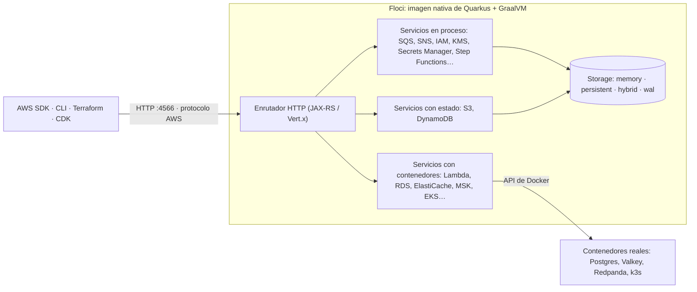
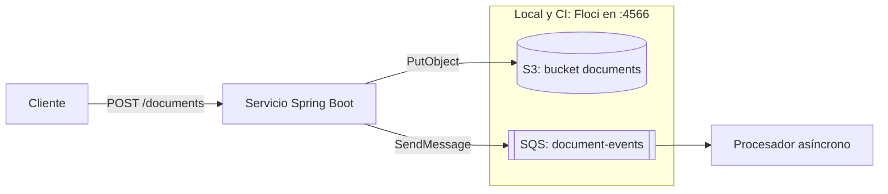

# Floci: llevar la nube al entorno local sin perder el control arquitectónico

_2026-11-15 · 15 min de lectura_

Un desarrollador necesita validar un cambio en un servicio que guarda archivos en S3 y publica eventos en SQS. La aplicación levanta en su máquina, pero probarla de verdad requiere credenciales de una cuenta de desarrollo, permisos que gestiona otro equipo, una VPN y un ambiente de integración compartido que a esa hora usan otras tres personas. Cada uno de esos pasos agrega espera y variabilidad a un ciclo que debería durar segundos. Este artículo analiza Floci, un ecosistema open source de emuladores cloud locales, a partir de una tesis: la velocidad del feedback es una propiedad del diseño de la plataforma, no un esfuerzo individual de cada desarrollador. Las capacidades que se mencionan son las declaradas en los repositorios oficiales al 15 de noviembre de 2026; las conclusiones son propias y se señalan como tales.

## La dependencia invisible de la nube

En un equipo que desarrolla aplicaciones cloud-native, levantar el servicio en local no equivale a poder probarlo. El código arranca, pero cada llamada a almacenamiento, colas, secretos o identidad sale de la máquina hacia una cuenta remota. Esa dependencia rara vez aparece en los diagramas de arquitectura y, sin embargo, determina buena parte de la experiencia de desarrollo.

Sus efectos se acumulan en cuatro lugares. En el **onboarding**, porque una persona nueva no puede ejecutar las pruebas de integración hasta tener acceso a la cuenta correcta. En el **debugging**, porque reproducir un error que depende del estado de un ambiente compartido es difícil y a veces imposible. En el **testing**, porque las pruebas que tocan servicios reales son lentas, costosas o inestables, y terminan desactivándose. Y en la **autonomía**, porque cada ajuste de permisos o de infraestructura de desarrollo pasa por la cola de otro equipo.

Desde Platform Engineering, el problema no es que los desarrolladores tengan que esperar, sino que la plataforma convierte esa espera en el camino por defecto. Si la forma más fácil de probar un cambio es abrir un pull request y esperar al pipeline, el ciclo de feedback se mide en decenas de minutos aunque el cambio sea trivial. El principio de que el camino correcto debe ser el más fácil aplica también acá: probar contra dependencias realistas debería ser más fácil que no probar.

## Qué es Floci

Floci es una familia de emuladores open source, publicados bajo licencia MIT, que exponen APIs con la forma de los servicios de cuatro nubes en un entorno local. El repositorio principal, [floci](https://github.com/floci-io/floci), emula AWS en el puerto 4566. Lo acompañan [floci-az](https://github.com/floci-io/floci-az) para Azure (puerto 4577), [floci-gcp](https://github.com/floci-io/floci-gcp) para GCP (4588) y [floci-oci](https://github.com/floci-io/floci-oci) para Oracle Cloud (4599). Alrededor de ellos hay una CLI ([floci-cli](https://github.com/floci-io/floci-cli)), una consola web ([floci-ui](https://github.com/floci-io/floci-ui)) que muestra solo lo que devuelven los emuladores, y módulos de Testcontainers para Java, Node.js, Python, .NET y Go.

Emular una API cloud significa implementar el protocolo de red del servicio, de modo que un cliente estándar, como el AWS SDK, la CLI o Terraform, funcione sin cambios salvo la URL de destino. Conviene distinguirlo de otras tres opciones. Un **mock** reemplaza al cliente dentro del proceso de pruebas y verifica que se lo llamó, pero no ejecuta el protocolo. Un **contenedor con la tecnología real**, como PostgreSQL detrás de una API con forma de RDS, ejecuta el motor auténtico pero no la capa administrada del proveedor. La **infraestructura de producción** es la única que reproduce el comportamiento completo, con sus permisos, cuotas y fallas. Floci combina las dos primeras: emula en proceso la mayoría de las APIs y delega en contenedores reales los servicios donde la fidelidad depende del motor.

## Arquitectura: cómo funciona por dentro

Según el README y el código del repositorio, el emulador de AWS es una aplicación Java construida con Quarkus (versión 3.40.1.1 al momento de esta revisión) y compilada a Java 25, que se distribuye como imagen nativa de GraalVM y como binario independiente. Un enrutador HTTP basado en JAX-RS y Vert.x recibe todas las peticiones en un único puerto y las dirige al servicio correspondiente según el protocolo de AWS de cada llamada.

Los servicios se dividen en tres grupos. La mayoría, como SQS, SNS, IAM, KMS, Secrets Manager o Step Functions, se emulan en proceso. S3 y DynamoDB también corren en proceso, pero con estado persistible. Un tercer grupo, que incluye Lambda, RDS, ElastiCache, MSK, ECS, EKS y OpenSearch, levanta contenedores Docker reales a través del socket del host: RDS usa `postgres:16-alpine` o `mysql:8.0`, MSK usa Redpanda y EKS usa k3s. Athena ejecuta SQL real mediante un sidecar basado en DuckDB.

_Arquitectura del emulador de AWS, según la documentación del repositorio_



El estado se configura con `FLOCI_STORAGE_MODE`: `memory` para pruebas efímeras, `persistent` con escritura inmediata a disco, `hybrid` con volcados asíncronos cada cinco segundos y `wal` con un registro previo a cada respuesta. El emulador también aísla recursos por cuenta: si la access key tiene doce dígitos, se usa como ID de cuenta, lo que permite probar flujos entre cuentas en local.

### Los trade-offs del enfoque

- **Un proceso para muchos servicios** simplifica la configuración, pero concentra el riesgo: un defecto en el enrutamiento afecta a todos los servicios a la vez.
- **La emulación en proceso** es rápida y liviana, pero su fidelidad depende de cuánto del comportamiento real se haya reimplementado. Los contenedores reales mejoran la fidelidad del motor a cambio de más recursos y de requerir el socket de Docker, que otorga privilegios amplios sobre el host.
- **La imagen nativa** reduce el tiempo de arranque y la memoria. El proyecto declara alrededor de 24 ms de arranque y 13 MiB de memoria en reposo, frente a 3,3 s y 143 MiB de LocalStack Community; son cifras del propio proyecto, no mediciones independientes.

## Del concepto a la práctica: S3 y SQS con Spring Boot

El ejemplo implementa un caso frecuente: un servicio recibe un documento por HTTP, lo guarda en S3 y publica un evento en SQS para que otro componente lo procese de forma asíncrona. Usa Java 21, Spring Boot 3.5.16, AWS SDK for Java v2 (2.59.1), JUnit 5, Testcontainers 1.21.4 y `testcontainers-floci` 1.16.0, la línea compatible con Testcontainers 1.x. Para Spring Boot 4 y Testcontainers 2 corresponde la línea 2.x del módulo, cuyo artefacto es `testcontainers-floci-aws`.

> **Qué se verificó:** El proyecto del ejemplo compila con esas versiones, resueltas desde Maven Central. La prueba de integración no se ejecutó en el entorno donde se escribió este artículo, porque no tenía Docker disponible; por eso no se informan resultados de ejecución.

_El ejemplo en local y en pruebas_



### Dependencias

_pom.xml (fragmento): el BOM del SDK y las dependencias de prueba_

```xml
<parent>
  <groupId>org.springframework.boot</groupId>
  <artifactId>spring-boot-starter-parent</artifactId>
  <version>3.5.16</version>
</parent>

<dependencyManagement>
  <dependencies>
    <dependency>
      <groupId>software.amazon.awssdk</groupId>
      <artifactId>bom</artifactId>
      <version>2.59.1</version>
      <type>pom</type>
      <scope>import</scope>
    </dependency>
  </dependencies>
</dependencyManagement>

<dependencies>
  <dependency>
    <groupId>org.springframework.boot</groupId>
    <artifactId>spring-boot-starter-web</artifactId>
  </dependency>
  <dependency>
    <groupId>software.amazon.awssdk</groupId>
    <artifactId>s3</artifactId>
  </dependency>
  <dependency>
    <groupId>software.amazon.awssdk</groupId>
    <artifactId>sqs</artifactId>
  </dependency>
  <dependency>
    <groupId>org.springframework.boot</groupId>
    <artifactId>spring-boot-starter-test</artifactId>
    <scope>test</scope>
  </dependency>
  <dependency>
    <groupId>org.testcontainers</groupId>
    <artifactId>junit-jupiter</artifactId>  <!-- 1.21.4, gestionada por Spring Boot -->
    <scope>test</scope>
  </dependency>
  <dependency>
    <groupId>io.floci</groupId>
    <artifactId>testcontainers-floci</artifactId>
    <version>1.16.0</version>
    <scope>test</scope>
  </dependency>
</dependencies>
```

### Configuración: el mismo código en local y en la nube

La decisión de diseño más importante del ejemplo es que el código no sabe si habla con Floci o con AWS. La URL del emulador llega por configuración y, cuando está vacía, el SDK usa su resolución estándar de endpoints y credenciales. Así se evita mantener un perfil de código distinto para desarrollo.

_application.yml_

```yaml
app:
  aws:
    region: ${AWS_REGION:us-east-1}
    endpoint: ${AWS_ENDPOINT_URL:}   # vacío en la nube real
    bucket: ${DOCUMENTS_BUCKET:documents}
    queue-name: ${DOCUMENTS_QUEUE:document-events}
```

_AwsConfig.java: clientes del SDK con endpoint opcional_

```java
@ConfigurationProperties(prefix = "app.aws")
public record AwsProperties(String region, String endpoint, String bucket, String queueName) {
    boolean hasEndpointOverride() { return endpoint != null && !endpoint.isBlank(); }
}

@Configuration
@EnableConfigurationProperties(AwsProperties.class)
class AwsConfig {

    @Bean
    S3Client s3Client(AwsProperties props) {
        S3ClientBuilder builder = S3Client.builder().region(Region.of(props.region()));
        if (props.hasEndpointOverride()) {
            // Solo en local o en pruebas: emulador y URLs path-style.
            builder.endpointOverride(URI.create(props.endpoint())).forcePathStyle(true);
        }
        return builder.build();
    }

    @Bean
    SqsClient sqsClient(AwsProperties props) {
        SqsClientBuilder builder = SqsClient.builder().region(Region.of(props.region()));
        if (props.hasEndpointOverride()) {
            builder.endpointOverride(URI.create(props.endpoint()));
        }
        return builder.build();
    }
}
```

_DocumentService.java: guardar y publicar_

```java
@Service
public class DocumentService {

    private final S3Client s3;
    private final SqsClient sqs;
    private final AwsProperties props;

    DocumentService(S3Client s3, SqsClient sqs, AwsProperties props) {
        this.s3 = s3;
        this.sqs = sqs;
        this.props = props;
    }

    public String store(byte[] content, String contentType) {
        String id = UUID.randomUUID().toString();
        String key = "documents/" + id;

        s3.putObject(b -> b.bucket(props.bucket()).key(key).contentType(contentType),
                RequestBody.fromBytes(content));

        String queueUrl = sqs.getQueueUrl(b -> b.queueName(props.queueName())).queueUrl();
        sqs.sendMessage(b -> b.queueUrl(queueUrl).messageBody(
                "{\"documentId\":\"%s\",\"bucket\":\"%s\",\"key\":\"%s\"}"
                        .formatted(id, props.bucket(), key)));
        return id;
    }
}
```

El controlador que expone `POST /documents` solo delega en este servicio y responde `202 Accepted` con el identificador. En un sistema real, el evento debería publicarse con una garantía explícita, por ejemplo mediante el patrón outbox, porque el código anterior puede guardar el archivo y fallar antes de publicar el mensaje. La emulación local no cambia esa responsabilidad de diseño.

### Docker Compose para desarrollo

_compose.yaml: emulador, inicialización de recursos y aplicación_

```yaml
services:
  floci:
    image: floci/floci:2.5.0          # versión fija para entornos reproducibles
    ports:
      - "4566:4566"
    environment:
      FLOCI_HOSTNAME: floci           # las URLs devueltas (QueueUrl) apuntan al servicio, no a localhost
      FLOCI_STORAGE_MODE: hybrid      # conserva el estado entre reinicios

  init:
    image: amazon/aws-cli:2.17.0
    depends_on: [floci]
    environment:
      AWS_ENDPOINT_URL: http://floci:4566
      AWS_REGION: us-east-1
      AWS_ACCESS_KEY_ID: test
      AWS_SECRET_ACCESS_KEY: test
    entrypoint: ["/bin/sh", "-c"]
    command: >
      "until aws s3 ls >/dev/null 2>&1; do sleep 1; done;
       aws s3 mb s3://documents || true;
       aws sqs create-queue --queue-name document-events"

  app:
    build: .
    ports:
      - "8080:8080"
    depends_on:
      init:
        condition: service_completed_successfully
    environment:
      AWS_ENDPOINT_URL: http://floci:4566
      AWS_REGION: us-east-1
      AWS_ACCESS_KEY_ID: test
      AWS_SECRET_ACCESS_KEY: test
```

El servicio `init` crea los recursos con la AWS CLI estándar. En un equipo que ya define su infraestructura con Terraform u OpenTofu, la alternativa más coherente es aplicar los mismos módulos contra Floci, que el proyecto declara compatible con el proveedor oficial de AWS: así el entorno local se deriva de la misma fuente que producción.

### Prueba de integración automatizada

_DocumentServiceIntegrationTest.java: un emulador aislado por ejecución_

```java
@SpringBootTest
@Testcontainers
class DocumentServiceIntegrationTest {

    @Container
    static FlociContainer floci = new FlociContainer("floci/floci:2.5.0")
            .withDockerSocket(false); // S3 y SQS corren en proceso: sin socket de Docker

    @DynamicPropertySource
    static void awsProperties(DynamicPropertyRegistry registry) {
        registry.add("app.aws.endpoint", floci::getEndpoint);
        registry.add("app.aws.region", floci::getRegion);
        // La cadena de credenciales por defecto del SDK lee estas propiedades del sistema.
        System.setProperty("aws.accessKeyId", floci.getAccessKey());
        System.setProperty("aws.secretAccessKey", floci.getSecretKey());
    }

    @Autowired DocumentService documents;
    @Autowired S3Client s3;
    @Autowired SqsClient sqs;
    @Autowired AwsProperties props;

    @BeforeAll
    static void createResources(@Autowired S3Client s3, @Autowired SqsClient sqs,
                                @Autowired AwsProperties props) {
        s3.createBucket(b -> b.bucket(props.bucket()));
        sqs.createQueue(b -> b.queueName(props.queueName()));
    }

    @Test
    void storesTheDocumentAndPublishesAnEvent() {
        String id = documents.store("hola".getBytes(StandardCharsets.UTF_8), "text/plain");

        String stored = s3.getObjectAsBytes(b -> b.bucket(props.bucket()).key("documents/" + id))
                .asUtf8String();
        assertThat(stored).isEqualTo("hola");

        String queueUrl = sqs.getQueueUrl(b -> b.queueName(props.queueName())).queueUrl();
        var messages = sqs.receiveMessage(b -> b.queueUrl(queueUrl)
                .waitTimeSeconds(2).maxNumberOfMessages(1)).messages();
        assertThat(messages).extracting(Message::body).singleElement().asString().contains(id);
    }
}
```

Dos detalles merecen atención. El primero es fijar la versión de la imagen: `FlociContainer()` sin argumentos usa `floci/floci:latest`, y el proyecto publica versiones estables dos veces por mes, de modo que una prueba sin versión fija puede cambiar de comportamiento sin que cambie el código. El segundo es `withDockerSocket(false)`: el módulo monta el socket de Docker de forma automática cuando algún servicio habilitado lo necesita, y todos están habilitados por defecto. Para un servicio que solo usa S3 y SQS, desactivarlo reduce los privilegios que la prueba otorga al contenedor.

### Ejecución en CI

_.github/workflows/ci.yml: Testcontainers en un runner con Docker_

```yaml
name: ci
on: [push, pull_request]
jobs:
  test:
    runs-on: ubuntu-latest
    steps:
      - uses: actions/checkout@v4
      - uses: actions/setup-java@v4
        with:
          distribution: temurin
          java-version: '21'
          cache: maven
      - run: ./mvnw -B verify
```

Los runners de GitHub Actions basados en Ubuntu incluyen Docker, por lo que Testcontainers puede crear el emulador sin pasos adicionales. Cada ejecución obtiene una instancia aislada, sin estado compartido con otras ramas ni con otras personas.

## Floci como componente de una Internal Developer Platform

El valor de un emulador crece cuando deja de ser una herramienta que cada equipo configura por su cuenta y pasa a formar parte de un golden path. La experiencia deseada se puede describir en una frase: una persona crea un servicio desde una plantilla, ejecuta un comando y obtiene una aplicación funcional con sus dependencias cloud emuladas y sus pruebas de integración en verde.

Conviene separar lo que existe de lo que es una propuesta. Lo que el ecosistema ofrece hoy, según sus repositorios, incluye la CLI con comandos `start`, `wait`, `env` y `stop` pensados para CI; los módulos de Testcontainers en cinco lenguajes; compatibilidad declarada con Terraform, OpenTofu y CDK, respaldada por pruebas automatizadas en el repositorio; un chart de Helm para Kubernetes; compatibilidad con la configuración y los scripts de inicialización de LocalStack; y una skill para agentes de programación. Lo que sigue es una propuesta de arquitectura, no una integración existente.

- **Plantilla en Backstage** (u otro portal interno) que genere el servicio con `compose.yaml`, la prueba de integración con Testcontainers y la versión de Floci fijada por la plataforma.
- **Módulos de Terraform u OpenTofu compartidos** que se apliquen contra Floci en local y contra la cuenta real en los ambientes, de modo que el entorno de desarrollo y el de producción provengan de la misma definición.
- **Un workflow reutilizable de CI** que ejecute las pruebas contra el emulador y deje para una etapa posterior las pruebas de humo en la nube.
- **Una versión de Floci gestionada por la plataforma**, actualizada de forma deliberada y con pruebas de regresión propias, porque el ritmo de cambios del proyecto es alto.
- **Onboarding automatizado**: la primera tarea de una persona nueva es ejecutar las pruebas de integración en su máquina, sin solicitar ningún acceso.

## Impacto en Developer Experience

No hay datos públicos e independientes que cuantifiquen el impacto de Floci en la productividad, y este artículo no los inventa. Lo que sí puede hacerse es identificar dónde debería notarse y cómo medirlo antes y después de adoptarlo.

_Dónde debería notarse el cambio y cómo medirlo_

| Dimensión | Hipótesis | Cómo medirla |
|---|---|---|
| Tiempo hasta el primer entorno funcional | Baja, porque no requiere solicitar accesos | Tiempo desde el alta hasta la primera ejecución verde de las pruebas de integración |
| Tiempo de feedback | Baja, porque las pruebas corren en la máquina | Duración de la suite de integración en local y en CI |
| Dependencia de ambientes compartidos | Disminuye | Cantidad de reservas o conflictos en el ambiente de integración |
| Reproducibilidad | Mejora, con versiones fijas | Tasa de pruebas inestables (flaky) en CI |
| Autonomía | Aumenta | Tickets a plataforma por accesos o recursos de desarrollo |
| Costo cloud de desarrollo y testing | Puede bajar | Gasto de las cuentas de desarrollo y CI, por servicio |

Estas métricas se conectan con las de [DORA](https://dora.dev/): el tiempo de entrega de cambios incluye el tiempo que un cambio espera a ser validado, y la tasa de fallas de cambio es la contracara que hay que vigilar. Si la emulación acelera el feedback pero deja pasar más errores a producción, el resultado neto es negativo. Por eso conviene medir las dos cosas a la vez, junto con una encuesta breve de experiencia de desarrollo.

## Floci frente a LocalStack y otras alternativas

La comparación más inmediata es con LocalStack, el emulador de AWS más difundido. En marzo de 2026, LocalStack [anunció](https://blog.localstack.cloud/the-road-ahead-for-localstack/) que su emulador pasaba a distribuirse como una imagen unificada que requiere un token de autenticación, y que ya no podía comprometerse a actualizar con regularidad la edición Community. Floci se presenta explícitamente como reemplazo directo de esa edición: usa el mismo puerto, traduce variables de entorno de LocalStack y ejecuta sus scripts de inicialización sin cambios.

Ese origen explica parte de su crecimiento, pero también obliga a leer sus comparaciones con cuidado. La tabla de su README contrasta Floci con LocalStack Community, no con las ediciones comerciales, y las cifras de arranque y memoria son del propio proyecto. Además del emulador de AWS, existen alternativas consolidadas para otros contextos.

_Alternativas de emulación local, sin un ganador universal_

| Criterio | Floci | LocalStack | Moto | Azurite | Emuladores de gcloud |
|---|---|---|---|---|---|
| Alcance | AWS, Azure, GCP y OCI; más de cien servicios de AWS declarados | AWS, con una larga trayectoria | AWS, como biblioteca de Python o servidor | Azure Storage: Blob, Queue y Table | Pub/Sub, Firestore, Datastore, Bigtable, Spanner |
| Fidelidad | Protocolo en proceso y contenedores reales para motores | A evaluar por servicio | Mocks del protocolo; menor fidelidad en servicios complejos | Alta para el alcance que cubre | Oficial, para cada servicio |
| Licencia | MIT | Imagen unificada que requiere token desde marzo de 2026 | Apache 2.0 | MIT | Parte del SDK de Google Cloud |
| Integración con SDK | SDK estándar con endpoint configurable | SDK estándar con endpoint configurable | Decoradores en Python o modo servidor | Connection strings de Azure | Variables de entorno del emulador |
| CI y Testcontainers | Módulos propios en cinco lenguajes | Módulo oficial de Testcontainers | Sin contenedor en modo biblioteca | Módulo de Testcontainers | Módulos de Testcontainers para varios servicios |
| Madurez | Proyecto de nueve meses, con ritmo de cambios muy alto | Producto establecido | Proyecto maduro | Mantenido por Microsoft | Mantenidos por Google |

Los indicadores de madurez de Floci son llamativos y ambiguos a la vez. El repositorio principal se creó el 18 de febrero de 2026 y, al 15 de noviembre, tenía más de 31.000 estrellas, unos 170 contribuidores, más de 5.300 pull requests fusionados, más de 2.400 issues cerrados y alrededor de 170 abiertos, con 63 versiones publicadas y un tren de releases los días 15 y último de cada mes. El directorio de compatibilidad declara 2.576 pruebas automatizadas sobre cinco SDKs y tres herramientas de infraestructura como código. Es evidencia de actividad y de una comunidad amplia, pero un proyecto de nueve meses no tiene todavía un historial de estabilidad a largo plazo, y la cadencia de cambios exige fijar versiones.

## Los límites de la emulación

La emulación local reduce dependencias, pero no reproduce la nube. Algunas diferencias son de diseño y la propia documentación las declara; otras son inherentes a cualquier emulador.

- **IAM y seguridad.** Por defecto, Floci no verifica firmas SigV4 y acepta cualquier credencial no vacía. La evaluación de políticas IAM existe, pero se activa de forma explícita con `FLOCI_SERVICES_IAM_ENFORCEMENT_ENABLED`, y la documentación recomienda dejarla desactivada en la mayoría de los escenarios locales. Una prueba verde en local no demuestra que los permisos de producción sean correctos.
- **Networking.** VPC, grupos de seguridad, endpoints privados, DNS y TLS de producción no se reproducen con fidelidad. En el emulador de Azure, la mayoría de los servicios corre por HTTP plano salvo que se habilite TLS.
- **Latencia, cuotas y límites.** El emulador responde en milisegundos y su catálogo de cuotas usa valores estáticos generosos. Un sistema que funciona en local puede encontrar throttling, límites de tamaño o latencias reales que cambian su comportamiento.
- **Consistencia y fallas.** Las fallas parciales, los reintentos del lado del proveedor y los comportamientos de consistencia de un servicio distribuido no aparecen en un proceso local. Incluso la emulación de AWS FIS es, según su documentación, una simulación del plano de control que no inyecta fallas en otros servicios.
- **Servicios administrados y stubs.** Varios servicios están implementados como stubs: Bedrock Runtime devuelve respuestas ficticias y Textract o Transcribe completan trabajos sin procesar contenido real. Sirven para probar el flujo de integración, no el resultado.
- **Performance.** Ninguna medición hecha contra un emulador local es representativa del rendimiento en la nube.

### Una estrategia de pruebas por capas

_Qué valida cada capa y dónde conviene ejecutarla_

| Capa | Qué valida | Dónde corre |
|---|---|---|
| Unit tests | Lógica de negocio sin dependencias externas | Local y CI, en cada cambio |
| Integración con emulación local | Uso correcto del SDK, serialización, flujos entre servicios | Local y CI, en cada cambio, contra Floci |
| Contrato y compatibilidad | Formato de eventos y APIs entre productores y consumidores | CI, en cada cambio |
| Smoke tests en la nube real | Permisos IAM, networking, configuración real | Ambiente de staging, en cada despliegue |
| Resiliencia y performance | Cuotas, latencias, comportamiento ante fallas | Ambientes dedicados, de forma periódica |

La emulación mueve hacia la izquierda la mayor parte de las pruebas de integración, que son las más frecuentes, y deja en la nube real las que dependen de lo que solo la nube real tiene. El error de adopción más probable no es técnico: es eliminar las pruebas en la nube porque las pruebas locales pasan.

## Cloud local y desarrollo asistido por agentes

Los agentes de programación necesitan lo mismo que las personas para trabajar con autonomía: un entorno aislado, reproducible y con feedback automático. En términos de [harness engineering](/blog/harness-engineering-agentes-codigo-guias-sensores/), una suite de integración contra un emulador local es un sensor computacional: determinista, barato y ejecutable en cada cambio. En términos de [Loop Engineering](/blog/loop-engineering-agentic-loops/), es el verificador que cierra cada iteración del ciclo.

Un flujo posible: el agente recibe una especificación, implementa la funcionalidad, ejecuta las pruebas contra Floci, lee los errores, corrige el código y repite hasta que las pruebas pasan o se agota un límite de iteraciones; recién entonces propone un pull request para revisión humana. El aislamiento tiene además un beneficio de seguridad: el agente trabaja sin credenciales reales, de modo que un error no puede crear ni borrar recursos de una cuenta. La CLI de Floci incluye una skill para agentes, compatible con herramientas como Claude Code, Codex o Cursor, que les indica cómo configurar los clientes contra los emuladores en lugar de la nube real.

> **El límite de este ciclo:** Un agente que valida contra un emulador comprueba que su código usa bien las APIs, no que el sistema funcione en la nube. Los permisos, la red, las cuotas y las fallas reales quedan fuera de su verificación, y por eso la revisión humana y las pruebas en un ambiente real siguen siendo parte del ciclo.

## Conclusión: plataformas que eliminan fricción

Desde la gestión de ingeniería, la pregunta no es si Floci es mejor que otra herramienta, sino qué dependencia elimina y qué responsabilidad nueva introduce. Elimina la necesidad de una cuenta cloud y de un ambiente compartido para la mayoría de las pruebas de integración. Introduce la responsabilidad de gestionar la versión del emulador, de conocer qué servicios se emulan con fidelidad suficiente y de mantener las pruebas en la nube real donde la emulación no alcanza.

La adopción conviene hacerla de forma gradual: empezar por un servicio con dependencias simples, como S3, SQS o DynamoDB; medir el tiempo de feedback y la tasa de pruebas inestables antes y después; fijar la versión del emulador en la plataforma; y recién entonces incorporarlo a la plantilla de servicios. Si las métricas no mejoran o aparecen más fallas en producción, la decisión correcta es revisar el alcance, no extenderlo.

La lección transferible va más allá de esta herramienta. La velocidad del feedback no depende solo de la disciplina de cada equipo: es una propiedad que la plataforma habilita o impide. Una plataforma que logra que probar contra dependencias realistas sea más fácil que no probar está haciendo, en la práctica, que el camino correcto sea el más fácil.

## Referencias

- Floci. [floci-io en GitHub](https://github.com/floci-io): [floci](https://github.com/floci-io/floci), [floci-az](https://github.com/floci-io/floci-az), [floci-gcp](https://github.com/floci-io/floci-gcp), [floci-oci](https://github.com/floci-io/floci-oci), [floci-cli](https://github.com/floci-io/floci-cli), [floci-ui](https://github.com/floci-io/floci-ui) y [testcontainers-floci](https://github.com/floci-io/testcontainers-floci). Consultados el 15 de noviembre de 2026.
- Floci. [Documentación oficial](https://floci.io/).
- LocalStack. [The Road Ahead for LocalStack](https://blog.localstack.cloud/the-road-ahead-for-localstack/).
- Moto. [Mock AWS Services](https://github.com/getmoto/moto).
- Microsoft. [Azurite](https://github.com/Azure/Azurite).
- Google Cloud. [Emuladores locales de gcloud](https://cloud.google.com/sdk/gcloud/reference/beta/emulators).
- Testcontainers. [Documentación para Java](https://java.testcontainers.org/).
- DORA. [dora.dev](https://dora.dev/).

---

**En síntesis: Floci reduce la dependencia de cuentas y ambientes compartidos para la mayoría de las pruebas de integración, y lo hace con un enfoque que combina emulación en proceso y contenedores reales. No reemplaza la nube: IAM, networking, cuotas y fallas siguen requiriendo pruebas en un ambiente real. Su valor depende de integrarlo en la plataforma con versiones fijas, una estrategia de pruebas por capas y métricas que confirmen que el feedback más rápido no se paga con más fallas en producción.**

