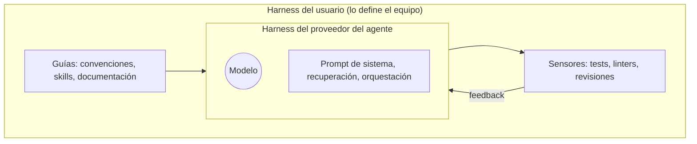
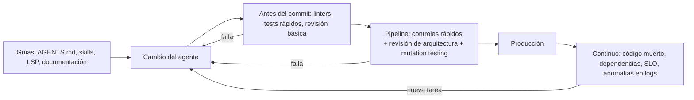

# Harness engineering: cómo dar confianza al trabajo de un agente de código

_2026-11-14 · 12 min de lectura_

Un agente de código puede producir en minutos un cambio que a una persona le llevaría horas. La dificultad aparece después: decidir si ese cambio es correcto, mantenible y coherente con la arquitectura exige una revisión que consume buena parte del tiempo ahorrado. En «Harness engineering for coding agent users», publicado el 2 de abril de 2026 en martinfowler.com, Birgitta Böckeler, Distinguished Engineer de Thoughtworks, propone un modelo para reducir esa dependencia de la revisión manual: rodear al agente de controles que aumenten la probabilidad de que acierte en el primer intento y que le permitan corregirse antes de que intervenga una persona. Este artículo resume el modelo, lo contrasta con otras prácticas y lo aplica a un sistema multiagente propio.

## Qué es un harness y qué parte le corresponde al usuario

El término *harness* se usa con frecuencia para designar todo lo que rodea al modelo en un agente de IA. Böckeler parte de esa definición, tomada de una publicación de LangChain que resume la idea como «agente = modelo + harness», pero la considera demasiado amplia y la acota a un contexto específico: el de quien usa un agente de código, no el de quien lo construye.

La distinción se entiende como tres anillos concéntricos. En el centro está el modelo. Alrededor, el harness que arma el proveedor del agente: el prompt de sistema, la recuperación de contexto y la orquestación interna. En el anillo exterior está el harness del usuario, el conjunto de reglas, herramientas y verificaciones que un equipo agrega para su propio código. El artículo trata ese último anillo, que es el único que el equipo controla.

_Los tres contextos de un agente de código, según Böckeler_

El objetivo de ese harness exterior es doble: aumentar la probabilidad de que el agente produzca un resultado correcto en el primer intento y agregar un ciclo de feedback que corrija problemas antes de la revisión humana. Según Böckeler, el beneficio se mide en menos trabajo de revisión, mejor calidad del sistema y menos tokens desperdiciados en intentos fallidos.

### Relación con context engineering y loop engineering

Böckeler describe la construcción de un harness de usuario como «una forma específica de context engineering»: el contexto es el medio por el cual las guías y los sensores llegan al agente. La relación con [Loop Engineering](/blog/loop-engineering-agentic-loops/), otra práctica que se discute en 2026, es complementaria. Loop engineering se ocupa del ciclo de trabajo: qué lo dispara, dónde se guarda su estado y cuándo se detiene. Harness engineering se ocupa de qué controles alimentan ese ciclo y qué tan confiables son. Un loop sin un buen harness itera contra señales débiles; un harness sin un loop produce señales que nadie consume.

## Guías y sensores

El modelo organiza los controles según el momento en que actúan. Las **guías** (*feedforward*) orientan al agente antes de que actúe: convenciones de código, documentación de arquitectura, instrucciones para un tipo de tarea. Los **sensores** (*feedback*) observan el resultado después de que el agente actúa y le permiten corregirse: tests, linters, revisiones.

Ninguno de los dos alcanza por separado. Un harness hecho solo de sensores produce, en palabras de Böckeler, un agente que repite los mismos errores, porque nada le indica cómo evitarlos. Uno hecho solo de guías codifica reglas que nunca se comprueban. Una observación práctica del artículo es que los sensores rinden más cuando su salida está escrita para un modelo de lenguaje: un mensaje de linter que explica cómo corregir el problema funciona, según Böckeler, como una forma positiva de inyección de instrucciones.

_Ejemplos de controles del artículo, clasificados por dirección y tipo_

| Control | Dirección | Tipo | Implementación de ejemplo |
|---|---|---|---|
| Convenciones de código | Guía | Inferencial | `AGENTS.md`, skills |
| Instrucciones para iniciar un proyecto | Guía | Ambos | Una skill con un script de inicialización |
| Transformaciones de código | Guía | Computacional | Recetas de OpenRewrite |
| Tests estructurales | Sensor | Computacional | Hook de pre-commit con ArchUnit para límites entre módulos |
| Instrucciones de revisión | Sensor | Inferencial | Skills de revisión |

## Controles computacionales e inferenciales

La segunda dimensión del modelo es el tipo de control. Los **computacionales** son deterministas: tests, linters, verificadores de tipos, análisis estructural. Corren en CPU, tardan entre milisegundos y segundos y dan siempre el mismo resultado ante la misma entrada. Los **inferenciales** usan un modelo para hacer análisis semántico: revisión de código con IA o un modelo que actúa como juez. Son más lentos, más caros y no deterministas, pero pueden evaluar aspectos que un linter no ve.

La consecuencia práctica es una división del trabajo. Los controles computacionales son lo bastante baratos para ejecutarse en cada cambio. Los inferenciales conviene reservarlos para momentos en que su costo se justifica y, según Böckeler, aumentan la confianza cuando se usan con un modelo capaz.

_Diferencias entre los dos tipos de control_

| Criterio | Computacional | Inferencial |
|---|---|---|
| Ejemplos | Tests, linters, type checking, ArchUnit, mutation testing | Revisión con IA, LLM como juez, skills de revisión |
| Determinismo | Sí | No |
| Costo y latencia | Bajos: milisegundos a segundos | Altos: requieren inferencia en GPU |
| Frecuencia razonable | En cada cambio | En momentos seleccionados |
| Fortaleza | Reglas explícitas y verificables | Juicio semántico: duplicación conceptual, sobreingeniería |

## El ciclo de dirección y el momento de cada control

El modelo asigna a las personas un rol que Böckeler llama *steering loop*, el ciclo de dirección: cuando un problema se repite, la tarea no es corregirlo una vez más, sino mejorar una guía o un sensor para que sea menos probable o directamente imposible. El propio agente puede ayudar a construir el harness: escribir tests estructurales, redactar reglas a partir de patrones observados, generar linters personalizados o documentar cómo funciona una parte del código.

El segundo principio retoma ideas de integración y entrega continuas: los controles deben ejecutarse lo más temprano posible, porque un error detectado antes es más barato de corregir. El artículo distribuye los sensores a lo largo del ciclo de vida de un cambio.

_Dónde ubica cada sensor el modelo de Böckeler_

Los sensores continuos cubren dos tipos de problema que un pipeline no ve. La deriva del código, como código muerto, dependencias desactualizadas o cobertura que se degrada, y la salud en tiempo de ejecución: degradación de latencia o disponibilidad, o un modelo que muestrea respuestas para evaluar su calidad.

## Tres dimensiones que un harness puede regular

Böckeler propone agrupar los controles según lo que regulan, y aclara que la clasificación le resulta útil «por ahora». Las tres dimensiones tienen un grado de madurez muy distinto.

- **Mantenibilidad.** Es la dimensión más accesible, porque existen muchas herramientas. Los sensores computacionales detectan con confiabilidad código duplicado, complejidad ciclomática, falta de cobertura, deriva arquitectónica y violaciones de estilo. Los modelos abordan problemas semánticos, como duplicación conceptual, tests redundantes o sobreingeniería, pero de forma costosa y probabilística, no en cada commit. Ninguno de los dos detecta con confiabilidad un diagnóstico equivocado, funcionalidades innecesarias o instrucciones mal interpretadas.
- **Aptitud arquitectónica.** Agrupa guías y sensores para características de la arquitectura, lo que Thoughtworks llama *fitness functions*. Un ejemplo del artículo combina una skill que describe requisitos de rendimiento con tests de rendimiento que devuelven el resultado al agente.
- **Comportamiento.** Böckeler lo llama el problema central. La práctica habitual combina una especificación funcional como guía con una suite de tests generada por IA, su cobertura y pruebas manuales como sensores. El diagnóstico del artículo es explícito: ese enfoque deposita demasiada confianza en tests que escribió el mismo tipo de sistema que escribió el código, y todavía no alcanza. Algunos equipos usan [fixtures aprobados](https://lexler.github.io/augmented-coding-patterns/patterns/approved-fixtures/) de forma selectiva, pero no hay una respuesta general.

> **El punto más débil:** La dimensión de comportamiento es la que más importa al usuario final y la menos resuelta. Un harness puede garantizar que el código sea mantenible y respete la arquitectura, y aun así aceptar una funcionalidad que no hace lo que se pidió. Por eso el modelo no propone eliminar la revisión humana, sino dirigirla hacia donde los sensores no llegan.

## Harnessability: no todo código se deja controlar igual

El modelo introduce una propiedad del código: la facilidad con que admite un harness. Un lenguaje con tipado fuerte ofrece el verificador de tipos como sensor gratuito. Módulos con límites claros permiten escribir reglas de arquitectura. Frameworks como Spring ocultan detalles y, de forma implícita, aumentan la tasa de éxito del agente. El artículo recoge además el concepto de *ambient affordances*, de Ned Letcher: propiedades estructurales del entorno que lo vuelven legible y navegable para un agente.

Esto tiene una consecuencia incómoda que Böckeler formula con precisión: el harness es más necesario donde es más difícil de construir. Un proyecto nuevo puede diseñarse para ser controlable desde el inicio; un sistema heredado, sin tests ni límites claros, es el que más necesita controles y el que menos los admite.

Para organizaciones con muchos servicios, el artículo sugiere *harness templates*: si unas pocas topologías, como APIs de negocio, procesadores de eventos o dashboards, cubren la mayor parte de las necesidades, cada una puede tener su paquete de guías y sensores. La justificación proviene de la cibernética, en particular de la ley de la variedad requerida de Ashby: un regulador solo puede controlar la variedad que es capaz de modelar, y comprometerse con una topología reduce el espacio de resultados posibles. El costo, advierte Böckeler, es el mismo que el de las plantillas de servicio: versionado y deriva, quizá agravados por controles no deterministas.

## El rol de las personas

Una persona que desarrolla software trae consigo un harness implícito: convenciones absorbidas con el tiempo, la incomodidad de trabajar con código complejo, responsabilidad ante el equipo, alineación con la organización y un ritmo que deja espacio para aplicar la experiencia. Un agente carece de responsabilidad social, de criterio estético, de intuición sobre el equipo y de memoria organizacional.

Un harness intenta externalizar parte de ese conocimiento, pero tiene límites, y construirlo es costoso, de modo que conviene priorizar. La conclusión de Böckeler es que un buen harness no debería apuntar a eliminar la intervención humana, sino a orientarla hacia las decisiones donde aporta más.

## El modelo aplicado a un caso: Website Factory

Para evaluar la utilidad del modelo, conviene aplicarlo a un sistema concreto. [Website Factory](/blog/orquestacion-multiagente-website-factory/) es un sistema propio en el que un orquestador de Claude Code coordina subagentes especializados para convertir un brief en un sitio Astro. Sus controles no se diseñaron con este modelo en mente, lo que hace el ejercicio más informativo: muestra qué cubre un harness construido por intuición y qué deja afuera.

_Controles de Website Factory clasificados con el modelo de guías y sensores_

| Control | Dirección | Tipo | Dimensión |
|---|---|---|---|
| `CLAUDE.md` con reglas de orquestación y definiciones de subagentes en `.claude/agents/` | Guía | Inferencial | Mantenibilidad y comportamiento |
| Especificación, plan y tareas de Spec Kit | Guía | Inferencial | Comportamiento |
| `/speckit.analyze` antes de implementar | Sensor | Inferencial | Comportamiento (consistencia de la especificación) |
| `astro check` y `astro build` | Sensor | Computacional | Mantenibilidad |
| `validate_content.py` contra el contrato de contenido | Sensor | Computacional | Comportamiento |
| `qa-reviewer` independiente, con hallazgos por severidad | Sensor | Inferencial | Las tres |
| `/speckit.converge` al final | Sensor | Inferencial | Comportamiento (especificación frente a código) |

La clasificación deja ver tres cosas. Primero, el sistema depende más de controles inferenciales que computacionales, la combinación más costosa y menos determinista. Segundo, no hay ningún sensor de aptitud arquitectónica: ninguna regla verifica de forma automática los límites entre componentes ni el rendimiento del sitio generado. Tercero, la dimensión de comportamiento se apoya en un validador escrito por el propio agente de frontend, y en una ejecución el `qa-reviewer` detectó que ese validador cubría menos casos que el contrato que debía controlar. Es exactamente el riesgo que Böckeler señala para la dimensión de comportamiento.

Según el modelo, las mejoras con mejor relación costo-beneficio serían sensores computacionales baratos: un presupuesto de rendimiento con Lighthouse, controles de accesibilidad automatizados y tests estructurales sobre la organización de componentes. También ayudaría que el validador de contenido se derive del contrato y no lo escriba el mismo agente que implementa.

## Preguntas abiertas y un punto de partida

El artículo no presenta datos cuantitativos ni experimentos controlados; describe un modelo mental de técnicas que ya se usan. Entre los ejemplos que cita figuran el relato de OpenAI sobre un equipo que construyó un producto con código escrito por agentes, con arquitectura en capas impuesta mediante linters y tests estructurales, y el de Stripe sobre sus agentes *minions*, con hooks de pre-push y la idea de llevar el feedback lo más temprano posible.

Böckeler deja varias preguntas sin resolver: cómo mantener la coherencia entre guías y sensores a medida que el harness crece, cuánto confiar en las decisiones del agente cuando las instrucciones y el feedback se contradicen, si un sensor que nunca se activa indica alta calidad o baja capacidad de detección, y cómo medir la cobertura del propio harness, de forma análoga a la cobertura de código o al mutation testing.

### Cómo empezar

1. **Inventariar los controles existentes** y clasificarlos por dirección (guía o sensor), tipo (computacional o inferencial) y dimensión. El inventario suele mostrar dónde no hay nada.
2. **Priorizar sensores computacionales baratos** que corran en cada cambio: verificador de tipos, linters y tests estructurales. Escribir sus mensajes de error pensando en que los leerá un agente.
3. **Registrar los errores que se repiten** en la revisión humana y convertir cada uno en una guía o un sensor nuevo. Ese es el ciclo de dirección.
4. **Reservar los controles inferenciales** para momentos de mayor costo, como la integración o la revisión de arquitectura, en lugar de cada commit.
5. **Tratar la dimensión de comportamiento con cautela:** separar quién escribe los tests de quién escribe el código y mantener la revisión humana donde los sensores no alcanzan.

## Referencias

- Böckeler, B. (2026). [Harness engineering for coding agent users](https://martinfowler.com/articles/harness-engineering.html). martinfowler.com, 2 de abril de 2026.
- Böckeler, B. [Context engineering for coding agents](https://martinfowler.com/articles/exploring-gen-ai/context-engineering-coding-agents.html). martinfowler.com.
- LangChain. [The anatomy of an agent harness](https://blog.langchain.com/the-anatomy-of-an-agent-harness/).
- Anthropic. [Effective harnesses for long-running agents](https://www.anthropic.com/engineering/effective-harnesses-for-long-running-agents).
- OpenAI. [Harness engineering: leveraging Codex in an agent-first world](https://openai.com/index/harness-engineering/).
- Stripe. [Minions: Stripe’s one-shot, end-to-end coding agents](https://stripe.dev/blog/minions-stripes-one-shot-end-to-end-coding-agents).
- Thoughtworks Technology Radar. [Architectural fitness function](https://www.thoughtworks.com/en-de/radar/techniques/architectural-fitness-function).
- Augmented Coding Patterns. [Approved fixtures](https://lexler.github.io/augmented-coding-patterns/patterns/approved-fixtures/).
- Fowler, M. [Continuous Integration](https://martinfowler.com/articles/continuousIntegration.html).

---

**En síntesis: harness engineering es el trabajo de rodear a un agente de código de guías que orienten su resultado y sensores que le permitan corregirse antes de la revisión humana. El modelo de Böckeler ordena esos controles por momento, tipo y dimensión, y deja claro su límite principal: la corrección funcional todavía no tiene sensores confiables. Un buen harness no elimina la revisión humana; la dirige hacia donde los controles no llegan.**

