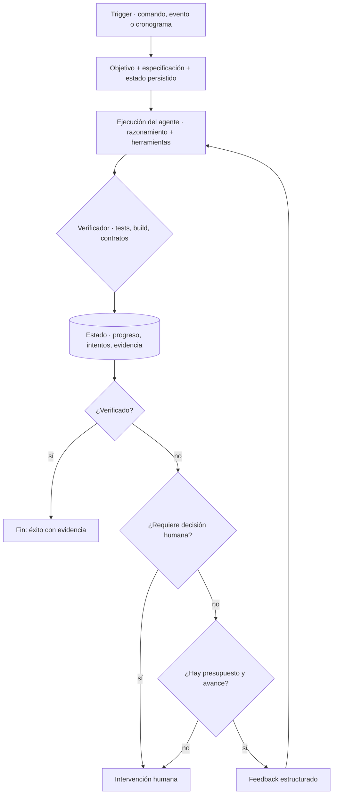

# Loop Engineering: cómo diseñar el ciclo de trabajo de los agentes de IA

_2026-11-13 · 12 min de lectura_

Quien trabaja con agentes de código conoce la secuencia: el agente entrega un resultado, una persona lo revisa y responde con indicaciones como "ejecutá los tests", "el build falló" o "intentá de nuevo". Cada una de esas respuestas es, en los hechos, una iteración de un ciclo de control. El ciclo existe, pero lo sostiene una persona. Loop Engineering, un término que empezó a circular a mediados de 2026, describe el esfuerzo de llevar ese ciclo al diseño del sistema: definir qué lo inicia, dónde se conserva el progreso, cómo se verifica cada resultado, qué información recibe el agente en la siguiente vuelta y bajo qué condiciones se detiene o pide intervención humana.

## Un término reciente para un problema conocido

Conviene distinguir lo establecido de lo emergente. La idea de que un agente es un modelo de lenguaje que razona y actúa dentro de un ciclo, usando herramientas, está bien asentada. El nombre *Loop Engineering*, en cambio, es nuevo. El paper [Loop Engineering: Building Blocks, Adoption, and Impact](https://arxiv.org/abs/2608.21884), de Jai Lal Lulla, Vahram Nersesyan, Seyedmoein Mohsenimofidi, Christoph Treude y Sebastian Baltes, sitúa su aparición en junio de 2026, cuando distintos practicantes empezaron a describir un nivel de trabajo en el que, en lugar de interactuar con un agente mediante prompts, "los desarrolladores diseñan sistemas que promptean a los agentes por ellos".

IBM, en [What is loop engineering?](https://www.ibm.com/think/topics/loop-engineering), publicado en julio de 2026, la define como la práctica de diseñar flujos agénticos que guían de forma iterativa a los agentes hacia objetivos definidos por el usuario, "con mínima intervención humana", y la presenta como una práctica emergente. Su modelo describe cuatro etapas —objetivo, acción, observación y ajuste— y subraya la necesidad de criterios de parada claros y verificables.

El mismo paper aporta una advertencia que merece atención. Tras revisar la literatura gris sobre el tema, los autores encontraron un acuerdo amplio sobre los componentes de un loop, pero concluyen que esas fuentes "no aportan evidencia sistemática de los beneficios que afirman". Se trata, por lo tanto, de una práctica con fundamentos razonables y todavía poco estudiada. Este artículo la aborda con esa cautela.

## Cuatro prácticas complementarias

Loop Engineering no sustituye a las prácticas anteriores; se apoya en ellas. Cada una responde a una pregunta distinta, y un ciclo bien diseñado no compensa instrucciones ambiguas, un contexto incompleto o un entorno mal delimitado: en esos casos, solo itera más rápido hacia un resultado deficiente.

_La pregunta que responde cada práctica_

| Práctica | Pregunta central | Ejemplo |
|---|---|---|
| Prompt Engineering | ¿Qué se le pide al agente y de qué manera? | Una delegación con objetivo, entradas, salidas y criterios de aceptación |
| Context Engineering | ¿Qué información necesita para decidir bien? | Indicar las rutas exactas de la especificación y del plan, en lugar de pedirle que explore el repositorio |
| Harness Engineering | ¿Con qué herramientas, permisos y límites opera? | Un agente de análisis sin acceso a la terminal; un navegador habilitado solo para el entorno local |
| Loop Engineering | ¿Qué inicia el ciclo, cómo se mide el avance, qué se hace ante un error y cuándo termina? | Un build fallido genera información estructurada para una nueva iteración, con un máximo de dos antes de escalar a una persona |

La frontera entre harness y loop no es nítida, y las fuentes no la trazan de la misma manera. El [cookbook de OpenAI sobre ciclos de mejora de agentes](https://developers.openai.com/cookbook/examples/agents_sdk/agent_improvement_loop) define el harness como "el contrato completo alrededor del modelo", que incluye los controles de validación. Una distinción práctica es considerar el harness como el entorno en el que se ejecuta el agente, y el loop como la política de control que determina qué ocurre entre una ejecución y la siguiente.

## La anatomía de un loop agéntico

Al cruzar la definición de IBM, la revisión del paper y la experiencia que Anthropic documentó con agentes de larga duración, emergen nueve componentes. El paper resume los elementos comunes de la literatura: ciclos iniciados por un cronograma o por eventos del repositorio, acotados por condiciones de parada verificables por máquina, con archivos de estado persistentes, subagentes verificadores, presupuestos de tokens y puntos definidos de escalamiento a personas.

- **Trigger.** El evento que inicia la ejecución: un comando, un cambio en el repositorio, una tarea programada o el fallo de otro ciclo.
- **Objetivo y especificación.** Lo que debe lograrse, expresado de modo que un componente distinto del agente pueda determinar si se logró.
- **Estado.** El progreso, conservado fuera de la ventana de contexto del modelo. Anthropic describe el problema con precisión: cada sesión nueva "comienza sin memoria de lo anterior". Su propuesta combina un archivo de progreso, una lista de funcionalidades en JSON y el historial de git ([Effective harnesses for long-running agents](https://www.anthropic.com/engineering/effective-harnesses-for-long-running-agents)).
- **Ejecución del agente.** El razonamiento y el uso de herramientas, dentro de los límites que fija el harness.
- **Verificador.** Tests, compilación, contratos, análisis estático o la revisión de otro agente. Cuanto más determinista sea la señal, más confiable es el ciclo.
- **Feedback.** La información del verificador que se incorpora a la siguiente iteración, y el formato en que se entrega.
- **Reintento y recuperación.** Los mecanismos para corregir sin repetir el mismo error, incluida la posibilidad de volver a un estado válido conocido, por ejemplo mediante un commit.
- **Condiciones de parada.** Éxito verificado, presupuesto agotado, falta de avance o error no recuperable.
- **Intervención humana.** Los casos en los que el ciclo no debe decidir por sí mismo y devuelve el control.

_Arquitectura de un loop agéntico con verificación y escalamiento_



_Pseudocódigo de un loop con verificadores, presupuesto y detección de estancamiento_

```python
def run_loop(goal, spec, state, budget):
    while True:
        result = agent.execute(goal, spec, context=state.relevant(), feedback=state.last_feedback)
        report = verifiers.run(result)          # build, tests, contratos: señales deterministas
        state.record(result, report)            # persistido en archivos y commits, no en el contexto

        if report.passed and acceptance.met(spec, result):
            return Done(evidence=report)        # éxito = verificación + aceptación, no la palabra del agente

        if report.requires_human():             # dependencias nuevas, credenciales, ambigüedad de negocio
            return Escalate(reason=report.blocker, state=state)

        if state.iterations >= budget.max_iterations or state.cost >= budget.max_cost \
           or state.elapsed >= budget.max_time:
            return Escalate(reason="presupuesto agotado", state=state)

        if state.no_progress(window=2):         # los mismos errores en dos iteraciones seguidas
            return Escalate(reason="sin avance", state=state)

        state.last_feedback = report.structured()   # archivo:línea, regla incumplida, salida del comando
        if report.regressed():
            state.restore_last_good()               # recuperación: volver al último estado verificado
```

Dos aspectos del pseudocódigo concentran buena parte del diseño. El primero es que el éxito exige verificación y, además, aceptación contra la especificación: que los tests pasen es una condición necesaria, no suficiente. El segundo es que existen tres salidas distintas del éxito —decisión humana, presupuesto agotado y falta de avance— y en todas el estado queda preparado para que otra persona u otro agente retome el trabajo.

## Un caso de aplicación: loops dentro de un sistema multiagente

En [un artículo anterior](/blog/orquestacion-multiagente-website-factory/) describí [Website Factory](https://github.com/juliancardozo/website-factory-mvp), un sistema en el que un orquestador de Claude Code coordina seis subagentes especializados para convertir un brief en Markdown en un sitio Astro con Tailwind CSS 4, sobre el flujo de GitHub Spec Kit. Los agentes no se comunican entre sí: intercambian información a través de archivos. Aquel texto se centraba en la orquestación; este se ocupa de una cuestión diferente.

Orquestar consiste en decidir quién hace cada tarea y en qué orden. Diseñar loops consiste en decidir qué ocurre cuando un resultado no cumple lo esperado. Un flujo bien orquestado pero sin ciclos de corrección se interrumpe ante el primer error; un sistema con ciclos pero sin orquestación reintenta sin saber a qué componente corresponde el problema. Ambos diseños se necesitan.

_Distribución de responsabilidades en Website Factory_

| Responsabilidad | Responsable | Artefacto |
|---|---|---|
| Planificación | Orquestador, mediante las skills de Spec Kit (specify, plan, tasks, analyze) | `spec.md`, `plan.md`, `tasks.md` |
| Ejecución | Subagentes especializados; el `frontend-engineer` implementa | `docs/*.md`, `src/` |
| Verificación | `astro check`, `astro build`, `validate_content.py` y un `qa-reviewer` independiente | `docs/qa-report.md` |
| Control | Orquestador: prioridades, reintentos, parada y escalamiento | `docs/agent-runs.md` |

### Lo que el sistema ya incorpora

- **Un ciclo interno de implementación.** El agente que implementa ejecuta la verificación de tipos y el build; un error de compilación vuelve como salida del comando y origina una nueva iteración dentro de su sesión.
- **Un ciclo de evaluación y corrección acotado.** El `qa-reviewer` registra hallazgos con severidad y referencia `archivo:línea`; el orquestador aplica correcciones con un máximo de dos iteraciones, y lo que queda sin resolver se documenta como pendiente.
- **Verificación antes y después de implementar.** `/speckit.analyze` revisa la consistencia entre especificación, plan y tareas antes de escribir código, y `/speckit.converge` compara especificación y código al final.
- **Estado fuera del contexto.** La especificación, las tareas, el reporte de QA y el registro de cada delegación quedan en archivos versionados. Es un punto relevante: en su análisis de repositorios, el paper identificó 217 proyectos con ciclos autónomos y observó que casi todos versionaban la configuración que inicia el ciclo, pero casi ninguno los archivos de estado.
- **Escalamiento según el tipo de error.** Cuando una tarea requería instalar una dependencia nueva, el sistema no la instaló: marcó la tarea como bloqueada y trasladó la decisión.

Un hallazgo de esa ejecución muestra por qué el verificador también necesita ser verificado. El `qa-reviewer` detectó que el validador escrito por el agente de frontend cubría menos casos que el contrato que debía controlar. Un ciclo que confía en un verificador incompleto converge rápido, pero hacia un resultado equivocado.

### Mejoras posibles, todavía no implementadas

- **Un trigger automático.** Hoy el ciclo se inicia manualmente con `/website-factory`; un pull request que modifique un brief sería un disparador natural.
- **Presupuestos explícitos** de tokens, tiempo y costo por ejecución, además del límite de iteraciones.
- **Detección de estancamiento**, comparando los errores de dos iteraciones consecutivas y escalando si se repiten.
- **Feedback con un esquema definido.** El reporte de QA es Markdown estructurado; un formato JSON con severidad, regla y ubicación sería más difícil de reinterpretar. Anthropic eligió JSON para su lista de funcionalidades precisamente porque el modelo tiende menos a modificarlo de forma indebida.
- **Verificación de punta a punta integrada al ciclo.** La revisión visual en tres anchos de pantalla se realizó con un navegador, pero no forma parte de los verificadores automáticos.

## Las condiciones de parada

La condición de parada es probablemente la decisión de diseño más importante de un loop, y también la que con más facilidad queda implícita. Cuando no está definida, el ciclo termina cuando el modelo considera que terminó. Anthropic documenta ese modo de falla: agentes que, al observar que hubo avances, dan el trabajo por concluido, o que marcan funcionalidades como completas antes de comprobarlas.

_Tipos de condición de parada_

| Condición | Qué previene | Riesgo a considerar |
|---|---|---|
| Máximo de iteraciones | Ciclos indefinidos y costos sin control | Un valor arbitrario; conviene basarlo en cuántas iteraciones suelen ser necesarias |
| Presupuesto de tokens, tiempo y costo | Que una tarea simple consuma recursos desproporcionados | Interrumpir sin dejar el estado listo para retomar |
| Aceptación verificable | Dar por exitoso un resultado sin evidencia | Criterios que el propio agente pueda reinterpretar |
| Falta de avance | Reintentar el mismo error con otra formulación | Confundir cambio con avance: lo que importa son los errores resueltos, no el tamaño del diff |
| Errores que requieren a una persona | Que el agente resuelva decisiones que no le corresponden | Clasificarlos de antemano: credenciales, dependencias, datos de negocio, despliegues |

El riesgo más difícil de advertir es aceptar un resultado incorrecto porque las pruebas pasan. Un ciclo optimiza contra su verificador; si el verificador mide algo más acotado que la necesidad real, el ciclo encontrará la manera de satisfacerlo sin resolver el problema. Es una forma de la ley de Goodhart aplicada a agentes. IBM aborda una cuestión cercana con el concepto de *comprehension debt*: la distancia entre la cantidad de código de un sistema y el grado en que las personas lo comprenden. Por eso resulta útil distinguir entre éxito técnico —el build pasa— y cumplimiento —el resultado responde a lo que el usuario necesitaba— y asegurar que este último incluya al menos un control que no haya escrito el mismo agente que produjo el código.

## Observabilidad y gobernanza

Desde la perspectiva de Platform Engineering, un loop agéntico es una carga de trabajo más, y requiere lo mismo que cualquier otra: trazas, logs, métricas, control de costos, permisos, aislamiento y auditoría. El cookbook de OpenAI ilustra un ciclo de mejora del propio agente en el que, según sus palabras, las trazas muestran qué ocurrió, el feedback explica qué importaba, los evals convierten esas expectativas en controles reutilizables y Codex implementa los cambios resultantes. Como punto de partida recomienda un ciclo revisado, en el que el sistema propone los cambios y una persona aprueba el diff antes del merge. Es un ejemplo construido con datos sintéticos, no una medición de resultados, pero su arquitectura es instructiva.

En [Harness engineering: leveraging Codex in an agent-first world](https://openai.com/index/harness-engineering/), de febrero de 2026, OpenAI relató cómo un equipo construyó un producto interno cuyo código escribieron agentes, y señaló que el avance inicial fue más lento de lo previsto debido a un entorno insuficientemente especificado, no a las capacidades del modelo. La observación se extiende a los ciclos: la calidad del sistema depende en buena medida del entorno y de los verificadores.

_Indicadores propuestos para evaluar un loop (propuesta; no son resultados medidos)_

| Indicador | Pregunta que responde |
|---|---|
| Porcentaje de ejecuciones verificadas con éxito | ¿El ciclo resuelve lo que se le pide sin intervención? |
| Reintentos por tarea aceptada | ¿Converge con pocas iteraciones o necesita muchas? |
| Costo por tarea aceptada | ¿Cuánto cuesta un resultado útil, no una ejecución? |
| Tasa de escalamiento humano, por motivo | ¿Escala por razones de riesgo o por fallas del propio ciclo? |
| Tiempo hasta completar | ¿Cuánto transcurre desde el trigger hasta un resultado aceptado? |
| Defectos detectados después de la aceptación | ¿El verificador es más débil que la necesidad? |

La gobernanza agrega dos requisitos que la Developer Experience no puede pasar por alto. Cada ejecución debe poder reconstruirse —qué recibió, qué herramientas usó, qué verificó y por qué se detuvo— y cada agente debe operar con identidad y permisos propios, aislado en un worktree o en un sandbox. Un ciclo que no puede auditarse difícilmente pueda adoptarse a escala en un equipo.

## Los límites de la autonomía

Los riesgos de un loop son los de cualquier sistema con realimentación, amplificados por un componente probabilístico:

- **Ciclos indefinidos**, que no fallan de manera visible: simplemente consumen recursos.
- **Verificadores insuficientes**, que convierten el ciclo en un mecanismo eficiente para producir resultados que superan controles equivocados.
- **Acumulación de errores.** Cada iteración parte del resultado anterior, de modo que un supuesto incorrecto temprano se convierte en la base de todo lo que sigue.
- **Contexto desactualizado.** El agente decide con una versión del estado que ya no es la vigente.
- **Éxito prematuro.** El agente declara terminado un trabajo que no verificó de punta a punta.

Por estas razones, la autonomía de un sistema agéntico no debería evaluarse por la cantidad de intervención humana que elimina, sino por la evidencia verificable que produce y por la claridad de sus límites operativos. Mayor autonomía sin mayor evidencia no reduce el riesgo: lo desplaza.

## Por dónde empezar

Para un equipo que quiera diseñar su primer loop, una secuencia razonable es la siguiente:

1. **Elegir una tarea con un verificador confiable y de bajo costo**, como un build y una suite de tests, o el cumplimiento de un contrato. Sin verificador no hay un ciclo de control, sino reintentos.
2. **Definir las condiciones de parada antes que el prompt**: éxito, presupuesto, falta de avance y casos de escalamiento.
3. **Mantener el estado fuera del contexto**, con un archivo de progreso y un commit por iteración.
4. **Estructurar el feedback** con archivo, línea, regla incumplida y salida del comando, en lugar de mensajes genéricos.
5. **Comenzar con un ciclo revisado**, en el que el sistema propone y una persona aprueba, y reducir la revisión solo donde la evidencia lo justifique.
6. **Medir resultados por tarea aceptada**, no por ejecución.

## El rol del ingeniero

Desde la gestión de equipos de ingeniería, el cambio que se observa no implica menos ingeniería, sino ingeniería ejercida en otro nivel. Diseñar un loop requiere las competencias de siempre —definir requisitos verificables, elegir buenos tests, anticipar modos de falla, gestionar el riesgo y cuidar la experiencia de quienes usan el sistema—, aplicadas ahora a un ejecutor que no es una persona.

Para un Tech Lead, esto desplaza buena parte del trabajo de mayor impacto hacia el verificador y las condiciones de parada, más que hacia la redacción del prompt. Para un Engineering Manager, implica tratar la adopción de agentes como una decisión de plataforma y de gobernanza, con métricas de resultado y puntos de escalamiento definidos. La ingeniería no desaparece; cambia el nivel de abstracción en el que se ejerce.

### Referencias

- [What is loop engineering?](https://www.ibm.com/think/topics/loop-engineering) — Ivan Belcic y Cole Stryker, IBM Think, 17 de julio de 2026.
- [Loop Engineering: Building Blocks, Adoption, and Impact](https://arxiv.org/abs/2608.21884) — Lulla, Nersesyan, Mohsenimofidi, Treude y Baltes, arXiv:2608.21884, agosto de 2026 (v3, octubre de 2026; JAWs@ASE 2026).
- [Effective harnesses for long-running agents](https://www.anthropic.com/engineering/effective-harnesses-for-long-running-agents) — Justin Young, Anthropic, 26 de noviembre de 2025.
- [Harness engineering: leveraging Codex in an agent-first world](https://openai.com/index/harness-engineering/) — Ryan Lopopolo, OpenAI, 11 de febrero de 2026.
- [Build an Agent Improvement Loop with Traces, Evals, and Codex](https://developers.openai.com/cookbook/examples/agents_sdk/agent_improvement_loop) — OpenAI Cookbook, 2026.
- [Website Factory](https://github.com/juliancardozo/website-factory-mvp) — repositorio del caso, con la ejecución completa.

---

**En síntesis: un loop no es un agente que reintenta, sino un componente con disparador, estado persistido, verificador independiente, feedback estructurado, presupuesto y condiciones de parada definidas antes que el prompt. Poder explicar cuándo y por qué se detiene es la mejor prueba de que fue diseñado.**

