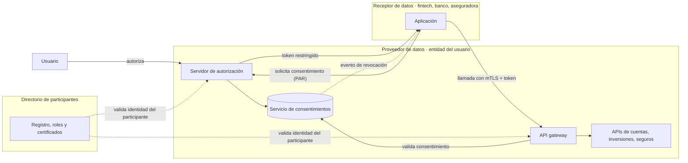
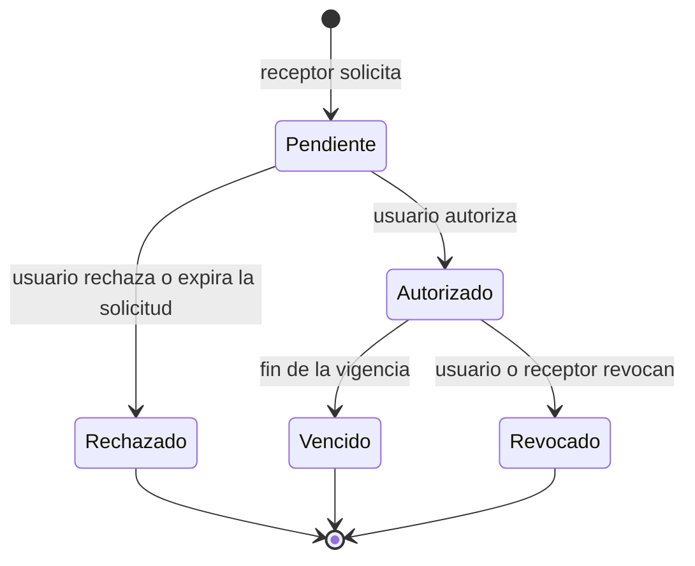

# Open Finance como infraestructura: la arquitectura que hay detrás del consentimiento

_2026-11-13 · 11 min de lectura_

En octubre, Forbes Argentina publicó la crónica de un panel del Summit Fintech 2026 dedicado a Open Finance, con Julián Bersano, CEO y cofundador de Klimber, y Andrés Gil, socio de Cyber en Banca, Seguros y Tecnología de Deloitte. La conversación giró alrededor de una idea: que el cliente controle sus datos financieros y pueda compartirlos, con su consentimiento, con otros proveedores. La nota se detiene en el impacto sobre la competencia, la regulación y la educación financiera. Este artículo se ocupa de la capa que la hace posible: qué tiene que existir, en términos de arquitectura, para que compartir datos financieros sea seguro, auditable y revocable.

## Lo que se dijo en el panel

Según la crónica, firmada por Andrea Glikman, Open Finance reúne en un mismo acceso información de cuentas bancarias, billeteras virtuales, inversiones, seguros y créditos. El usuario decide qué datos comparte, con quién, con qué finalidad y por cuánto tiempo, y a cambio puede acceder a ofertas más ajustadas a su perfil. Bersano lo describió como la "democratización de los servicios financieros" y calificó al mercado argentino de incipiente.

Gil aportó la mirada de seguridad y regulación. Mencionó el Decreto 353 de mayo de 2025 como punto de partida de la agenda de finanzas abiertas, con principios generales que todavía requieren normas específicas, y planteó la necesidad de actualizar la legislación de protección de datos personales y fortalecer su aplicación. Sostuvo además dos ideas con consecuencias directas para la arquitectura: que los datos no estarán en un repositorio central, sino en cada participante, compartidos mediante reglas comunes; y que la seguridad no puede pensarse entidad por entidad, porque una organización con buenos controles queda expuesta a las vulnerabilidades de sus contrapartes.

El panel dejó abierta una pregunta concreta: quién verificará que las APIs sean seguras y cómo se controlará a los participantes que acceden al ecosistema. Es, en esencia, una pregunta de ingeniería de plataformas.

## Los componentes de un ecosistema de Open Finance

Los mercados que avanzaron antes —el Reino Unido con Open Banking, Brasil con Open Finance— convergieron en una arquitectura con piezas reconocibles. Ninguna es exótica por separado; la dificultad está en que deben funcionar igual en decenas de organizaciones con sistemas, prioridades y niveles de madurez distintos.

_Arquitectura de referencia de un ecosistema de Open Finance_



_Responsabilidad de cada componente_

| Componente | Responsabilidad | Pregunta que responde |
|---|---|---|
| Directorio de participantes | Registrar entidades habilitadas, sus roles y sus certificados | ¿Quién puede participar y quién es cada uno? |
| Servidor de autorización | Autenticar al usuario y emitir tokens con alcance acotado | ¿Qué autorizó el usuario y a quién? |
| Servicio de consentimientos | Persistir cada consentimiento, su finalidad, su vigencia y su estado | ¿Este acceso sigue siendo válido hoy? |
| API gateway | Aplicar autenticación mutua, límites de uso y validación del consentimiento en cada llamada | ¿Esta llamada concreta está permitida? |
| APIs de datos | Exponer información con esquemas comunes y versionados | ¿Qué datos se entregan y en qué formato? |
| Auditoría y eventos | Registrar accesos y propagar cambios de estado | ¿Qué ocurrió, cuándo y quién lo hizo? |

## El consentimiento es una máquina de estados

La definición que se escuchó en el panel —qué datos, con quién, para qué y por cuánto tiempo— es, leída desde la ingeniería, la especificación de un objeto. El error más frecuente es tratar el consentimiento como un booleano o como un registro que se escribe una vez. En la práctica es un proceso con estados, transiciones y efectos, del mismo modo que un cobro no es una llamada HTTP sino un proceso de negocio auditable, como desarrollé en [un artículo sobre webhooks de pago](/blog/webhooks-pagos-maquinas-de-estado/).

_Ciclo de vida de un consentimiento_



Modelarlo así tiene consecuencias de diseño concretas. Las transiciones deben ser idempotentes, porque una revocación puede llegar dos veces. Los estados finales no deben poder reabrirse: un nuevo acceso exige un consentimiento nuevo. Cada llamada a una API de datos debe validar el estado vigente, no el estado al momento de emitir el token. Y la revocación tiene que propagarse a los receptores mediante eventos, con reintentos y verificación, para que dejen de usar los datos y no solo de pedirlos.

_Ejemplo ilustrativo de solicitud de acceso con detalle de autorización (estructura inspirada en RFC 9396; los campos no corresponden a un estándar argentino)_

```json
{
  "authorization_details": [
    {
      "type": "account_information",
      "purpose": "evaluacion_crediticia",
      "permissions": ["accounts:read", "balances:read", "transactions:read"],
      "transaction_window_days": 180,
      "expires_at": "2027-05-13T00:00:00-03:00"
    }
  ]
}
```

La finalidad (`purpose`) merece una mención aparte. No es un dato decorativo: es lo que permite, más adelante, auditar si los datos se usaron para lo que el usuario autorizó. Un diseño que no la persiste en el consentimiento ni la asocia a cada acceso no puede responder esa pregunta.

## Seguridad sistémica: proteger APIs entre organizaciones

La observación de Gil sobre la seguridad del ecosistema tiene una traducción técnica directa. En un esquema de Open Finance, una entidad con controles robustos puede verse comprometida si uno de los participantes a los que entrega datos tiene credenciales débiles o tokens que pueden reutilizarse. Por eso los mercados que avanzaron no dejaron la seguridad de las APIs librada al criterio de cada organización: adoptaron perfiles de seguridad comunes.

El más difundido es FAPI (Financial-grade API), de la OpenID Foundation, que construye sobre OAuth 2.0 y OpenID Connect y restringe las opciones a las combinaciones adecuadas para datos financieros. Brasil lo adoptó para su Open Finance, y el Reino Unido lo utiliza en su estándar de Open Banking. Sus mecanismos centrales responden a riesgos específicos:

_Mecanismos de un perfil de seguridad para APIs financieras_

| Mecanismo | Especificación | Riesgo que mitiga |
|---|---|---|
| Pushed Authorization Requests (PAR) | RFC 9126 | Manipulación de los parámetros de la solicitud en el navegador del usuario |
| Autenticación mutua con TLS | RFC 8705 | Que un cliente no registrado se haga pasar por un participante habilitado |
| Tokens restringidos al emisor (mTLS o DPoP) | RFC 8705 / RFC 9449 | Reutilización de un token robado por un tercero |
| Detalle de autorización | RFC 9396 | Permisos amplios cuando el usuario autorizó algo específico |
| Pruebas de conformidad | Suites de la OpenID Foundation | Implementaciones que dicen cumplir el perfil y no lo cumplen |

La última fila responde, en parte, la pregunta que el panel dejó abierta. En los ecosistemas más maduros, la verificación de que una API es segura no depende de una auditoría documental: combina un perfil técnico obligatorio, pruebas de conformidad automatizadas que cada participante debe superar y un directorio que solo emite credenciales a quienes cumplen. La supervisión deja de ser un control periódico y se convierte en una condición para operar.

## Datos distribuidos, contratos comunes

Que los datos permanezcan en cada participante, como señaló Gil, es una decisión acertada desde la privacidad y la resiliencia: no hay un repositorio central que concentre riesgo. Pero traslada la complejidad a los contratos. Si cada entidad expone sus datos con un esquema propio, cada receptor debe construir y mantener una integración por proveedor, y la promesa de comparar ofertas con facilidad se diluye.

- **Esquemas comunes y versionados.** Una especificación compartida, por ejemplo en OpenAPI, con reglas explícitas de compatibilidad y plazos de convivencia entre versiones.
- **Niveles de servicio públicos.** Disponibilidad, latencia y límites de uso medidos y publicados por cada proveedor; sin ellos, un receptor no puede ofrecer una experiencia confiable.
- **Semántica precisa.** Qué significa "saldo disponible", en qué moneda y zona horaria se informan los movimientos, cómo se identifican las cuentas. Las diferencias semánticas generan más errores que los formatos.
- **Entornos de prueba compartidos.** Un sandbox con datos sintéticos realistas acelera la integración y permite automatizar las pruebas de conformidad.

Para equipos que trabajan con plataformas multi-tenant, el problema resulta familiar: como se analiza en [el artículo sobre Row Level Security](/blog/multi-tenancy-rls-frontera-datos/), el aislamiento y la autorización deben resolverse en la capa de datos, no confiarse a cada pantalla o servicio. El mismo principio, aplicado a nivel de ecosistema, lleva a validar el consentimiento en el gateway en cada llamada, y no solo al emitir el token.

## Agentes de IA con acceso a datos financieros

Bersano planteó, en condicional, que agentes de IA podrían comparar créditos o seguros en nombre del usuario y proponer alternativas según su perfil. Es una posibilidad plausible, y también el escenario que más exige de la arquitectura de consentimiento.

Un agente que actúa por un usuario necesita una autorización delegada con alcance mínimo, finalidad explícita y vigencia corta; no las credenciales del usuario. Cada acceso debe quedar atribuido al agente y al consentimiento que lo habilitó. Y el agente no debería poder ampliar sus propios permisos ni encadenar finalidades: comparar ofertas de crédito no es lo mismo que contratar una. Las mismas reglas que ordenan el trabajo de agentes en desarrollo de software —mínimo privilegio, verificadores deterministas y escalamiento a una persona ante decisiones con consecuencias, como se analiza en [el artículo sobre Loop Engineering](/blog/loop-engineering-agentic-loops/)— se vuelven, en finanzas, requisitos de cumplimiento.

## Fraude, transparencia y educación

El cierre de la nota advierte que, sin estándares, una mayor circulación de información puede aumentar el riesgo de fraude. La ingeniería puede reducir ese riesgo, aunque no eliminarlo. Tres prácticas tienen un impacto directo:

- **Un panel de consentimientos para el usuario**, en cada entidad, que muestre quién accede a qué datos, con qué finalidad y hasta cuándo, con revocación en un paso. Es la contraparte técnica de la educación financiera que reclamó el panel.
- **Detección de anomalías sobre el patrón de acceso**: volúmenes, horarios o tipos de datos inusuales para un receptor y una finalidad determinados.
- **Trazabilidad de punta a punta**: un identificador de correlación que permita reconstruir, ante un reclamo, el recorrido desde la autorización hasta cada lectura de datos.

## Lo que un equipo puede hacer hoy

Según la nota, Argentina cuenta con un marco inicial y con experiencias de intercambio entre entidades mediante APIs, pero todavía carece de reglas específicas y de mecanismos efectivos de supervisión. Para un equipo técnico en un banco o una fintech, esperar la norma definitiva no es la única opción. Hay decisiones que resultan valiosas en cualquier escenario regulatorio:

1. **Modelar el consentimiento como entidad propia**, con estados, finalidad, vigencia y auditoría, aunque hoy solo se use internamente.
2. **Separar autorización de acceso a datos**: un servidor de autorización basado en estándares abiertos y un gateway que valide cada llamada.
3. **Adoptar un perfil de seguridad reconocido**, como FAPI, en lugar de diseñar uno propio. Es más fácil adaptarse a una norma futura desde un estándar que desde una solución a medida.
4. **Documentar las APIs con contratos versionados** y publicar niveles de servicio, aunque los consumidores sean, por ahora, internos.
5. **Diseñar la revocación desde el inicio**, incluida su propagación a terceros y la eliminación de los datos ya entregados cuando corresponda.
6. **Medir el ecosistema, no solo la integración**: tasa de consentimientos revocados, tiempo de propagación de una revocación, accesos rechazados por consentimiento vencido.

Open Finance suele presentarse como un cambio de modelo de negocio, y lo es. Pero su viabilidad se decide en una capa menos visible: la que garantiza que cada dato compartido tenga una autorización vigente, una finalidad declarada y un registro que permita explicarlo. Como dijo Gil en el panel, lo que importa de cualquier normativa es cómo se aplica; en este caso, buena parte de esa aplicación será código.

### Referencias

- [Open Finance: la infraestructura que puede cambiar el negocio de fintech y bancos en la Argentina](https://www.forbesargentina.com/summit/open-finance-infraestructura-puede-cambiar-negocio-fintech-bancos-argentina-n100767) — Andrea Glikman, Forbes Argentina, 21 de octubre de 2026.
- [FAPI Working Group](https://openid.net/wg/fapi/) — OpenID Foundation: perfiles de seguridad para APIs financieras.
- [RFC 9126: OAuth 2.0 Pushed Authorization Requests](https://www.rfc-editor.org/rfc/rfc9126) — IETF.
- [RFC 8705: OAuth 2.0 Mutual-TLS Client Authentication and Certificate-Bound Access Tokens](https://www.rfc-editor.org/rfc/rfc8705) — IETF.
- [RFC 9449: OAuth 2.0 Demonstrating Proof of Possession (DPoP)](https://www.rfc-editor.org/rfc/rfc9449) — IETF.
- [RFC 9396: OAuth 2.0 Rich Authorization Requests](https://www.rfc-editor.org/rfc/rfc9396) — IETF.

---

**En síntesis: Open Finance se discute como una transformación de negocio, pero se construye como infraestructura. Consentimiento modelado como máquina de estados, un perfil de seguridad común, un directorio de participantes, contratos versionados y revocación de punta a punta son las condiciones para que compartir datos financieros sea, además de posible, confiable.**

