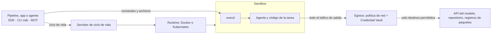

# OpenSandbox: dónde corren los agentes de IA y por qué es una decisión de Engineering Management

_2026-11-16 · 15 min de lectura_

Cuando un equipo empieza a delegar tareas a agentes de IA, la conversación suele centrarse en qué modelo usar y cómo escribir buenas instrucciones. Hay una pregunta previa que recibe menos atención: dónde se ejecuta lo que el agente hace. Un agente de código instala dependencias, corre pruebas, clona repositorios y llama a APIs. Si lo hace en la laptop de un desarrollador o en un runner compartido, hereda sus permisos, sus credenciales y su acceso a la red. OpenSandbox es un proyecto open source que propone una respuesta: un sandbox aislado, efímero y con políticas explícitas para cada tarea. Este artículo lo analiza desde la perspectiva de un Engineering Manager, porque elegir dónde corren los agentes define cuánto se puede delegar, con qué riesgo, a qué costo y con qué capacidad de aprender de los resultados.

## El problema: delegar sin heredar todos los permisos

En la mayoría de los equipos, la adopción de agentes empieza de forma individual. Cada persona prueba una herramienta en su máquina, con su sesión de GitHub, sus variables de entorno y su acceso a la VPN. Funciona bien para explorar, pero tiene tres consecuencias que un Engineering Manager no puede ignorar.

La primera es el **riesgo**: el agente opera con todos los permisos de la persona, incluidos los que no necesita para la tarea. Una dependencia comprometida o una instrucción inyectada en un archivo del repositorio puede usar esas credenciales. La segunda es la **escala**: si cada tarea delegada ocupa la máquina de alguien, la cantidad de trabajo en paralelo queda limitada por la cantidad de laptops. La tercera es la **falta de evidencia**: cuando el trabajo de los agentes ocurre en entornos personales, el equipo no puede medir qué funciona, cuánto cuesta ni dónde falla.

La tesis de este artículo es que **el sandbox es la unidad de delegación**. Así como un ticket define qué se pide, un sandbox define con qué recursos, permisos y acceso a la red se ejecuta. Cuando esa unidad es explícita, se puede razonar sobre el riesgo, presupuestar la capacidad y medir los resultados.

## Qué es OpenSandbox

[OpenSandbox](https://github.com/opensandbox-group/OpenSandbox) se define como un runtime de sandboxes para agentes de IA: entornos aislados donde una aplicación o un agente puede ejecutar comandos, manejar archivos, correr código y operar navegadores o escritorios. Se instala en infraestructura propia, empieza con Docker en una máquina local y escala a Kubernetes con la misma API.

_OpenSandbox en datos (verificado en el repositorio el 16 de noviembre de 2026, commit 44e79a2)_

| Aspecto | Situación |
|---|---|
| Licencia y gobernanza | Apache 2.0. Proyecto de la Agentic AI Foundation (AAIF), con un Technical Charter bajo LF Projects adoptado el 20 de octubre de 2026 |
| Origen | Iniciado en el ecosistema de Alibaba: los paquetes de Java y .NET y uno de los registros de imágenes conservan ese nombre |
| Actividad | Repositorio creado en diciembre de 2025; unas 17.000 estrellas y cerca de 200 contribuidores. Última versión estable: 1.2.1 (13 de noviembre de 2026); 1.3.0 en release candidate |
| Clientes | SDK para Python, Java/Kotlin, TypeScript, C# y Go; CLI `osb`; servidor MCP para Claude Code, Cursor y otros clientes |
| Runtimes | Docker para desarrollo local; Kubernetes con contenedores, runtimes seguros (gVisor, Kata, Firecracker) y microVMs basadas en templates (Fast Sandbox) |
| Controles | Políticas de salida de red por sandbox, Credential Vault, multi-tenancy por namespace, límites de recursos, expiración automática |
| Integraciones documentadas | Claude Code, Codex CLI, Gemini CLI, LangGraph, Google ADK, Playwright, Chrome, Harbor para evaluaciones, entre otras |

Las cifras de actividad describen interés y ritmo de desarrollo, no adopción en producción. Para una decisión de plataforma importan más otros datos que aparecen más adelante: la estabilidad de la API, el estado de las funciones experimentales y las limitaciones documentadas.

## Cómo funciona, en lo que importa para decidir

La arquitectura separa tres caminos. El **ciclo de vida** (crear, pausar, renovar, eliminar sandboxes) pasa por un servidor en FastAPI que delega en el runtime configurado. La **ejecución** de comandos y operaciones sobre archivos va directo al sandbox, a través de un daemon llamado `execd`. Y el **tráfico de salida** del sandbox pasa por un componente de egress que aplica la política de red y, si está habilitado, inyecta credenciales.

_Los tres caminos de OpenSandbox, simplificados_



Para un Engineering Manager, el componente más relevante es el último. El egress permite declarar, por sandbox, a qué destinos puede conectarse el agente, con la opción de denegar todo lo demás. El **Credential Vault** agrega algo menos habitual: las credenciales reales se guardan en el componente de egress y se inyectan en las solicitudes salientes que coinciden con una regla. El proceso dentro del sandbox solo ve un valor de relleno. Un agente puede llamar a la API del modelo o clonar un repositorio privado sin tener nunca el token en su entorno.

## Casos de uso en equipos de alto desempeño

Los ejemplos del repositorio cubren muchos escenarios. Desde la perspectiva de un equipo de producto, cinco tienen impacto directo en cómo se trabaja.

_Casos de uso y su efecto en el equipo (análisis propio)_

| Caso | Qué cambia en el equipo | Qué decide el Engineering Manager |
|---|---|---|
| Agentes de código por ticket, en paralelo | Las tareas acotadas (actualizar dependencias, migraciones mecánicas, pruebas faltantes) avanzan sin ocupar la máquina de nadie | Qué tipos de tareas se delegan y cuánta revisión requiere cada uno |
| Evaluación de agentes antes de adoptarlos | Comparar modelos, prompts o herramientas con un conjunto fijo de tareas, un sandbox limpio por intento (por ejemplo, con Harbor) | Qué evidencia se exige antes de cambiar de herramienta o de modelo |
| Ejecución de código generado en el producto | Funciones como un intérprete de código o análisis de datos para usuarios corren aisladas del resto del sistema | Qué nivel de aislamiento exige el producto (contenedor o microVM) |
| Entornos efímeros con navegador | Agentes que prueban flujos de UI con Playwright o Chrome en un entorno descartable | Qué pruebas exploratorias se automatizan y quién revisa los hallazgos |
| Entornos reproducibles para incidentes y onboarding | Reproducir un problema o preparar un entorno de práctica sin tocar ambientes compartidos | Qué imágenes base mantiene la plataforma |

El caso de la **evaluación** merece atención especial. La mayoría de los equipos adopta herramientas de IA por impresiones: alguien prueba un modelo nuevo, le parece mejor y el cambio se difunde. Con un sandbox limpio por intento y un conjunto de tareas representativas del propio código, la comparación se vuelve un experimento repetible. Para un Engineering Manager es la diferencia entre decidir por anécdotas y decidir con datos.

## Un ejemplo: una tarea delegada con permisos mínimos

El ejemplo ejecuta una tarea de un agente de código asociada a un ticket. Crea un sandbox con red denegada por defecto, guarda la clave del modelo y el token del repositorio en el Credential Vault, clona el repositorio, ejecuta Claude Code en modo no interactivo, corre las pruebas y devuelve un informe. Al final destruye el sandbox, haya salido bien o no.

> **Qué se verificó:** El código usa el SDK de Python de OpenSandbox 1.2.1. Las políticas de red y las credenciales se construyeron con los modelos del SDK, que validan sus campos, y la orquestación se probó con un sandbox simulado: tres pruebas automáticas verifican que ningún secreto llega al entorno ni a los comandos del sandbox, que el informe registra el resultado y que el sandbox se destruye incluso si fallan las pruebas. No se ejecutó contra un servidor real porque el entorno no tenía Docker. El Credential Vault además requiere que el servidor tenga configurado el egress en modo `dns+nft`.

_tarea_agente.py: política de red y credenciales_

```python
from opensandbox.models.sandboxes import (
    Credential, CredentialBinding, CredentialProxyConfig, NetworkPolicy, NetworkRule,
)

ANTHROPIC = "api.anthropic.com"
GIT_HOST = "github.com"


def politica_red() -> NetworkPolicy:
    # Todo lo que no está en la lista queda bloqueado.
    return NetworkPolicy(defaultAction="deny", egress=[
        NetworkRule(action="allow", target=ANTHROPIC),
        NetworkRule(action="allow", target="registry.npmjs.org"),
        NetworkRule(action="allow", target=GIT_HOST),
    ])


def boveda(repo: str, anthropic_key: str, git_user: str, git_token: str):
    basic = base64.b64encode(f"{git_user}:{git_token}".encode()).decode()
    credenciales = [
        Credential(name="anthropic", source={"value": anthropic_key}),
        Credential(name="git", source={"value": basic}),
    ]
    vinculos = [
        CredentialBinding(name="anthropic-api",
                          match={"schemes": ["https"], "hosts": [ANTHROPIC], "paths": ["/v1/*"]},
                          auth={"type": "apiKey", "name": "x-api-key", "credential": "anthropic"}),
        CredentialBinding(name="git-repo",                       # solo este repositorio
                          match={"schemes": ["https"], "hosts": [GIT_HOST], "paths": [f"/{repo}.git*"]},
                          auth={"type": "basic", "credential": "git"}),
    ]
    return credenciales, vinculos
```

_tarea_agente.py: el ciclo de la tarea (se omiten los imports y la función auxiliar ejecutar, que corre un comando y devuelve su código de salida)_

```python
async def correr_tarea(ticket: str, repo: str, instruccion: str, equipo: str) -> dict:
    sb = await Sandbox.create(
        os.getenv("SANDBOX_IMAGE", "opensandbox/code-interpreter:latest"),
        timeout=timedelta(minutes=30),                      # el sandbox expira solo
        resource={"cpu": "2", "memory": "4Gi"},
        env={"ANTHROPIC_API_KEY": "placeholder", "GIT_TERMINAL_PROMPT": "0"},  # sin secretos reales
        metadata={"equipo": equipo, "ticket": ticket},      # trazabilidad y costos por equipo
        network_policy=politica_red(),
        credential_proxy=CredentialProxyConfig(enabled=True),
    )
    informe = {"ticket": ticket, "sandbox": sb.id, "pasos": []}
    try:
        cred, vinc = boveda(repo, os.environ["ANTHROPIC_API_KEY"],
                            os.environ["GIT_USER"], os.environ["GIT_TOKEN"])
        await sb.credential_vault.create(credentials=cred, bindings=vinc)
        await sb.commands.run(f"git clone https://{GIT_HOST}/{repo}.git /workspace/repo")
        await sb.commands.run("npm install -g @anthropic-ai/claude-code --no-audit --no-fund")
        for cmd in (f"claude -p {shlex.quote(instruccion)} --output-format json",
                    "make test",
                    "git diff --stat"):
            paso = await ejecutar(sb, cmd)
            informe["pasos"].append(paso)
            if paso["exit_code"] not in (0, None):
                break
        informe["resultado"] = "ok" if all(p["exit_code"] in (0, None) for p in informe["pasos"]) else "falló"
        return informe
    finally:
        await sb.kill()                                     # nada queda corriendo
```

Cada decisión del código tiene una lectura de gestión. El **timeout** convierte un olvido en un costo acotado. Los **recursos** explícitos permiten estimar capacidad. La **metadata** con equipo y ticket vincula cada sandbox con una unidad de trabajo y un centro de costo. La **red denegada por defecto** reduce lo que un agente comprometido puede hacer. Y el **vínculo del token de Git limitado a un repositorio** aplica el principio de mínimo privilegio a nivel de ruta: aunque el agente intente clonar otro repositorio, la credencial no se inyecta.

Vale una observación sobre los ejemplos oficiales. El ejemplo básico de Claude Code del repositorio pasa el token del modelo como variable de entorno del sandbox, lo que es práctico para una prueba local. La guía del Credential Vault muestra la alternativa que conviene adoptar como estándar del equipo: un valor de relleno en el entorno y la credencial real en la bóveda.

> **Riesgo residual:** Los destinos permitidos siguen siendo canales posibles. Si el agente puede escribir en github.com, puede publicar información en cualquier lugar donde tenga permisos. Por eso conviene que el token tenga solo los permisos de la tarea (lectura, o escritura en una rama) y que la entrega del resultado, como abrir un pull request, la haga el pipeline fuera del sandbox y no el agente.

## Niveles de autonomía: una política explícita

Un error frecuente es aplicar la misma configuración a todo el trabajo delegado. Una tarea que lee código para generar documentación no tiene el mismo riesgo que una que modifica la lógica de pagos. La tabla propone cuatro niveles. Es un modelo propio para que cada equipo lo adapte, no una función del proyecto.

_Niveles de autonomía para trabajo delegado a agentes (propuesta)_

| Nivel | Ejemplos | Configuración del sandbox | Revisión humana |
|---|---|---|---|
| 0 · Solo lectura | Explicar código, generar documentación, analizar un incidente | Sin credenciales de escritura; red limitada al modelo | Opcional |
| 1 · Cambios acotados | Pruebas faltantes, actualización de dependencias, refactors mecánicos | Repositorio con token de lectura; resultado como parche que el pipeline convierte en PR | Revisión de PR estándar |
| 2 · Cambios de lógica | Funcionalidades pequeñas, corrección de bugs | Igual que el nivel 1, con runtime seguro (gVisor o microVM) y ejecución de la suite completa | Revisión por una persona dueña del área |
| 3 · Áreas críticas | Pagos, autenticación, datos personales | Igual que el nivel 2, con datos sintéticos y sin acceso a ambientes reales | Dos revisores y criterio explícito de aceptación |

Escribir esta tabla tiene un efecto organizacional más importante que la configuración en sí: obliga a acordar con el equipo qué se delega y bajo qué condiciones. Esa conversación, que en muchos equipos nunca ocurre, es la que evita tanto el uso descontrolado como la prohibición generalizada.

## Métricas: qué mirar y qué no

La métrica más tentadora, cantidad de tareas ejecutadas por agentes, es la menos útil: crece aunque el trabajo no sirva. Las métricas de la tabla miden resultados y costo. Son hipótesis para observar durante la adopción, no valores de referencia.

_Métricas para la adopción de agentes en sandboxes (propuesta)_

| Métrica | Qué indica | Fuente |
|---|---|---|
| Tasa de aceptación de los cambios propuestos por agentes | Si el trabajo delegado es útil | PRs etiquetados por origen |
| Costo por cambio aceptado | Tokens más cómputo del sandbox, dividido por cambios que llegan a main | Facturación del modelo y metadata del sandbox |
| Tiempo de revisión de cambios de agentes | Si la delegación traslada carga a quienes revisan | Datos del repositorio |
| Tasa de fallas por tipo de tarea | Qué tareas conviene dejar de delegar o especificar mejor | Informes de cada ejecución |
| Conexiones bloqueadas por la política de red | Imágenes mal preparadas o comportamientos inesperados | Logs del egress |
| Tiempo hasta tener un sandbox listo | Fricción de la plataforma | Instrumentación del pipeline |

Estas métricas se conectan con marcos conocidos. El tiempo de revisión y la tasa de aceptación son indicadores de flujo, en la línea de DORA. La percepción del equipo sobre la utilidad de los agentes, relevada con una encuesta breve, completa el cuadro del lado de la satisfacción, como propone SPACE. Ninguna métrica aislada alcanza.

## Quién es dueño de qué

OpenSandbox es infraestructura compartida y necesita un dueño. Con la terminología de Team Topologies, la distribución natural es la siguiente.

- **Equipo de plataforma:** opera el servidor y el runtime, mantiene las imágenes base, define las reglas de red que ningún equipo puede sobrescribir (`deny.always`, como el endpoint de metadatos de la nube), gestiona los tenants y publica la plantilla de tarea delegada. Lo trata como un producto, con documentación y métricas de uso.
- **Equipos de producto:** deciden qué tareas delegan dentro de los niveles acordados, escriben las instrucciones y revisan los resultados. Son dueños de la calidad de lo que entra a su código.
- **Equipo habilitador o referentes técnicos:** acompañan a los equipos en los primeros usos, recogen patrones que funcionan y los convierten en plantillas.
- **Seguridad:** revisa la configuración de aislamiento, las reglas de red y el manejo de credenciales, y participa en la definición de los niveles 2 y 3.

La función de multi-tenancy de OpenSandbox acompaña esta división: cada equipo puede tener su propia clave de API y su namespace de Kubernetes, con lo que el uso y los costos quedan separados sin desplegar una instancia por equipo.

## Madurez y riesgos: lo que hay que saber antes de adoptarlo

Un proyecto con menos de un año de vida y crecimiento rápido requiere una evaluación cuidadosa. El propio repositorio documenta con claridad varias limitaciones, lo que es una buena señal, pero hay que leerlas.

- **API sin versión estable.** El roadmap indica de forma explícita que no está previsto declarar una API v1 estable hasta que la semántica del ciclo de vida y la compatibilidad de los SDK maduren. Conviene fijar versiones y aislar el uso detrás de una capa propia.
- **Funciones experimentales.** El pool de sandboxes precalentados del lado del cliente está marcado como experimental y puede cambiar entre versiones menores.
- **Cadena de suministro.** El README advierte que las versiones unificadas actuales tienen una brecha conocida de firma y procedencia de imágenes, y recomienda fijar imágenes por digest.
- **Credential Vault con requisitos.** Necesita el modo de egress `dns+nft`, no es compatible con un service mesh que intercepte el tráfico en el mismo pod (como Istio con inyección de sidecar) y, en Kubernetes, la bóveda se vacía al pausar y reanudar un sandbox.
- **Alta disponibilidad parcial.** La alta disponibilidad completa del plano de control figura como trabajo planificado.
- **Benchmarks propios.** Los tiempos de creación publicados para Firecracker, del orden de decenas de milisegundos, se midieron en un entorno específico del proyecto con artefactos en caché. Son una referencia, no una garantía para otra infraestructura.

Las alternativas también merecen consideración. Los servicios gestionados de sandboxes para agentes, como E2B o Daytona, reducen el trabajo operativo a cambio de ejecutar fuera de la infraestructura propia. Proyectos como `kubernetes-sigs/agent-sandbox`, que OpenSandbox puede usar como proveedor, ofrecen una primitiva de Kubernetes más acotada. Y para casos simples, un contenedor efímero en el CI existente con una política de red estricta puede ser suficiente. La elección depende de dónde deben quedar los datos, cuánto volumen se espera y qué capacidad operativa tiene el equipo de plataforma.

## Una hoja de ruta de 90 días

La siguiente secuencia está pensada para que cada etapa termine con una decisión basada en evidencia. Es una propuesta; los plazos dependen del punto de partida.

1. **Días 1 a 30: piloto acotado.** Un equipo voluntario, un tipo de tarea de nivel 1 (por ejemplo, agregar pruebas faltantes) y OpenSandbox con Docker en un runner dedicado. Definir las métricas y medir la línea de base. Decisión al cierre: ¿la tasa de aceptación justifica seguir?
2. **Días 31 a 60: estándar del equipo.** Escribir la política de niveles con el equipo y seguridad, publicar la plantilla de tarea delegada con red denegada por defecto y Credential Vault, y armar un conjunto de evaluación con 20 o 30 tareas reales para comparar modelos o instrucciones. Decisión: ¿qué tareas se delegan de forma habitual?
3. **Días 61 a 90: plataforma compartida.** Si los resultados lo justifican, desplegar en Kubernetes con multi-tenancy, runtime seguro para los niveles 2 y 3 y un tablero con las métricas por equipo. Decisión: ¿se extiende a otros equipos, se mantiene el alcance o se evalúa una alternativa gestionada?

## Preguntas para la decisión

Antes de adoptar OpenSandbox o cualquier alternativa, conviene que el liderazgo técnico pueda responder estas preguntas:

- ¿Qué tareas queremos delegar y cuál es el peor resultado posible de cada una?
- ¿Qué credenciales necesita cada tipo de tarea y cómo evitamos que lleguen al entorno del agente?
- ¿Quién opera la plataforma y con qué capacidad, sabiendo que la API todavía puede cambiar?
- ¿Dónde deben quedar el código y los datos que procesa el agente?
- ¿Cómo vamos a saber, dentro de tres meses, si la delegación mejoró el flujo del equipo o solo trasladó trabajo a la revisión?

## Conclusión

OpenSandbox resuelve un problema concreto, ejecutar el trabajo de los agentes en entornos aislados, efímeros y con políticas explícitas, y lo hace con un diseño que toma en serio la red y las credenciales. Es un proyecto joven, con una API que todavía evoluciona y limitaciones documentadas que hay que considerar antes de llevarlo a producción.

Más allá de la herramienta, la idea que deja es útil para cualquier equipo: decidir dónde corren los agentes es decidir cuánto se puede delegar. Un Engineering Manager que convierte esa decisión en una política explícita, con niveles de autonomía, permisos mínimos y métricas de resultado, le da al equipo la posibilidad de aprovechar los agentes sin depender de la confianza individual ni de la prohibición.

## Referencias

- OpenSandbox. [Repositorio](https://github.com/opensandbox-group/OpenSandbox), [sitio y documentación](https://open-sandbox.ai) y [roadmap](https://github.com/opensandbox-group/OpenSandbox/blob/main/ROADMAP.md).
- OpenSandbox. [Credential Vault](https://github.com/opensandbox-group/OpenSandbox/blob/main/docs/guides/credential-vault.md) y [seguridad de red](https://github.com/opensandbox-group/OpenSandbox/blob/main/docs/guides/network-security.md).
- OpenSandbox. [Runtimes seguros](https://github.com/opensandbox-group/OpenSandbox/blob/main/docs/guides/secure-container.md) y [multi-tenancy](https://github.com/opensandbox-group/OpenSandbox/blob/main/docs/guides/multi-tenancy.md).
- Agentic AI Foundation. [OpenSandbox](https://aaif.io/projects/opensandbox).
- Harbor. [Framework de evaluación de agentes](https://github.com/harbor-framework/harbor).
- Kubernetes SIGs. [agent-sandbox](https://github.com/kubernetes-sigs/agent-sandbox).
- Skelton, M. y Pais, M. [Team Topologies](https://teamtopologies.com/).
- DORA. [Investigación sobre desempeño de equipos de software](https://dora.dev/).

---

**En síntesis: el sandbox es la unidad de delegación del trabajo con agentes. OpenSandbox ofrece entornos aislados y efímeros con red denegada por defecto y credenciales que nunca llegan al agente, sobre Docker o Kubernetes. Es un proyecto joven, con API todavía no estable, que conviene adoptar con un piloto acotado, niveles de autonomía explícitos, permisos mínimos y métricas de resultado, no de volumen.**

