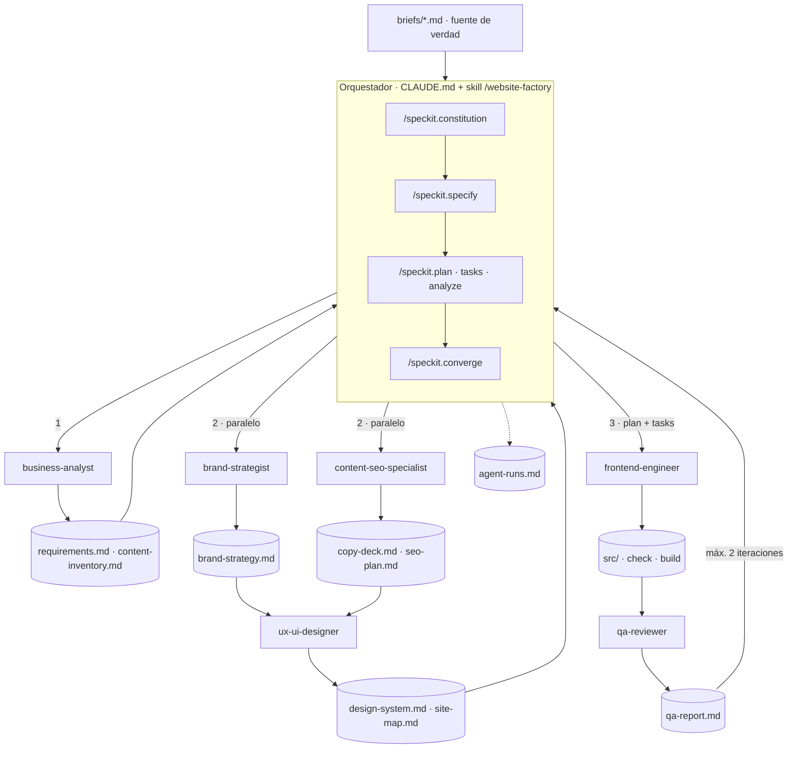

# Siete agentes, un objetivo: cómo se orquesta un sistema multiagente que construye un sitio web

_2026-11-12 · 16 min de lectura_

Un modelo de lenguaje, por sí solo, es una función estocástica: recibe contexto y devuelve una muestra. Un agente es esa función dentro de un loop con herramientas, memoria y un criterio de parada. Y un sistema multiagente es otra cosa: una arquitectura distribuida donde varias de esas inferencias se reparten el trabajo, comparten estado y se controlan entre sí. Website Factory es un ejemplo completo y público: un orquestador de Claude Code descompone un objetivo, lo delega en seis subagentes especializados sobre el flujo Spec-Driven Development de GitHub Spec Kit y solo da una etapa por cerrada cuando un verificador determinista lo confirma. Entrada: un brief en Markdown. Salida: un sitio Astro + Tailwind CSS 4 que compila, pasa sus controles y deja la traza de cada decisión. Este artículo abre el sistema por dentro.

## De la inferencia al sistema

Para entender por qué hace falta orquestar, conviene separar tres niveles que en la conversación cotidiana se mezclan:

_Tres niveles de abstracción en IA generativa aplicada_

| Nivel | Qué es | Unidad de diseño | Modo de falla típico |
|---|---|---|---|
| Modelo | Una inferencia: contexto → distribución → muestra | El prompt | Alucinación: una salida plausible y sin grounding |
| Agente | Un loop de razonamiento y acción con tool use (patrón ReAct) | Herramientas, contexto y condición de parada | Deriva: el loop no converge o converge a algo incorrecto |
| Sistema multiagente | Varios agentes con roles, estado compartido y control | Topología, contratos, verificadores y límites | Errores en cascada: la salida mala de uno es la entrada de otro |

Con un agente generalista las tres fallas se acumulan en un único contexto: el mismo loop decide posicionamiento, copy, SEO, accesibilidad y código, y además evalúa su propio trabajo. La ventana de contexto se llena de información irrelevante para cada subtarea, la atención del modelo se diluye y no hay ningún punto independiente que detecte el error antes de que se propague. La respuesta de ingeniería es la misma que en cualquier sistema distribuido: **descomponer, aislar, contratar interfaces y verificar en los bordes**.

En Website Factory el repositorio pasa a ser **el programa que ejecutan los agentes**: las reglas (`CLAUDE.md`), los roles (`.claude/agents/*.md`), los flujos (`.claude/skills/*/SKILL.md`), las especificaciones (`specs/`) y los verificadores (`scripts/`) son el código fuente del sistema, y el modelo es el runtime. Los prompts que recibe cada agente no se escriben a mano: los genera el orquestador a partir de ese programa.

## El problema y las restricciones de diseño

El objetivo es una **fábrica reproducible**: dado cualquier brief con el mismo formato, producir un sitio que compile, pase controles automáticos y deje evidencia de cada decisión. El caso de demostración del repositorio es *Supermercado Los Álamos*, un comercio ficticio. Antes de escribir una línea se fijaron cinco restricciones, que funcionan como la función objetivo del sistema:

1. **Grounding estricto: el brief es la fuente de verdad.** Cada dato comercial se etiqueta como `VERIFIED`, `ASSUMPTION`, `PLACEHOLDER` o `BLOCKED`. Lo no confirmado no se publica como si fuera real: es la defensa estructural contra la alucinación.
2. **Especialización con mínimo privilegio**: cada rol con sus herramientas y sus archivos de salida, y nada más.
3. **Trazabilidad de punta a punta**: IDs que conecten brief → requisitos → spec → copy → tareas → código → QA.
4. **Verificación determinista**: `astro check`, `astro build` y un validador de contenido tienen que pasar; no alcanza con que el agente diga que pasaron.
5. **Personas en los puntos de riesgo**: nada de despliegues, dependencias nuevas ni servicios externos sin aprobación explícita.

> **Alcance:** MVP de hasta cinco páginas, sin CMS, pagos, autenticación ni formularios con backend. Stack fijo: Astro con TypeScript y salida estática, Tailwind CSS 4 vía @tailwindcss/vite, JavaScript de cliente solo cuando una funcionalidad lo justifique.

## Topología: un orquestador, seis especialistas

La primera decisión de arquitectura fue la topología. El sistema usa **orquestador + especialistas** (hub-and-spoke), que en la taxonomía de Anthropic sobre sistemas agénticos corresponde al patrón *orchestrator-workers*. Hay una sola sesión principal de Claude Code que decide prioridades, permisos, reintentos y resultado final. Los subagentes no se hablan entre sí, y no pueden crear otros agentes ni modificar las reglas superiores.

La coordinación no ocurre por mensajes sino **a través de archivos**, al estilo de una arquitectura *blackboard*: cada agente lee los artefactos que produjeron los anteriores y escribe solo los suyos. Esto tiene tres ventajas sobre un chat entre agentes: el estado es inspeccionable y versionable con git, el contexto de cada agente queda acotado a lo que necesita, y el orquestador puede auditar cualquier paso intermedio.

_Topología orquestador-especialistas con coordinación por archivos_



### Los seis especialistas y su superficie de herramientas

_Roles, herramientas y propiedad de archivos (definidos en .claude/agents/)_

| Agente | Responsabilidad | Herramientas | Es dueño de |
|---|---|---|---|
| business-analyst | Brief → REQ-001..n con Given/When/Then, supuestos y bloqueos; clasifica cada dato | Read, Grep, Glob, Write | requirements.md, content-inventory.md |
| brand-strategist | Posicionamiento, tono, mensajes por sección, dirección visual | Read, Grep, Glob, Write | brand-strategy.md |
| content-seo-specialist | Copy con IDs estables (HOME-S1-SUB…), SEO local, JSON-LD estricto | Read, Grep, Glob, Write | copy-deck.md, seo-plan.md |
| ux-ui-designer | Tokens @theme, componentes con props, responsive 360/768/1440, foco | Read, Grep, Glob, Write | design-system.md, site-map.md |
| frontend-engineer | Implementa tasks.md en Astro + TS + Tailwind 4 | Read, Grep, Glob, Write, Edit, **Bash** | src/, public/, astro.config.mjs |
| qa-reviewer | Auditoría independiente brief ↔ spec ↔ diseño ↔ código | Read, Grep, Glob, **Bash**, Write | qa-report.md |

Dos principios de coordinación sostienen la tabla. **Propiedad exclusiva de archivos**: como `brand-strategist` y `content-seo-specialist` escriben archivos distintos, pueden correr en paralelo (*fan-out*) sin condiciones de carrera; las ediciones de un mismo archivo se serializan. **Mínimo privilegio**: los cuatro roles de análisis y diseño no tienen `Bash`, así que no pueden instalar paquetes, borrar archivos ni ejecutar nada. Solo compila quien implementa y solo verifica quien audita.

## Programar el sistema para que los agentes ejecuten los prompts

La tendencia más interesante de la ingeniería agéntica es esta: dejamos de escribir prompts y empezamos a **programar sistemas que generan y ejecutan prompts**. En Website Factory hay tres capas, cada una con un nivel de abstracción distinto:

_Las capas del programa agéntico_

| Capa | Archivo | Equivalente en software tradicional | Qué define |
|---|---|---|---|
| Gobernanza | `CLAUDE.md` + `.specify/memory/constitution.md` | Invariantes y políticas del sistema | Misión, regla de oro, secuencia obligatoria, política de subagentes, quality gates |
| Flujo | `.claude/skills/website-factory/SKILL.md` | Función principal / pipeline | Los nueve pasos, qué agente o skill corre en cada uno, qué se paraleliza |
| Roles | `.claude/agents/*.md` | Módulos con interfaz | Rol, inputs, outputs, restricciones y herramientas permitidas |
| Contexto de trabajo | `specs/001-…/` y `docs/` | Estado / memoria compartida | Spec, plan, contratos, tareas y artefactos intermedios |
| Verificación | `scripts/validate_content.py`, `npm run check/build` | Tests | Señales deterministas de aprobado o fallido |

Con esa estructura, `/website-factory briefs/cliente.md` se comporta como una llamada a función: la skill lee el brief, recorre la secuencia y, en cada paso, **compila un prompt** para el agente que corresponde. Ese prompt no es fijo; se construye con las rutas, los criterios de aceptación y las restricciones del paso actual.

Una distinción que el `CLAUDE.md` deja explícita, porque es fácil de confundir: las invocaciones `/speckit.*` son operaciones del orquestador dentro del chat de Claude Code, no comandos de terminal, y que un agente "escriba una spec" no equivale a ejecutar `/speckit.specify`. El sistema tiene dos runtimes —el shell y el agente— y cada instrucción tiene que dejar claro en cuál corre.

## Prompt engineering: cada delegación es un contrato

El prompt engineering cambia de naturaleza cuando quien escribe el prompt es otro agente. Ya no se trata de encontrar la frase mágica, sino de definir **una interfaz**: qué entra, qué sale, cómo se valida y cuándo se termina. Por cada delegación, el orquestador genera un prompt con seis secciones obligatorias y registra un resumen en `docs/agent-runs.md`.

_Contrato de delegación (ejemplo reconstruido a partir del registro de la ejecución)_

```text
MISSION:          Convertir el brief en requisitos verificables y clasificar
                  cada dato como VERIFIED / ASSUMPTION / PLACEHOLDER / BLOCKED.
INPUTS:           briefs/supermercado-los-alamos.md
                  .specify/memory/constitution.md · CLAUDE.md · docs/quality-gates.md
OUTPUT FILES:     docs/requirements.md · docs/content-inventory.md   (solo estos)
ACCEPTANCE:       REQ-001..n con criterios Given/When/Then; cada dato comercial
                  con estado y línea del brief; supuestos A-xx y bloqueos B-xx.
CONSTRAINTS:      No inventar cifras, reseñas, servicios ni canales de contacto.
                  Stack y alcance fijos. No editar archivos de otros agentes.
STOP CONDITIONS:  Si un dato es contradictorio, marcarlo BLOCKED y devolver el
                  control; no resolver la ambigüedad por cuenta propia.
```

- **MISSION** acota el rol a una responsabilidad. Un agente con una misión difusa expande su alcance.
- **INPUTS** con rutas exactas es *context engineering*: el agente no explora el repo buscando qué leer, recibe exactamente lo necesario.
- **OUTPUT FILES** convierte la propiedad de archivos en parte del contrato y hace posible la paralelización.
- **ACCEPTANCE** con IDs medibles permite que otro agente (el QA) verifique sin interpretar.
- **CONSTRAINTS** repite las invariantes en el punto de uso: no se confía en que el agente "recuerde" la constitución.
- **STOP CONDITIONS** es la sección que más se olvida y la que más importa: define cuándo el agente tiene que dejar de intentar y devolver el control.

Los prompts de rol (`.claude/agents/*.md`) son estables y cortos; los prompts de tarea son dinámicos y específicos. Esa separación es la misma que entre la definición de una clase y la llamada a uno de sus métodos con argumentos.

## Context engineering: el contexto es un presupuesto

Si el prompt es la interfaz, el contexto es la memoria de trabajo, y es un recurso finito. Cuanto más ruido entra en la ventana de contexto, peor decide el modelo. El diseño del enjambre es, en buena medida, una estrategia de gestión de contexto:

- **Aislamiento por subagente.** Cada subagente arranca con su propia ventana de contexto. El `ux-ui-designer` no carga la conversación sobre JSON-LD; el orquestador solo recibe resúmenes, no la exploración completa de cada agente.
- **Memoria externa en archivos.** Los artefactos de `docs/` y `specs/` son memoria persistente: sobreviven a la sesión, se pueden leer por partes y cualquier agente posterior los consume sin reconstruirlos.
- **Contexto progresivo.** Las skills se cargan cuando se invocan; los roles exponen una `description` corta y el cuerpo completo entra solo cuando el agente se usa.
- **IDs estables como índice.** `REQ-007`, `FR-012`, `CONT-S2-MAP-TITLE`, `T024`: un agente puede citar y buscar un requisito sin copiar su texto, y el QA puede cruzar capas con `grep`.
- **Fuente única de datos.** Dirección, teléfono y horarios aparecen literalmente en un solo archivo, `src/content/site.ts` (contrato C-01). Menos duplicación también es menos contexto contradictorio.

_src/content/site.ts: cada dato comercial lleva su estado y su origen en el brief_

```ts
// --- Teléfono: BRIEF-VALIDAR (brief L148, B-03); formato E.164 = ASSUMPTION (A-09) ---
export const phone: Phone = {
  display: '0000 00-0000', // BRIEF-VALIDAR
  e164: phoneE164,          // ASSUMPTION (A-09)
  href: 'tel:' + phoneE164,
};

// --- Horarios: BRIEF-VALIDAR (brief L151-152). Sin feriados (PENDIENTE) ni "abierto ahora". ---
export const hours: OpeningHours[] = [
  { days: 'Lunes a sábado', value: '07:30 a 21:00', closed: false }, // BRIEF-VALIDAR
  { days: 'Domingo', value: 'Cerrado', closed: true },               // BRIEF-VALIDAR
];

export const offers: Offer[] = []; // sin ofertas confirmadas → estado vacío honesto
```

## Loop engineering: iterar con señales deterministas

Todo agente es un loop: reunir contexto, actuar, observar el resultado y decidir si sigue. Un sistema multi-agente es un **loop de loops**. Llamo *loop engineering* a diseñar esos ciclos de forma explícita: qué señal cierra cada iteración, cuántas iteraciones se permiten y qué pasa cuando se agotan. Un loop sin señal de salida diverge; un loop con una señal blanda ("me parece que quedó bien") converge a cualquier cosa.

_Los loops del sistema y sus condiciones de salida_

| Loop | Quién itera | Señal de feedback | Límite / salida |
|---|---|---|---|
| Interno de implementación | frontend-engineer | `astro check` y `astro build` (exit code) | 0 errores, 0 warnings; si no, corrige y reintenta |
| Consistencia de especificación | Orquestador con `/speckit.analyze` | Hallazgos CRITICAL / MEDIUM / LOW entre spec, plan y tasks | No se implementa con CRITICAL abiertos |
| Evaluador-optimizador | qa-reviewer → orquestador → corrección | Hallazgos BLOCKER / MAJOR / MINOR con evidencia `archivo:línea` | **Máximo dos iteraciones**; lo no resuelto queda como pendiente documentado |
| Convergencia | Orquestador con `/speckit.converge` | Brechas entre spec y código generado | Converged, o tarea bloqueada a la espera de una persona |
| Aprobación humana | Persona | Decisión explícita | Dependencias nuevas, servicios externos y despliegue |

El patrón *evaluator-optimizer* (un agente produce, otro evalúa, el primero corrige) funciona solo si el evaluador es **independiente**: otro contexto, otro prompt, criterios escritos de antemano. Si el mismo agente que implementó se autoevalúa, tiende a confirmar lo que hizo: es el equivalente agéntico de evaluar un modelo con sus propios datos de entrenamiento. Por eso el `qa-reviewer` no recibe el razonamiento del implementador, solo los artefactos; no hay fuga de información entre quien produce y quien evalúa.

Y la parte que hace que los loops sean confiables: las señales de cierre son **deterministas** siempre que se pueda. El modelo muestrea de una distribución; el exit code de un build no. En términos de aprendizaje por refuerzo, el verificador es una función de recompensa verificable: binaria, barata de calcular e imposible de convencer con una buena redacción. El validador de contenido convierte reglas de negocio en una señal binaria:

_scripts/validate_content.py (fragmento): invariante C-01 de fuente única_

```python
single_source = src / 'content' / 'site.ts'
for f in src_files:
    if f == single_source:
        continue
    s = f.read_text(encoding='utf-8')
    for m in re.finditer(r'Ejemplo|B0000|00-0000|000000|07:30|21:00', s):
        errors.append(f'{f.relative_to(root)}: C-01 dato comercial literal fuera de site.ts ("{m.group(0)}")')
```

## El arnés: guardrails que no dependen del modelo

Un enjambre sin límites diverge. Además de los loops, el sistema tiene frenos que no dependen de que el modelo "se porte bien":

1. **Constitución versionada** con seis principios no negociables (brief como fuente de verdad, stack fijo, contenido separado del diseño, accesibilidad, SEO local honesto, verificabilidad). `/speckit.plan` incluye un *Constitution Check* que tiene que pasar.
2. **Estados vacíos honestos**: canales sin confirmar con `value: null` no se renderizan; `offers: []` muestra "todavía no hay ofertas publicadas", nunca precios de ejemplo.
3. **SEO sin inventar**: sin `canonical`, `og:url` ni `og:image` mientras no exista una URL pública confirmada; JSON-LD `GroceryStore` solo con `name` y `address`.
4. **Permisos del proyecto mínimos**: `.claude/settings.json` solo habilita el navegador contra `127.0.0.1:4321` para la revisión visual local.
5. **Sin acciones externas**: no se declaran pruebas de navegador ni puntuaciones Lighthouse que no se ejecutaron, y no se instala nada sin aprobación.
6. **Registro de cada delegación** en `docs/agent-runs.md`: fecha, agente, misión, entradas, salidas, validación y estado. Es el *trace* del sistema.

## Qué produjo una ejecución completa

La ejecución completa quedó en el repositorio: specs, documentación intermedia, registro de agentes, reporte de QA y el sitio generado. Estos son los números, todos verificables en `docs/agent-runs.md` y `docs/qa-report.md`:

_Resultados de la ejecución sobre el brief de Supermercado Los Álamos_

| Etapa | Resultado |
|---|---|
| Análisis de negocio | 18 requisitos, 11 supuestos y 8 bloqueos explícitos |
| Especificación (`/speckit.specify`) | 4 historias de usuario, FR-001..019 trazados a REQ, SC-001..007; checklist 16/16, sin necesidad de `/speckit.clarify` |
| Diseño | 34 componentes especificados, tokens `@theme`, ilustraciones SVG propias en lugar de fotos sin licencia |
| Plan y tareas | Investigación R-01..08, contratos C-01..03, 41 tareas organizadas por historia |
| `/speckit.analyze` | 0 CRITICAL, 2 MEDIUM, 4 LOW; los relevantes se corrigieron en `tasks.md` antes de implementar |
| Implementación | `astro check` 0 errores / 0 warnings / 0 hints; build de 5 páginas; validador PASS |
| QA independiente | 0 BLOCKER, 0 MAJOR, 8 MINOR |
| Revisión visual | 5 páginas × 3 anchos (360/768/1440): 15/15 sin scroll horizontal |
| Convergencia | Converged; una tarea (cargar tipografías) bloqueada a la espera de aprobación |

### Lo que mostró el loop de QA

El hallazgo más revelador fue QA-008: el `qa-reviewer` detectó que **el validador escrito por el `frontend-engineer` era más estrecho que el contrato** que debía verificar. Buscaba algunos datos literales pero no todos, y su patrón no detectaba "compras online". El auditor no solo revisa el código: revisa los tests. Se corrigió en la primera iteración, con prueba positiva y negativa.

El otro momento clave fue una parada correcta. El brief pedía tipografías específicas; cargarlas requería instalar paquetes `@fontsource`. Como eso es una dependencia nueva, el sistema no la instaló: dejó la tarea T040 bloqueada, lo documentó como QA-001 y devolvió la decisión. Un agente que sabe detenerse vale más que uno que siempre termina.

> **Veredicto del propio sistema:** Aprobado para preview local con observaciones; no apto para producción hasta validar teléfono y horarios con el comercio, confirmar categorías, sumar fotos con licencia y definir dominio. Que el sistema diga esto de sí mismo es parte del resultado.

### Límites honestos

- Es no determinista: otra ejecución con el mismo brief puede producir otro sitio que cumpla igualmente la spec. Lo reproducible es el proceso y los controles, no el HTML exacto.
- `validate_content.py` es heurístico: no reemplaza una revisión editorial ni una auditoría de seguridad.
- No incluye Playwright, Lighthouse ni despliegue automático. La prueba de teclado asistida quedó registrada como no ejecutada.
- Para varios clientes en paralelo conviene un repo o una rama por proyecto, para que no choquen `specs/` ni el estado de `.specify/`.

## Principios de diseño para sistemas multiagente

La conclusión no es que los agentes reemplacen a un equipo, sino que **el trabajo de ingeniería se mueve un nivel de abstracción hacia arriba**. En lugar de escribir el sitio, escribimos el sistema que escribe sitios: sus reglas, sus roles, sus contratos y sus loops. Ese sistema se revisa en pull requests, se versiona y mejora entre ejecuciones.

1. **Diseñá la topología antes que los prompts.** Orquestador único, especialistas sin comunicación lateral y coordinación por archivos es un punto de partida que escala y se puede auditar.
2. **Tratá cada delegación como una llamada a una API**: misión, entradas, salidas, aceptación, restricciones y condición de parada.
3. **El contexto es un presupuesto.** Aislá contextos por agente, persistí en archivos y pasá rutas exactas, no "mirá el repo".
4. **Todo loop necesita una señal determinista y un límite.** Dos iteraciones y después una persona.
5. **El evaluador tiene que ser independiente**, y también tiene que auditar los tests.
6. **Mínimo privilegio por rol**: si un agente no necesita ejecutar comandos, no le des `Bash`.
7. **Escribí dónde se detiene la autonomía**: dependencias, servicios externos, datos personales y despliegues pasan por una persona.

El repositorio es público y tiene licencia MIT. Se puede clonar, completar `templates/brief-template.md` con datos reales y correr `/website-factory briefs/mi-empresa.md` desde Claude Code. Me interesa saber cómo están armando sus propios arneses: ¿qué loops cerraron con señales deterministas y cuáles siguen dependiendo de "me parece que está bien"?

### Referencias

- [juliancardozo/website-factory-mvp](https://github.com/juliancardozo/website-factory-mvp) — repositorio del caso, con la ejecución completa.
- [GitHub Spec Kit](https://github.com/github/spec-kit) — toolkit de Spec-Driven Development (en el repo, versión 1.4.1.dev0).
- [Building effective agents](https://www.anthropic.com/engineering/building-effective-agents) — Anthropic: patrones orchestrator-workers, parallelization y evaluator-optimizer.
- [Effective context engineering for AI agents](https://www.anthropic.com/engineering/effective-context-engineering-for-ai-agents) — Anthropic: el contexto como recurso finito.
- [Subagents en Claude Code](https://docs.claude.com/en/docs/claude-code/sub-agents) — documentación oficial de subagentes, herramientas y contexto aislado.

---

**Criterio práctico: en un sistema multiagente no se optimiza el prompt, se diseña la arquitectura. Topología clara, contratos de delegación, contexto acotado, loops con señales deterministas y límites, y personas en los puntos donde un error cuesta caro.**

