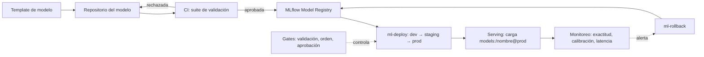

# Plataforma MLOps para modelos bayesianos: del notebook a producción con autonomía y control

_2026-11-16 · 17 min de lectura_

Un modelo bayesiano bien construido no responde solo «cuánto», sino también «con qué incertidumbre». Esa propiedad, que es su principal valor para el negocio, es también lo que lo vuelve más difícil de operar: el entrenamiento depende de un muestreo que puede no converger, el artefacto es una distribución y no un vector de pesos, y una predicción puntual correcta puede esconder intervalos mal calibrados. Este artículo recorre el trabajo de un equipo de plataforma que da soporte a Data Scientists que construyen este tipo de modelos: templates, validación automática, promoción entre entornos con MLflow, herramientas de despliegue y reversión, serving, monitoreo, gobernanza y formación. El objetivo es concreto: que la mayoría de los despliegues ocurran sin intervención del equipo de plataforma y sin perder control.

## El problema: autonomía sin perder control

En muchas organizaciones, llevar un modelo a producción sigue siendo un proyecto en sí mismo. El Data Scientist termina un notebook, abre un ticket y espera a que alguien de ingeniería empaquete el modelo, escriba una API, configure el despliegue y agregue algo de monitoreo. Cada paso se negocia de nuevo, el conocimiento queda en pocas personas y los modelos llegan tarde o no llegan.

La respuesta habitual es una plataforma de ML: un conjunto de herramientas, templates y procesos que permiten a los Data Scientists desplegar por su cuenta. Un objetivo frecuente es que al menos el 80% de los despliegues se completen sin intervención del equipo de plataforma. La cifra sirve como meta solo si se define cómo se mide: por ejemplo, la proporción de promociones a producción que no requirieron un ticket ni una sesión de soporte en los últimos 90 días. Sin esa definición, la autonomía se vuelve una percepción.

Autonomía no significa ausencia de controles. Significa que los controles están automatizados, son visibles y se ejecutan siempre igual, de modo que un Data Scientist puede saber de antemano qué tiene que cumplir su modelo para llegar a producción y por qué fue rechazado si no lo cumple.

## Qué cambia con un modelo bayesiano

La mayor parte de las prácticas de MLOps se pensaron para modelos que se entrenan con optimización y producen un conjunto de parámetros. Un modelo bayesiano ajustado con MCMC (Markov Chain Monte Carlo) produce otra cosa: muestras de la distribución posterior de sus parámetros. Esa diferencia afecta a cada etapa del ciclo.

_Diferencias operativas entre un modelo entrenado por optimización y uno bayesiano ajustado con MCMC_

| Etapa | Modelo por optimización | Modelo bayesiano con MCMC | Consecuencia para la plataforma |
|---|---|---|---|
| Entrenamiento | Converge a un óptimo; la pérdida indica progreso | Las cadenas pueden no converger aunque el proceso termine sin error | Los diagnósticos de convergencia son un gate obligatorio |
| Artefacto | Pesos del modelo | Miles de muestras de la posterior, a veces de cientos de MB | Hay que decidir qué se guarda para diagnóstico y qué se sirve |
| Predicción | Una pasada por el modelo | Una predicción por muestra, luego se resume | La latencia depende de cuántas muestras se usan |
| Calidad | Error de la predicción puntual | Error y calibración de los intervalos | Las métricas de monitoreo incluyen cobertura |
| Costo | Entrenamiento relativamente predecible | Depende de la geometría de la posterior | Conviene medir muestras efectivas por segundo |

Hay un punto que suele sorprender a equipos que vienen de otros tipos de modelos: **un muestreo que termina sin error puede producir resultados inválidos**. Cadenas que no se mezclaron, transiciones divergentes o pocas muestras efectivas generan una posterior que no representa al modelo. Por eso los diagnósticos no son una buena práctica opcional, sino una condición para registrar una versión.

## Una arquitectura de referencia

La arquitectura que sigue es una propuesta propia. Separa cuatro responsabilidades: el código del modelo, que pertenece al Data Scientist; la validación, que la plataforma define y ejecuta; el registro y la promoción, que usan MLflow como fuente de verdad; y el serving y el monitoreo, que la plataforma opera.

_Ciclo de vida de un modelo en la plataforma_



Dos decisiones importan más que el resto. La primera es que **el registro es la única fuente de verdad sobre qué versión corre en cada entorno**: el servicio no conoce números de versión, solo aliases. La segunda es que **promover y revertir son operaciones sobre el registro, no despliegues de infraestructura**: mover un alias es rápido, auditable y reversible, y el servicio toma la nueva versión al recargar el modelo.

## Templates: el camino más corto debe ser el correcto

Un template de repositorio es la forma más eficaz de difundir buenas prácticas, porque las incorpora antes de que alguien tenga que recordarlas. Conviene mantener al menos dos: uno para el modelo y otro para la API que lo sirve cuando el caso necesita lógica propia. Herramientas como [Copier](https://copier.readthedocs.io/) o [Cookiecutter](https://cookiecutter.readthedocs.io/) generan el repositorio; Copier además permite actualizar proyectos existentes cuando el template evoluciona, algo valioso cuando hay decenas de modelos.

_Contenido mínimo de los templates (propuesta)_

| Template | Incluye | Por qué |
|---|---|---|
| Modelo | Estructura `src/` con `modelo.py`, `entrenar.py` y `serving.py`; datos simulados para pruebas; suite de validación de la plataforma; pipeline de CI; `MODEL_CARD.md` | El Data Scientist escribe el modelo; todo lo demás ya está resuelto |
| Modelo | Configuración de muestreo con semilla, cadenas y umbrales declarados en un archivo | Los gates son explícitos y revisables en el código |
| API | FastAPI con contrato de entrada y salida, health checks, carga por alias, métricas y trazas | Cada servicio expone las mismas señales al monitoreo |
| Ambos | Dependencias fijadas, `pre-commit`, documentación con MkDocs | Reproducibilidad y documentación desde el primer commit |

El template no debería esconder el modelo detrás de abstracciones propias. Un Data Scientist que usa PyMC tiene que poder escribir PyMC. La plataforma aporta la estructura alrededor, no un lenguaje nuevo.

## Un ejemplo verificado: de PyMC a producción con MLflow

El ejemplo implementa un modelo jerárquico de demanda por tienda, la suite de validación, el registro en MLflow y las herramientas `ml-deploy` y `ml-rollback`. Usa PyMC 6.4, ArviZ 1.3, MLflow 3.18 y Typer, con Python 3.12.

> **Qué se verificó:** El código se ejecutó con esas versiones contra un registro de MLflow local sobre SQLite. Cuatro pruebas automáticas pasan: recuperación de parámetros con datos simulados, promoción y reversión con la CLI, rechazo de una versión no validada y carga del modelo por alias para predecir. Los tiempos que se mencionan corresponden a una laptop y sirven solo como orden de magnitud.

### El modelo

_modelo.py: modelo jerárquico con parametrización no centrada_

```python
import pymc as pm


def construir(tienda, precio, y, n_tiendas):
    with pm.Model() as m:
        mu_a = pm.Normal("mu_a", 40, 20)
        sigma_a = pm.HalfNormal("sigma_a", 10)
        z = pm.Normal("z", 0, 1, shape=n_tiendas)          # no centrada
        a = pm.Deterministic("a", mu_a + z * sigma_a)
        beta = pm.Normal("beta", 0, 5)
        sigma = pm.HalfNormal("sigma", 10)
        pm.Normal("y", a[tienda] + beta * precio, sigma, observed=y)
    return m


def ajustar(datos, draws=1000, tune=1000, chains=4, seed=42, target_accept=0.95):
    m = construir(datos["tienda"], datos["precio"], datos["y"], datos["n_tiendas"])
    with m:
        return pm.sample(draws=draws, tune=tune, chains=chains, random_seed=seed,
                         target_accept=target_accept, progressbar=False, quiet=True)
```

Cada tienda tiene su propio nivel de demanda, pero los niveles comparten una distribución común. Así, una tienda con pocos datos toma información de las demás. La **parametrización no centrada** (`a = mu_a + z * sigma_a`) es una práctica estándar en modelos jerárquicos: evita una geometría de la posterior que dificulta el muestreo y suele reducir las divergencias.

### Los gates de validación

_validacion.py: convergencia, calibración y latencia como condiciones explícitas_

```python
import arviz as az

UMBRALES = {"rhat_max": 1.01, "ess_bulk_min": 400, "divergencias_max": 0,
            "cobertura_90_min": 0.85, "cobertura_90_max": 0.95, "latencia_p95_ms_max": 50}


def convergencia(idata, var_names=("mu_a", "sigma_a", "beta", "sigma", "a")):
    rhat = az.rhat(idata, var_names=list(var_names))
    ess = az.ess(idata, var_names=list(var_names), method="bulk")
    return {
        "rhat_max": float(max(rhat[v].max() for v in var_names)),
        "ess_bulk_min": float(min(ess[v].min() for v in var_names)),
        "divergencias": int(idata.sample_stats["diverging"].sum()),
    }


def evaluar(metricas, u=UMBRALES):
    fallas = []
    if metricas["rhat_max"] > u["rhat_max"]: fallas.append("rhat")
    if metricas["ess_bulk_min"] < u["ess_bulk_min"]: fallas.append("ess")
    if metricas["divergencias"] > u["divergencias_max"]: fallas.append("divergencias")
    if not u["cobertura_90_min"] <= metricas["cobertura_90"] <= u["cobertura_90_max"]:
        fallas.append("cobertura")
    if metricas["latencia_p95_ms"] > u["latencia_p95_ms_max"]: fallas.append("latencia")
    return fallas
```

Los umbrales de R-hat (1,01) y de tamaño efectivo de muestra (400 en total entre cadenas) siguen las recomendaciones de Vehtari y colegas en su revisión del diagnóstico R-hat. La **cobertura** mide qué proporción de observaciones nuevas cae dentro del intervalo del 90%: si el modelo está bien calibrado, debería rondar ese valor. Un intervalo demasiado estrecho subestima el riesgo; uno demasiado ancho no aporta información.

Los gates detectaron problemas reales durante la preparación del ejemplo. Con menos datos y la configuración por defecto, la primera versión registró una transición divergente y una cobertura del 83,6% sobre 67 observaciones de prueba, y fue rechazada. Con más datos y `target_accept=0.95`, las siguientes versiones tuvieron cero divergencias y una cobertura del 90,3%. En las pruebas automáticas, una corrida con 500 muestras por cadena quedó por debajo del mínimo de ESS y también fue rechazada. Además de los umbrales, este episodio muestra un detalle: la banda de cobertura tiene que contemplar el tamaño del conjunto de prueba, porque con pocas observaciones la variación es grande.

### Servir la posterior sin PyMC en runtime

_serving.py: predictor liviano a partir de muestras guardadas_

```python
import numpy as np
import mlflow


class Predictor:
    def __init__(self, a, beta, sigma, seed=0):
        self.a, self.beta, self.sigma = a, beta, sigma      # (S, T), (S,), (S,)
        self.rng = np.random.default_rng(seed)

    @classmethod
    def desde_idata(cls, idata, max_draws=500, seed=0):
        post = idata.posterior.ds.stack(s=("chain", "draw"))
        idx = np.linspace(0, post.sizes["s"] - 1, max_draws).astype(int)   # thinning
        return cls(post["a"].values.T[idx], post["beta"].values[idx], post["sigma"].values[idx], seed)

    def muestras(self, tienda, precio):
        mu = self.a[:, tienda] + self.beta[:, None] * precio[None, :]      # (S, N) vectorizado
        return mu + self.sigma[:, None] * self.rng.standard_normal(mu.shape)


class ModeloDemanda(mlflow.pyfunc.PythonModel):
    def load_context(self, context):
        d = np.load(context.artifacts["draws"])
        self.p = Predictor(d["a"], d["beta"], d["sigma"])

    def predict(self, context, model_input, params=None):
        s = self.p.muestras(model_input["tienda"].to_numpy(),
                            model_input["precio"].to_numpy(dtype=float))
        out = model_input.copy()
        out["media"] = s.mean(axis=0)
        out["p05"], out["p95"] = np.quantile(s, [0.05, 0.95], axis=0)
        return out
```

Esta es una de las decisiones de diseño más útiles para modelos bayesianos en producción: **separar el ajuste del serving**. El ajuste corre con PyMC en un job de entrenamiento; el servicio solo necesita las muestras de los parámetros y una función vectorizada en NumPy que genera la predictiva posterior. Se guardan 500 muestras de las 4.000 disponibles, elegidas a intervalos regulares, y el servicio responde con la media y un intervalo del 90%. En el ejemplo, la latencia p95 para 154 predicciones fue de alrededor de 2 ms. La posterior completa se guarda aparte, en formato NetCDF, para diagnóstico y auditoría.

El trade-off es explícito: menos muestras implica menos latencia y más error de Monte Carlo en los cuantiles. Para cuantiles extremos, como un percentil 99 usado en decisiones de stock, 500 muestras pueden no alcanzar. La cantidad debería decidirse con el Data Scientist y quedar registrada como parámetro del modelo.

### Registrar la versión con su evidencia

_entrenar.py (fragmento): cada versión queda registrada con métricas y resultado de validación_

```python
with mlflow.start_run():
    mlflow.log_params({"draws": draws, "chains": 4, "seed": seed, "parametrizacion": "no_centrada"})
    idata = modelo.ajustar(entreno, draws=draws, seed=seed)
    pred = Predictor.desde_idata(idata)
    m = validacion.convergencia(idata)
    m["cobertura_90"] = validacion.cobertura(pred, tienda_test, precio_test, y_test)
    m["latencia_p95_ms"] = validacion.latencia_p95_ms(pred, tienda_test, precio_test)
    mlflow.log_metrics(m)
    fallas = validacion.evaluar(m)
    # ... guardar draws.npz y posterior.nc ...
    info = mlflow.pyfunc.log_model(name="modelo", python_model=ModeloDemanda(),
                                   artifacts={"draws": ruta_draws}, code_paths=["serving.py"],
                                   input_example=ejemplo, registered_model_name=NOMBRE)

version = str(info.registered_model_version)
cliente = mlflow.MlflowClient()
cliente.set_model_version_tag(NOMBRE, version, "validacion", "rechazada" if fallas else "aprobada")
cliente.set_model_version_tag(NOMBRE, version, "validacion.fallas", ",".join(fallas) or "-")
```

Registrar también las versiones rechazadas puede parecer innecesario, pero aporta trazabilidad: el historial muestra qué se intentó, por qué no pasó y qué cambió después. La etiqueta `validacion` es lo que la CLI consulta para permitir o rechazar una promoción.

## Promoción dev → staging → prod con aliases

Las versiones anteriores de MLflow usaban *stages* fijos (Staging, Production, Archived). Desde la versión 2.9 están deprecados en favor de **aliases**: nombres mutables que apuntan a una versión, como `dev`, `staging` o `prod`. El servicio carga `models:/demanda-tiendas@prod` y la promoción consiste en mover el alias.

Cuando los entornos están en workspaces o registros separados, como suele ocurrir en organizaciones con requisitos de aislamiento, `MlflowClient.copy_model_version` copia una versión de un modelo registrado a otro. El principio es el mismo: la versión que llega a producción es exactamente la que se validó, no un reentrenamiento.

_ml_cli.py (fragmento): ml-deploy verifica los gates antes de mover el alias_

```python
ENTORNOS = ["dev", "staging", "prod"]


@deploy_app.command()
def deploy(modelo: str, version: str, entorno: str = typer.Option(..., "--to"),
           ticket: str = typer.Option("", help="Cambio aprobado; obligatorio para prod"),
           dry_run: bool = False):
    """Promueve una versión al entorno indicado si pasa los gates."""
    c = MlflowClient()
    mv = c.get_model_version(modelo, version)
    errores = []
    if mv.tags.get("validacion") != "aprobada":
        errores.append(f"validación: {mv.tags.get('validacion', 'sin ejecutar')}")
    previo = ENTORNOS[ENTORNOS.index(entorno) - 1] if entorno != "dev" else None
    if previo and _version_de(c, modelo, previo) != str(version):
        errores.append(f"la versión {version} no está en {previo}")
    if entorno == "prod" and not ticket:
        errores.append("prod requiere --ticket")
    if errores:
        typer.echo("RECHAZADO: " + "; ".join(errores), err=True)
        raise typer.Exit(code=2)
    actual = _version_de(c, modelo, entorno)
    typer.echo(f"{modelo}@{entorno}: {actual or '-'} -> {version}")
    if dry_run:
        return
    if actual and actual != str(version):
        c.set_registered_model_tag(modelo, f"{entorno}.anterior", actual)
    c.set_registered_model_alias(modelo, entorno, version)
    c.set_model_version_tag(modelo, version, f"desplegado.{entorno}",
                            f"{datetime.now(timezone.utc).isoformat()} ticket={ticket or '-'}")


@rollback_app.command()
def rollback(modelo: str, entorno: str = typer.Option(..., "--env"), motivo: str = typer.Option(...)):
    """Vuelve el alias del entorno a la versión anterior registrada."""
    c = MlflowClient()
    anterior = c.get_registered_model(modelo).tags.get(f"{entorno}.anterior")
    if not anterior:
        typer.echo(f"no hay versión anterior registrada para {entorno}", err=True)
        raise typer.Exit(code=2)
    actual = _version_de(c, modelo, entorno)
    c.set_registered_model_alias(modelo, entorno, anterior)
    c.set_registered_model_tag(modelo, f"{entorno}.anterior", actual)
    c.set_model_version_tag(modelo, actual, f"revertido.{entorno}",
                            f"{datetime.now(timezone.utc).isoformat()} motivo={motivo}")
```

Las dos funciones se publican como comandos con `[project.scripts]` en `pyproject.toml` (`ml-deploy = "ml_cli:deploy_app"` y `ml-rollback = "ml_cli:rollback_app"`). Una sesión típica se ve así:

_Salida real de la CLI contra el registro local_

```bash
$ ml-deploy demanda-tiendas 2 --to prod --ticket CHG-9
RECHAZADO: la versión 2 no está en staging
$ ml-deploy demanda-tiendas 2 --to dev
demanda-tiendas@dev: - -> 2
$ ml-deploy demanda-tiendas 2 --to staging
demanda-tiendas@staging: - -> 2
$ ml-deploy demanda-tiendas 2 --to prod --ticket CHG-9
demanda-tiendas@prod: - -> 2
# ... la versión 3 recorre dev y staging ...
$ ml-deploy demanda-tiendas 3 --to prod --ticket CHG-10
demanda-tiendas@prod: 2 -> 3
$ ml-rollback demanda-tiendas --env prod --motivo "latencia p95"
demanda-tiendas@prod: 3 -> 2
```

Algunos principios de diseño para estas herramientas: deben ser **idempotentes**, de modo que repetir un comando no produzca efectos distintos; deben ofrecer `--dry-run`; deben dejar **evidencia en el registro** (quién, cuándo, con qué ticket), y deben devolver códigos de salida distintos para un rechazo por política y para un error técnico, para que el CI pueda tratarlos de forma diferente. El rollback tiene que ser la operación más simple de todas, porque se usa bajo presión.

> **Límites del ejemplo:** El ticket se acepta como texto; en una implementación real, la aprobación para prod debería venir de un mecanismo con identidad verificable, como los entornos protegidos con revisores obligatorios de GitHub Actions o GitLab, y la CLI debería ejecutarse desde el pipeline con credenciales de servicio, no desde la laptop de cada persona. El rollback guarda una sola versión anterior; un historial completo es una extensión directa.

## Suites de testing: qué validar en un modelo bayesiano

Las pruebas de un modelo bayesiano combinan las de cualquier software con otras propias del enfoque. Conviene organizarlas por costo, para que las rápidas corran en cada commit y las más caras en la integración o antes de una promoción.

_Capas de prueba para un modelo bayesiano (propuesta)_

| Prueba | Qué detecta | Cuándo corre |
|---|---|---|
| Unitarias y de contrato | Errores en transformaciones y en el esquema de entrada y salida | Cada commit, segundos |
| Chequeo predictivo a priori | Priors que generan valores imposibles, como demandas negativas enormes | Cada commit, segundos |
| Recuperación de parámetros | Un modelo que no puede recuperar los valores con los que se simularon los datos | Cada PR, minutos |
| Diagnósticos de convergencia | R-hat alto, ESS bajo, divergencias | Cada entrenamiento |
| Calibración y error en holdout | Intervalos mal calibrados, peor exactitud que la versión actual | Antes de registrar |
| Performance | Latencia p95 y memoria fuera del presupuesto | Antes de promover |

La **recuperación de parámetros** es la prueba más característica: se simulan datos con valores conocidos, se ajusta el modelo y se comprueba que esos valores caen dentro de los intervalos de la posterior. Si un modelo no recupera parámetros de datos que cumplen sus propios supuestos, difícilmente funcione con datos reales. En el ejemplo, la prueba verifica `mu_a`, `beta` y `sigma` dentro del intervalo del 94%. Para una validación más rigurosa del procedimiento de inferencia existe *simulation-based calibration*, que repite este ejercicio muchas veces; es costosa y suele reservarse para modelos críticos o cambios estructurales.

## Rendimiento: MCMC, inferencia y MLflow

### Eficiencia del muestreo

La métrica útil no es el tiempo de entrenamiento sino las **muestras efectivas por segundo**: un muestreador más rápido que produce cadenas muy correlacionadas puede ser peor que uno lento con buena mezcla. Las palancas, en orden aproximado de impacto: reparametrizar el modelo (como la forma no centrada del ejemplo), escalar y centrar predictores, usar priors informativos razonables, y probar otros backends de NUTS. `pm.sample` acepta `nuts_sampler` con las opciones `pymc`, `nutpie`, `numpyro` y `blackjax`; los dos últimos se basan en JAX y pueden aprovechar GPU. Cuál conviene depende del modelo, así que la plataforma debería facilitar la comparación, por ejemplo registrando ESS por segundo como métrica de cada corrida.

Para modelos que se reentrenan con frecuencia y no toleran el costo de MCMC, existen aproximaciones como la inferencia variacional (ADVI) o Pathfinder. Son más rápidas, pero tienden a subestimar la incertidumbre. Si se usan, la validación de calibración se vuelve aún más importante.

### Velocidad de inferencia

Las técnicas principales ya aparecen en el ejemplo: servir desde muestras guardadas en lugar de recompilar el modelo, reducir el número de muestras, vectorizar el cálculo sobre muestras y observaciones a la vez, y cargar el modelo una sola vez al iniciar el servicio. Para cargas por lotes, la predicción se puede ejecutar como job sobre todo el conjunto, con lo que la latencia por solicitud deja de importar.

### MLflow a escala

Con muchos equipos y miles de corridas, MLflow también necesita atención. Un backend en base de datos (PostgreSQL o MySQL) en lugar de archivos locales, con la base dimensionada y mantenida como cualquier otra; artifacts en almacenamiento de objetos, con `mlflow server --artifacts-destination` cuando se quiere que el servidor actúe como proxy y los clientes no necesiten credenciales del bucket; búsquedas con filtros y paginación (`search_model_versions` acepta `filter_string`, `max_results` y `page_token`) en lugar de traer todo; logging asíncrono (`mlflow.config.enable_async_logging()`) para que el entrenamiento no espere al servidor, y caché de las resoluciones de alias en los servicios, con un tiempo de expiración corto, para no consultar el registro en cada solicitud.

## Serving de modelos complejos

Los modelos bayesianos y los ensembles comparten un problema de serving: una predicción implica muchos cálculos que después se resumen. Algunas pautas de arquitectura ayudan a mantenerlo manejable.

- **Separar ajuste, preparación y serving.** El ajuste corre como job; un paso intermedio prepara el artefacto de serving (muestras reducidas, componentes precalculados); el servicio solo carga y calcula.
- **Un contrato de salida que incluya incertidumbre.** Media e intervalo, no solo un número. Si los consumidores ignoran el intervalo, el modelo pierde su principal ventaja.
- **Ensembles como un solo artefacto versionado.** Los modelos que componen un ensemble se registran juntos o con referencias fijas a versiones, nunca a aliases que puedan moverse por separado.
- **Elegir entre online y batch según el uso.** Muchas decisiones de negocio, como planificación de stock o precios, funcionan mejor con predicciones calculadas por lotes y guardadas, que con un servicio en línea.
- **Despliegue gradual para cambios relevantes.** Un modelo nuevo puede correr en modo sombra junto al actual, comparando predicciones antes de recibir tráfico real.

## Monitoreo de la salud del modelo

Un dashboard de salud de modelos combina métricas de servicio, de calidad y de proceso de entrenamiento. La tabla propone un conjunto mínimo; los umbrales dependen de cada caso.

_Métricas de salud de un modelo bayesiano en producción (propuesta)_

| Dimensión | Métrica | Cuándo se conoce | Señal de alerta |
|---|---|---|---|
| Servicio | Latencia p95, tasa de error, throughput | En tiempo real | Supera el presupuesto acordado |
| Datos | Distribución de las variables de entrada | En tiempo real | Valores fuera del rango de entrenamiento |
| Exactitud | Error absoluto medio, error porcentual | Cuando llegan los valores reales | Peor que la versión anterior o que un baseline simple |
| Calibración | Cobertura de los intervalos del 50% y del 90% | Cuando llegan los valores reales | Desvío sostenido respecto de la cobertura nominal |
| Entrenamiento | R-hat máximo, ESS mínimo, divergencias, ESS por segundo | En cada reentrenamiento | Degradación respecto de corridas anteriores |
| Uso | Versión activa por entorno, fecha del último reentrenamiento | Siempre | Modelo sin reentrenar más allá de lo previsto |

La **cobertura en producción** es la métrica que más información aporta y la que menos se mide. Si el 90% de las ventas reales cae dentro del intervalo del 90%, el modelo cuantifica bien su incertidumbre. Si cae el 70%, el modelo es demasiado confiado y las decisiones que usan el intervalo, como el stock de seguridad, están subestimando el riesgo, aunque el error de la media sea bueno.

## Gobernanza automatizada

La gobernanza manual, con planillas y reuniones de aprobación, no escala y suele convertirse en un trámite. La alternativa es expresar las políticas como chequeos que se ejecutan en el pipeline y dejan evidencia en el registro.

- **Gates técnicos:** validación aprobada, orden de entornos respetado, dependencias sin vulnerabilidades conocidas.
- **Gates de documentación:** `MODEL_CARD.md` con propósito, datos de entrenamiento, limitaciones y responsable; sin él, la versión no se promueve.
- **Gates de linaje:** la versión tiene etiquetas con el commit del código, la versión de los datos y la imagen de entrenamiento.
- **Aprobación humana donde aporta:** para producción y para modelos que afectan decisiones sobre personas, con revisores definidos por política y no por disponibilidad.
- **Auditoría como subproducto:** cada promoción y reversión queda registrada con fecha, autor y motivo, sin que nadie tenga que escribir un informe.

El objetivo es que el camino aprobado sea también el más fácil. Si cumplir con la política exige más trabajo que saltearla, la gente encuentra cómo saltearla.

## Autonomía: documentación, formación y feedback

Las herramientas no generan autonomía por sí solas. La autonomía depende de que los Data Scientists entiendan la plataforma, confíen en ella y puedan resolver problemas sin escalar.

### Documentación como producto

El esquema [Diátaxis](https://diataxis.fr/) ayuda a ordenarla en cuatro tipos con propósitos distintos: tutoriales para aprender (el primer modelo de punta a punta), guías prácticas para tareas concretas (cómo hacer un rollback), referencia (la API del SDK, generada desde el código con [MkDocs](https://www.mkdocs.org/) y mkdocstrings, o con [Sphinx](https://www.sphinx-doc.org/)) y explicaciones (por qué existen los gates). Los ejemplos de la documentación deberían ejecutarse en el CI, para que no queden desactualizados.

### Formación y certificación

Una certificación de uso de la plataforma funciona mejor como un ejercicio práctico que como un examen: llevar un modelo provisto desde el template hasta staging, provocar un rechazo de validación, corregirlo y ejecutar un rollback. Quien lo completó ya hizo todo lo que va a necesitar en el día a día. Las sesiones de formación también son una fuente de feedback: cada pregunta repetida señala un hueco en la documentación o en la herramienta.

### El SDK como producto

El SDK y las herramientas evolucionan con versionado semántico, notas de cambio y avisos de deprecación con plazo. El feedback se recoge de forma sistemática: entrevistas breves después de cada primer despliegue, análisis de tickets de soporte por categoría y una métrica de autonomía revisada cada trimestre. Cada ticket que se repite es candidato a convertirse en una mejora de la herramienta, en una guía o en un mensaje de error más claro.

## Incidentes y runbooks

Los incidentes con modelos tienen causas propias: datos de entrada que cambian, un reentrenamiento que no convergió pero pasó por un gate mal configurado, una dependencia actualizada que cambia resultados numéricos. Un runbook breve por tipo de síntoma reduce el tiempo de respuesta y la dependencia de quien conoce el sistema.

_Fragmento de runbook (propuesta)_

| Síntoma | Primeras verificaciones | Acción inmediata | Seguimiento |
|---|---|---|---|
| Latencia p95 alta tras una promoción | Versión activa, cantidad de muestras del artefacto, recursos del servicio | `ml-rollback --env prod` | Revisar el gate de latencia y su presupuesto |
| Cobertura en caída sostenida | Distribución de entradas, eventos de negocio recientes | Avisar a los consumidores del intervalo; evaluar reentrenamiento | Analizar con el Data Scientist si cambió el proceso subyacente |
| Reentrenamiento rechazado por divergencias | Cambios en los datos o en el modelo, diagnósticos guardados | Mantener la versión actual | Revisar parametrización y priors con el Data Scientist |
| Error al cargar el modelo | Alias apuntando a una versión existente, dependencias del artefacto | Rollback y reinicio del servicio | Agregar prueba de carga del artefacto al gate |

Después de cada incidente, la pregunta útil no es quién se equivocó, sino qué control hubiera detectado el problema antes. La respuesta suele terminar como un nuevo gate, una alerta o una línea en el template.

## Una hoja de ruta de 90 días

Para un equipo que parte de despliegues manuales, un orden posible es el siguiente. Es una propuesta; el punto de partida de cada organización cambia las prioridades.

1. **Días 1 a 30: registro y medición.** Instalar MLflow con backend en base de datos y almacenamiento de objetos, registrar los modelos existentes, definir la métrica de autonomía y medir la línea de base. Acordar con los Data Scientists los umbrales de convergencia y calibración.
2. **Días 31 a 60: el camino dorado.** Publicar el template de modelo con la suite de validación, `ml-deploy` y `ml-rollback`, y migrar un modelo piloto de punta a punta con su Data Scientist. Escribir el tutorial a partir de esa migración.
3. **Días 61 a 90: escala y operación.** Dashboard de salud, runbooks, gates de gobernanza, primera cohorte de certificación y revisión de la métrica de autonomía. Priorizar el backlog del trimestre siguiente según los tickets de soporte.

## Mapa de aprendizaje

Para quien quiere trabajar en este tipo de plataforma, las competencias se agrupan en cuatro áreas.

- **Estadística bayesiana aplicada:** modelos jerárquicos, diagnósticos de MCMC, chequeos predictivos y calibración. *Statistical Rethinking* de Richard McElreath y la documentación de PyMC y ArviZ son buenos puntos de partida.
- **MLOps:** registro de modelos, empaquetado, serving, monitoreo y reentrenamiento, con MLflow como herramienta concreta.
- **Ingeniería de software y plataforma:** Python empaquetable, CLIs, testing, CI/CD, contenedores y templates de repositorio.
- **Producto interno:** documentación, formación, medición de adopción y gestión del feedback. Es la parte que más determina si la plataforma se usa.

## Conclusión

Una plataforma para modelos bayesianos no se diferencia de otras plataformas de ML por las herramientas, sino por lo que valida. La convergencia del muestreo y la calibración de la incertidumbre son propiedades que no se ven en una predicción puntual y que, si no se controlan, se descubren tarde y en producción.

El trabajo del equipo de plataforma es convertir ese conocimiento en controles automáticos y caminos simples: un template que ya incluye las pruebas, una CLI que explica por qué rechaza una promoción, un rollback de un solo comando y una documentación que alcanza para no tener que preguntar. La autonomía de los Data Scientists es el resultado de ese diseño, no una concesión de control.

## Referencias

- MLflow. [Model Registry](https://mlflow.org/docs/latest/ml/model-registry/) y [documentación general](https://mlflow.org/docs/latest/).
- PyMC. [Documentación](https://www.pymc.io/projects/docs/en/stable/).
- ArviZ. [Documentación](https://python.arviz.org/).
- Vehtari, A., Gelman, A., Simpson, D., Carpenter, B. y Bürkner, P.-C. (2021). [Rank-normalization, folding, and localization: An improved R-hat for assessing convergence of MCMC](https://arxiv.org/abs/1903.08008). *Bayesian Analysis*.
- Gelman, A. et al. (2020). [Bayesian Workflow](https://arxiv.org/abs/2011.01808).
- Talts, S., Betancourt, M., Simpson, D., Vehtari, A. y Gelman, A. (2018). [Validating Bayesian Inference Algorithms with Simulation-Based Calibration](https://arxiv.org/abs/1804.06788).
- Typer. [Documentación](https://typer.tiangolo.com/).
- Diátaxis. [A systematic approach to technical documentation](https://diataxis.fr/).

---

**En síntesis: llevar modelos bayesianos a producción exige validar lo que una predicción puntual no muestra, la convergencia del muestreo y la calibración de los intervalos. Una plataforma eficaz convierte esos criterios en gates automáticos, usa el registro de MLflow como fuente de verdad con aliases por entorno, separa el ajuste del serving y ofrece herramientas simples para promover y revertir. La autonomía de los Data Scientists se construye con ese diseño, con documentación y con formación, y se mide.**

