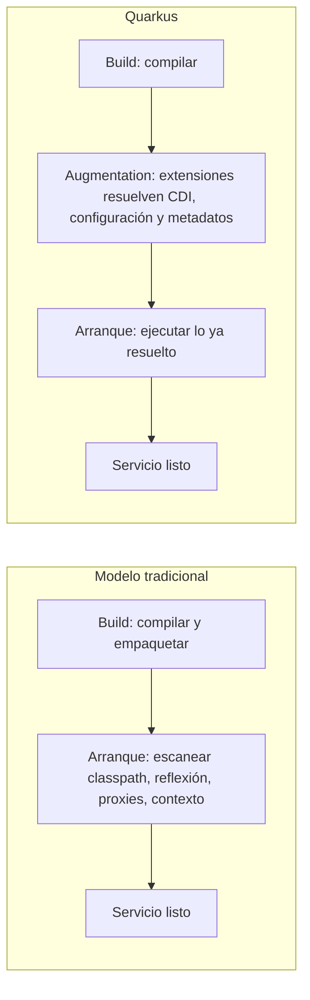

# Quarkus para equipos Java: qué cambia cuando el framework arranca en el build

_2026-11-13 · 12 min de lectura_

Quarkus se presenta como un framework Java para construir aplicaciones cloud-native rápidas y eficientes. Su documentación, organizada en un índice de guías que hoy corresponde a la versión 3.40, cubre desde la primera API REST hasta compilación nativa, mensajería, seguridad y observabilidad. Para un equipo que trabaja con Spring Boot, la pregunta relevante no es si Quarkus es más rápido, sino qué cambia en la forma de construir, probar y operar un servicio, y qué costos implica ese cambio. Este artículo recorre las guías con esa pregunta, a partir de una trayectoria que empezó en backend Java con Spring.

## La idea central: mover trabajo del arranque al build

Un framework Java tradicional hace buena parte de su trabajo cuando la aplicación arranca: escanea el classpath, lee anotaciones mediante reflexión, construye el grafo de dependencias, genera proxies y procesa la configuración. Ese trabajo se repite en cada inicio y consume tiempo y memoria durante toda la vida del proceso.

Quarkus traslada la mayor parte de ese trabajo a la compilación. El proyecto lo llama *compile time boot*: durante el build, cada extensión analiza el código, resuelve la inyección de dependencias, precalcula metadatos y genera el código necesario para arrancar. En tiempo de ejecución queda un proceso que ya sabe qué tiene que hacer. Según la página del proyecto, eso permite arranques rápidos y menor consumo de memoria tanto en la JVM como en ejecutables nativos.

_Dónde ocurre el trabajo: arranque tradicional frente a compile time boot_



Esta decisión de diseño tiene consecuencias que conviene conocer antes de adoptar el framework. Lo que se resuelve en el build no puede cambiar en ejecución: la inyección de dependencias se determina al compilar, y por eso, por ejemplo, la anotación `@Conditional` de Spring no tiene efecto en la capa de compatibilidad. La flexibilidad se traslada a los perfiles de configuración y de build, no al arranque.

## JVM, caché AOT o nativo: qué dicen los números oficiales

La compilación a ejecutable nativo con GraalVM o Mandrel es la característica más citada de Quarkus, y también la más malinterpretada. La propia guía de compilación nativa es explícita: Quarkus en la JVM ya es rápido, y para muchas aplicaciones el modo JVM es la opción correcta. Su recomendación es empezar en JVM y pasar a nativo cuando exista una necesidad concreta.

La guía publica una comparación entre tres modos de ejecución, medida en abril de 2026 con Quarkus 3.34.3, JDK 25 y GraalVM 25, sobre 4 CPU y un heap máximo de 512 MB:

_Modos de ejecución según la guía oficial de compilación nativa (benchmark del proyecto, no medición propia)_

| Indicador | JVM (fast-jar) | JVM + caché AOT de Leyden | Nativo (Mandrel) |
|---|---|---|---|
| Arranque en frío | ≈ 0,4 s a 3 s | ≈ 80 ms a 900 ms | ≈ 17 ms a 240 ms |
| Tiempo hasta la primera respuesta | 4.417 ms | 1.859 ms | 581 ms |
| Throughput máximo | 13.265 tps | 12.389 tps (≈ 7 % menos) | 5.411 tps (≈ 59 % menos) |
| Memoria residente (RSS) | 304 MiB | 240 MiB | 95 MiB |
| Tiempo de build | ≈ 30 s | — | 3 a 10 min, con 4 a 8 GB de RAM |

La tabla muestra un trade-off claro. El ejecutable nativo arranca en milisegundos y usa una fracción de la memoria, pero en este benchmark entrega menos de la mitad del throughput máximo y multiplica el tiempo de build. La guía lo resume en criterios: nativo cuando el arranque es crítico (serverless, escalado a cero, herramientas de línea de comandos), la memoria es escasa o el tamaño de la imagen importa; JVM cuando el throughput máximo es prioritario, el tiempo de build es una restricción o la aplicación depende mucho de reflexión o carga dinámica de clases.

> **Una lectura práctica:** La opción intermedia —la JVM con la caché AOT del proyecto Leyden, disponible desde JDK 24— reduce el arranque y la memoria con una pérdida de throughput pequeña y sin renunciar a las herramientas habituales de la JVM. Para servicios de larga duración, suele ser el primer paso a evaluar antes que el nativo.

## La experiencia de desarrollo: dev mode, testing continuo y Dev Services

El testimonio de Adoptium que aparece en el sitio del proyecto ilustra un punto que los benchmarks no capturan: para aplicaciones de larga duración, el arranque rápido no era decisivo, pero la recarga en vivo ahorraba tiempo de desarrollo. En la práctica, el argumento más fuerte de Quarkus para un equipo suele estar en el ciclo de trabajo diario.

- **Dev mode.** `quarkus dev` (o `./mvnw quarkus:dev`) recompila y recarga la aplicación al guardar un cambio, sin reiniciar el proceso manualmente.
- **Testing continuo.** Con el dev mode activo, Quarkus detecta qué tests cubren el código modificado y ejecuta solo esos. Arranca en pausa por defecto y se controla con teclas: `r` vuelve a correr todo, `f` solo los fallidos, `b` activa el modo de tests rotos.
- **Dev Services.** Si una extensión necesita un servicio —una base PostgreSQL, Kafka, Redis, Keycloak— y no hay una conexión configurada, Quarkus lo levanta automáticamente en un contenedor durante desarrollo y tests, y conecta la aplicación. Requiere Docker o Podman.

_application.properties: Dev Services en desarrollo y tests, conexión explícita solo en producción_

```properties
# Desarrollo y tests: sin URL configurada, Dev Services inicia PostgreSQL en un contenedor
quarkus.datasource.db-kind=postgresql

# Producción: la conexión se define únicamente en el perfil prod
%prod.quarkus.datasource.jdbc.url=jdbc:postgresql://db:5432/app
%prod.quarkus.datasource.username=${DB_USER}
%prod.quarkus.datasource.password=${DB_PASSWORD}
```

El detalle importa: Dev Services se activa solo cuando no hay configuración explícita. Declarar la conexión de producción con el prefijo `%prod.` permite que el entorno local siga siendo automático sin riesgo de que un desarrollador apunte por error a una base real. Para equipos de plataforma, es una forma concreta de reducir la fricción de incorporación: clonar el repositorio y ejecutar un comando alcanza para tener el servicio con sus dependencias funcionando.

## Viniendo de Spring: compatibilidad útil, no equivalencia

Quarkus ofrece extensiones de compatibilidad con Spring —inyección de dependencias, Web, Data JPA, Security, Scheduling, entre otras— que permiten usar anotaciones conocidas. La guía de Spring DI aclara el alcance: las clases de Spring se usan solo para leer metadatos; no se inicia un `ApplicationContext` ni se ejecuta infraestructura de Spring, y agregar bibliotecas arbitrarias de Spring no tiene efecto. Por debajo, la inyección la resuelve ArC, la implementación de Jakarta CDI 4.1 de Quarkus, en tiempo de build.

La propia documentación recomienda usar las anotaciones de CDI y publica una tabla de equivalencias. La migración de un componente típico es mecánica:

_El mismo componente con anotaciones de Spring y con CDI (equivalencias de la guía oficial)_

```java
// Spring
@Service
public class GreetingService {
    @Value("${greeting.suffix:!}")
    String suffix;
}

// Quarkus con CDI
@Singleton
public class GreetingService {
    @ConfigProperty(name = "greeting.suffix", defaultValue = "!")
    String suffix;
}
```

_Limitaciones documentadas de la capa de compatibilidad con Spring DI_

| Comportamiento de Spring | En Quarkus | Alternativa |
|---|---|---|
| `@Conditional` | Se ignora: la inyección se resuelve en el build | Perfiles de build condicionales |
| `@Autowired(required = false)` | No soportado | Inyectar `Instance<T>` y verificar `isResolvable()` |
| Resolución por nombre ante beans ambiguos | No soportada | Usar `@Named` |
| Inyectar `Set<T>` o `Map<String, T>` | No soportado; solo `List<T>` | Usar `List<T>` |
| `@Import`, `@ComponentScan` | No aplica: el descubrimiento ocurre en el build | — |
| Funcionalidades de test de Spring Boot | No soportadas | Guía de testing de Quarkus |

La conclusión práctica es que la compatibilidad reduce la curva de aprendizaje y permite migrar por partes, pero no convierte a Quarkus en un Spring más rápido. Los proyectos que dependen de configuración condicional en tiempo de ejecución, de auto-configuración de Spring Boot o de bibliotecas del ecosistema Spring requieren rediseño, no solo un cambio de dependencias.

## Un mapa de las guías según la necesidad del equipo

El índice de guías es extenso y está organizado por áreas. Para no recorrerlo de forma lineal, conviene entrar según el problema que el equipo necesita resolver:

_Puntos de entrada en la documentación de Quarkus_

| Necesidad | Guías relevantes |
|---|---|
| Primer contacto | "Creating your first application" (una API REST con recarga en vivo, inyección y tests en menos de 15 minutos) y "Your second Quarkus application" |
| APIs y servicios web | Quarkus REST, REST Client, OpenAPI, gRPC, GraphQL, WebSockets |
| Datos | Datasources, Hibernate ORM con Panache, Hibernate Reactive, Flyway y Liquibase, Redis y MongoDB |
| Mensajería y eventos | Kafka, AMQP, RabbitMQ, Pulsar, JMS |
| Seguridad | OpenID Connect, JWT, OAuth2, WebAuthn, Keycloak |
| Modelo de ejecución | Virtual threads, programación reactiva con Mutiny, propagación de contexto |
| Operación | Health checks, logging, Micrometer, OpenTelemetry, Fault Tolerance |
| Despliegue | Imágenes de contenedor, Kubernetes, OpenShift, funciones serverless en AWS Lambda, Azure y Google Cloud |

## Gobernanza, versiones y la capa de IA

Dos aspectos no técnicos influyen en una decisión de adopción. El primero es la gobernanza: el proyecto pasó a la Commonhaus Foundation, y el sitio lo presenta como una respuesta a la percepción de dependencia de un único proveedor; IBM, Red Hat y HeroDevs figuran como patrocinadores. El segundo es la política de versiones: Quarkus mantiene líneas LTS —3.40 y 3.33, entre otras— y publica versiones de emergencia cuando corresponde. La más reciente, 3.40.1.2, del 9 de noviembre de 2026, corrige un conjunto de CVE. Para un equipo, eso implica definir una política de actualización explícita, no solo elegir una versión.

El proyecto también avanza sobre herramientas para agentes de IA. Las guías para escribir extensiones incluyen capítulos sobre Dev MCP, Agent MCP y Dev Assistant, y el blog oficial publicó en noviembre de 2026 contenidos sobre análisis de causa raíz con LLM conectado por MCP a un stack de observabilidad y sobre aislamiento de agentes. Es una señal de dirección interesante, aunque todavía en evolución, para equipos que combinan Java con [ingeniería agéntica](/blog/loop-engineering-agentic-loops/).

## Cómo evaluarlo en un equipo sin reescribir un sistema

Adoptar un framework es una decisión de plataforma, con efectos durante años. Una evaluación razonable no empieza por migrar el servicio más crítico, sino por un piloto acotado con criterios definidos de antemano:

1. **Elegir un servicio nuevo o periférico**, con dependencias representativas (una base de datos, un broker de mensajes, autenticación) pero sin impacto crítico.
2. **Definir qué se quiere mejorar**: tiempo de arranque, memoria por instancia, costo de infraestructura o, con frecuencia, el ciclo de desarrollo. Cada objetivo lleva a decisiones distintas.
3. **Empezar en modo JVM** y medir con la carga real del servicio, no con un benchmark genérico. Evaluar la caché AOT antes que el ejecutable nativo.
4. **Medir la experiencia del equipo**: tiempo hasta el primer cambio en una persona nueva, duración del ciclo editar-probar, facilidad para levantar el entorno local con Dev Services.
5. **Inventariar dependencias de Spring** que no tienen equivalente directo, en particular configuración condicional y bibliotecas del ecosistema.
6. **Decidir con datos**: mantener, extender a otros servicios o descartar. Una plataforma con dos frameworks también tiene un costo, y conviene explicitarlo.

Quarkus no resuelve todos los problemas de un backend Java, y su propia documentación evita prometerlo. Lo que ofrece es una tesis clara —resolver en el build lo que no necesita resolverse en cada arranque— y un conjunto de herramientas que reducen la fricción del desarrollo diario. Para muchos equipos, ese segundo beneficio termina pesando más que el primero.

### Referencias

- [Quarkus: guías oficiales](https://quarkus.io/guides/) — índice de documentación, versión 3.40.
- [Quarkus](https://quarkus.io/) — sitio oficial del proyecto.
- [Building a native executable](https://quarkus.io/guides/building-native-image) — comparación de modos de ejecución y criterios de elección.
- [Dev Services overview](https://quarkus.io/guides/dev-services) — aprovisionamiento automático de servicios en desarrollo y tests.
- [Continuous testing](https://quarkus.io/guides/continuous-testing) — ejecución automática de tests afectados por un cambio.
- [Quarkus extension for Spring DI API](https://quarkus.io/guides/spring-di) — alcance y limitaciones de la compatibilidad con Spring.
- [Quarkus 3.40.1.2 released](https://quarkus.io/blog/quarkus-3-40-1-2-released/) — versión de emergencia de la línea LTS 3.40, 9 de noviembre de 2026.

---

**En síntesis: Quarkus mueve al build el trabajo que otros frameworks repiten en cada arranque. El ejecutable nativo es una opción para casos concretos, no un objetivo; el beneficio más amplio suele estar en el ciclo de desarrollo. Para equipos que vienen de Spring, la compatibilidad facilita la transición, pero la adopción conviene evaluarla con un piloto y criterios medibles.**

