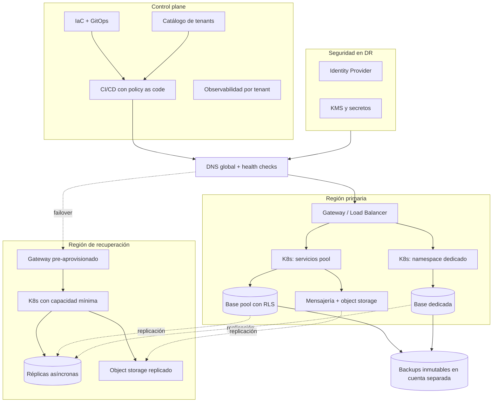

# SaaS multitenant: diseñar para escalar, automatizar para operar y replicar para sobrevivir

_2026-11-10 · 14 min de lectura_

Son las 03:17. Una región cloud deja de responder. Tres clientes financieros comparten la misma plataforma SaaS. La infraestructura está replicada, pero nadie verificó si el sistema de autenticación también puede recuperarse. No es un incidente real: es un experimento mental. Pero obliga a hacerse tres preguntas incómodas. ¿Estamos realmente aislando a nuestros tenants? ¿Podemos reconstruir la plataforma desde código? ¿Sabemos cuánto tardaríamos en recuperar el servicio completo, no solo la base de datos? La tesis de este artículo es que la resiliencia de un SaaS multitenant no depende de cuántos recursos duplicamos, sino de qué tan bien diseñamos el aislamiento, automatizamos la infraestructura y validamos nuestra capacidad real de recuperación.

## Multitenancy: compartir infraestructura sin compartir riesgos

Multitenancy suele presentarse como una decisión de costos: compartir infraestructura entre clientes para no pagar N copias de lo mismo. Es eso, pero sobre todo es una decisión de riesgo. Cada recurso compartido es un lugar donde un tenant puede afectar a otro: por seguridad, por rendimiento o por una falla. El diseño consiste en elegir, componente por componente, qué se comparte y qué no.

### Pool, silo y bridge

- **Pool**: infraestructura y datos compartidos, con aislamiento lógico. Un único cluster, una única base y un `tenant_id` que atraviesa cada capa.
- **Silo**: recursos dedicados por tenant. Cuenta, cluster o base propios. Más caro y más lento de aprovisionar, pero con un blast radius acotado por diseño.
- **Bridge**: una combinación. Servicios sin estado compartidos y datos dedicados, o un pool por defecto con la opción de mover a un tenant grande a un silo.

Los casos documentados recientes muestran que la respuesta casi nunca es pura. Cognizant consolidó OrderServ, un SaaS de pedidos para cadenas de comida rápida, desde un cluster de Amazon ECS por marca hacia un cluster compartido: 21 servicios en lugar de 105 para cinco marcas, onboarding por configuración en minutos y la opción de que una marca de alto volumen vuelva a un cluster dedicado. El caso en sentido opuesto es una plataforma de ad-serving con estado en memoria, donde el ruido entre vecinos es contención de memoria: pasó de una cuenta por tenant a cuentas compartidas por tier, pero conservó un cluster ECS por tenant dentro de cada grupo. Las dos son arquitecturas bridge, con fronteras en lugares distintos porque sus riesgos son distintos.

**Modelos de aislamiento: trade-offs típicos (no absolutos)**

| Dimensión | Pool | Bridge | Silo |
|---|---|---|---|
| Aislamiento de seguridad | Lógico: depende de identidad, código y políticas (RLS, IAM con contexto de tenant) | Mixto: dedicado donde está el dato o el riesgo, lógico en el resto | Físico o de cuenta: la frontera la impone la infraestructura |
| Costo por tenant | El más bajo; se amortiza con densidad | Intermedio; depende de qué capas se dedican | El más alto; capacidad ociosa por tenant |
| Complejidad operativa | Baja en cantidad de recursos, alta en disciplina de código | La más alta: dos modelos conviviendo y migraciones entre ellos | Alta en cantidad de recursos; exige automatización total |
| Escalabilidad | Escala con el sistema; sensible a noisy neighbors | Permite escalar tenants grandes de forma independiente | Lineal con tenants; los límites de cuenta y cuotas aparecen pronto |
| Blast radius | Toda la plataforma | Acotado por tier o por tenant | Un tenant |
| Onboarding | Configuración (minutos) | Configuración o aprovisionamiento según tier | Aprovisionamiento completo (requiere IaC) |

### El aislamiento es una cadena, no una capa

En un modelo pool, la frontera del tenant tiene que existir en cada capa: identidad (el tenant se deriva del token, no de un parámetro), aplicación (la librería de acceso a datos no construye una consulta sin tenant), base de datos (Row-Level Security como barrera cuando la aplicación se equivoca) y permisos de infraestructura (credenciales con alcance de tenant). OrderServ lo describe con claridad: una librería de tenancy que se niega a construir identificadores de recursos sin prefijo de tenant, y credenciales temporales con el tenant como session tag como segunda barrera. Ya escribí sobre [por qué el aislamiento de datos no puede depender de un WHERE](https://juliancardozo.github.io/blog/multi-tenancy-rls-frontera-datos/); la idea se generaliza: cada capa asume que la anterior puede fallar.

El cómputo también es una frontera. Los contenedores comparten el kernel del host, y eso importa cuando un tenant ejecuta código propio o no confiable. AWS anunció el 9 de noviembre de 2026 Nitro Sandboxes para Amazon EKS, donde cada pod corre en su propia VM liviana sobre el sistema Nitro, con requisito de Kubernetes 1.36 o superior. Es demasiado nuevo para recomendarlo sin evaluar, pero marca una tendencia: el aislamiento fuerte deja de ser sinónimo de un cluster por cliente.

### Noisy neighbor, blast radius y observabilidad por tenant

Un vecino ruidoso no siempre es un tenant que abusa: puede ser un cliente con una campaña legítima. OrderServ documenta picos promocionales de 5 a 10 veces en minutos y responde con capas: escalado predictivo, escalado reactivo, margen de capacidad y rate limits por tenant en el API Gateway. Nada de eso es gestionable sin observabilidad tenant-aware: métricas, logs y trazas etiquetados con el tenant, para responder en minutos "¿a quién afecta esto?" y "¿cuánto cuesta este cliente?". Si el onboarding de un tenant no crea también sus dashboards, alertas y presupuestos, el tenant existe pero no se puede operar.

## Infrastructure as Code: la arquitectura tiene que ser reproducible

Un diagrama describe la arquitectura que queremos. El código describe la que efectivamente tenemos, o al menos debería. Infrastructure as Code convierte la infraestructura en un artefacto de ingeniería: se versiona, se revisa, se prueba y se puede reconstruir. Terraform y OpenTofu, su fork bajo la Linux Foundation, comparten el mismo modelo: estado, plan y apply. La herramienta importa menos que la disciplina alrededor.

### Separar por ciclo de vida, no por herramienta

- **Global**: organización de cuentas, DNS, identidad, políticas base. Cambia poco y su blast radius es total.
- **Regional**: red, clusters, bases compartidas del pool, réplicas hacia la región de recuperación.
- **Tenant**: namespaces, cuotas, identidad de workload, recursos dedicados para tenants silo, dashboards y alertas.

Cada capa con su propio estado remoto, con bloqueo y cifrado, y con permisos distintos para aplicarla. Un error en la capa de tenant no debería poder tocar el DNS global. Los secretos no viven en el código ni en el estado en texto plano: se referencian desde un gestor de secretos o un KMS.

_Ejemplo ilustrativo (HCL, Terraform/OpenTofu). Los módulos ./modules/* son hipotéticos y encapsulan al proveedor_

```hcl
# El catálogo de tenants es la fuente de verdad del onboarding:
# sumar un cliente es un cambio en este mapa, revisado en un Pull Request.
variable "tenants" {
  type = map(object({
    tier        = string # "pool" | "silo"
    rpo_minutes = number # acordado con negocio, no elegido por infraestructura
  }))

  validation {
    condition     = alltrue([for t in values(var.tenants) : contains(["pool", "silo"], t.tier)])
    error_message = "tier debe ser \"pool\" o \"silo\"."
  }
}

variable "region"          { type = string }
variable "recovery_region" { type = string }

locals {
  silo_tenants = { for id, t in var.tenants : id => t if t.tier == "silo" }
}

# Capa regional: una base compartida para el pool, con RLS y réplica.
module "pool_database" {
  source             = "./modules/database"
  name               = "pool-${var.region}"
  row_level_security = true
  replica_region     = var.recovery_region
}

# Recursos dedicados solo para tenants silo.
module "silo_database" {
  source         = "./modules/database"
  for_each       = local.silo_tenants
  name           = "tenant-${each.key}"
  replica_region = var.recovery_region
}

# Todos los tenants: namespace, cuotas, identidad de workload y alertas.
module "tenant_runtime" {
  source   = "./modules/tenant-runtime"
  for_each = var.tenants

  tenant_id      = each.key
  resource_quota = each.value.tier == "silo" ? "dedicated" : "shared-default"
  database_url   = try(module.silo_database[each.key].endpoint, module.pool_database.endpoint)
  labels         = { tenant = each.key, tier = each.value.tier }
}
```

Lo importante del ejemplo no es la sintaxis, sino tres decisiones. El tier de un tenant es un dato, no una bifurcación del código. La validación rechaza configuraciones inválidas antes del plan. Y el RPO de cada tenant queda escrito junto a su definición, donde una política puede verificar que la estrategia de backup y réplica asignada es capaz de cumplirlo.

### Del Pull Request a la observabilidad

1. **Pull Request**: el cambio, incluido el alta de un tenant, se propone como código.
2. **Validaciones**: formato, `validate`, linters y escaneo de seguridad de la configuración.
3. **Plan**: el diff real contra el estado, publicado en el PR.
4. **Policy as Code**: reglas evaluadas sobre el plan (OPA/Rego, Sentinel o Kyverno en Kubernetes): cifrado obligatorio, sin recursos públicos, tags de tenant presentes.
5. **Revisión**: una persona revisa el plan, no solo el código. Más aprobaciones cuanto mayor el blast radius de la capa.
6. **Apply**: desde el pipeline, nunca desde una laptop, con credenciales de corta duración.
7. **Verificación**: smoke tests y checks de salud del tenant o de la región.
8. **Observabilidad**: el cambio queda asociado a métricas y eventos para correlacionar regresiones.

GitOps lleva la misma idea al runtime: un controlador en el cluster reconcilia continuamente lo declarado en Git con lo que corre. Ahí aparece el problema que la mayoría de los equipos subestima: el drift. El artículo de Qovery sobre provisión multi-cloud lo pone como línea divisoria entre herramientas: Crossplane revierte cambios fuera de banda de forma continua, plataformas como Spacelift o env0 corren chequeos de drift programados, y Terraform u OpenTofu solos lo muestran recién cuando alguien corre un plan. Vale leerlo sabiendo que es contenido de un proveedor, pero la clasificación es útil.

> **Límite.** IaC no garantiza por sí sola consistencia de datos, seguridad ni recuperación. Reconstruye recursos; no restaura el contenido de una base, no corrige una política mal diseñada y no prueba que el runbook funcione. Un `apply` exitoso en la región de recuperación no dice nada sobre si los datos que llegaron son los correctos.

## Replicación y continuidad operativa

Los términos se usan como sinónimos y no lo son. Confundirlos lleva a pagar por una protección y creer que se tiene otra.

**Conceptos que se confunden**

| Concepto | Qué resuelve | Qué no resuelve |
|---|---|---|
| Alta disponibilidad (HA) | Fallas de componentes o de una zona, sin intervención humana (Multi-AZ, réplicas, balanceo) | La pérdida de una región o la corrupción lógica de datos |
| Disaster Recovery (DR) | Recuperar una función de negocio ante un evento mayor, típicamente en otra región | Nada, si no fue probado bajo condiciones reales |
| Backup y restore | Volver a un punto en el tiempo, incluso antes de un error humano o un ransomware | El tiempo de recuperación: restaurar suele ser lento |
| Replicación síncrona | RPO cercano a cero: la escritura se confirma en ambos lados | La latencia: penaliza cada escritura y escala mal entre regiones lejanas |
| Replicación asíncrona | Copias remotas sin penalizar la latencia | La pérdida de datos en vuelo: existe un RPO mayor que cero |
| Active-active | RTO mínimo: las regiones ya sirven tráfico | La consistencia: exige resolver conflictos de escritura |
| Active-passive | Diseño más simple: una región escribe | El RTO: la región pasiva tiene que promoverse y escalar |

**RTO** es cuánto tiempo puede estar caída una función; **RPO**, cuántos datos se pueden perder, medido en tiempo. **Failover** es mover el servicio a la región de recuperación; **failback**, volver, y suele ser más difícil porque hay que reconciliar lo que se escribió en el medio.

La serie de AWS Architecture Blog publicada el 2 de noviembre de 2026 por Peter Garnepudi y Jay Desai propone empezar por tres decisiones de negocio antes que por el diagrama: definir el límite de recuperación alrededor de funciones de negocio y no de aplicaciones, anclar RTO y RPO a consecuencias de negocio, y contar la cadena de dependencias. Su ejemplo más claro: un objetivo de 1 hora para una aplicación quedaba limitado a 4 horas por un servicio de identidad compartido de otro equipo. Una aplicación se recupera tan rápido como su dependencia más lenta.

### Escenario hipotético: caída regional a las 03:17

1. **Detección**: alertas por síntomas (tasa de error, latencia por tenant), no solo por recursos. Se declara incidente con un rol de comando definido.
2. **Impacto por tenant**: ¿quiénes están afectados?, ¿qué tier tiene cada uno?, ¿qué RTO comprometimos con cada cliente? La observabilidad tenant-aware convierte esto en una consulta, no en una conversación.
3. **Decisión de failover**: la toma quien estaba designado de antemano, con criterios escritos. Fallar hacia la otra región tiene costo: pérdida de datos en vuelo y un failback posterior.
4. **Promoción de réplicas**: se verifica el lag de replicación de cada base antes de promoverla. Con replicación asíncrona, el último lag observado es la pérdida de datos real.
5. **Redirección del tráfico**: DNS con health checks o un control de enrutamiento preparado. AWS advierte que crear o modificar registros DNS e IAM durante el evento depende de planos de control de una sola región: esos cambios se dejan resueltos antes.
6. **Autenticación y dependencias**: el Identity Provider, los secretos, las integraciones de pago y los proveedores externos. En el caso que describe AWS, la plataforma de autenticación compartida quedó fuera del alcance de recuperación y los logins fallaron.
7. **Consistencia de datos**: conteos, sumas de control y reconciliación de los últimos eventos. En un SaaS financiero, saber qué transacciones quedaron en duda es parte del servicio.
8. **Comunicación y recuperación**: estado público por tenant, actualizaciones periódicas, y después un postmortem que vuelve a las tres decisiones.

> **Replicación no es backup.** Una réplica copia fielmente lo que pasa en el primario, incluido un `DELETE` sin `WHERE`, una migración defectuosa o datos cifrados por un ransomware. La recuperación ante errores lógicos necesita backups con retención, idealmente inmutables y en una cuenta separada, y restauraciones probadas.

## Una arquitectura de referencia

La siguiente propuesta es una referencia hipotética, no la descripción de un sistema real. Usa un modelo bridge: servicios y datos en pool por defecto, con recursos dedicados para tenants que lo requieren por contrato, regulación o volumen, y un esquema active-passive con capacidad mínima pre-aprovisionada en la región de recuperación.

_SaaS multitenant bridge con región de recuperación_



Las decisiones detrás del diagrama: el control plane vive fuera de las regiones de datos para poder operar durante una caída; el Identity Provider está dentro del alcance de DR; la mensajería se diseña para que los consumidores sean idempotentes, porque después de un failover se van a reprocesar mensajes; y los backups viven en una cuenta separada, para que una credencial comprometida en producción no pueda borrarlos.

**Servicios posibles en AWS y OCI (opciones, no equivalencias funcionales)**

| Capacidad | AWS | OCI |
|---|---|---|
| DNS y tráfico global | Route 53 (health checks, failover), Application Recovery Controller | OCI DNS con Traffic Management Steering Policies |
| Entrada | Application Load Balancer, Amazon API Gateway | OCI Load Balancer, OCI API Gateway |
| Kubernetes | Amazon EKS | Container Engine for Kubernetes (OKE) |
| Identidad | Amazon Cognito, IAM Identity Center | OCI IAM con Identity Domains |
| Base relacional | Aurora PostgreSQL (Global Database) | OCI Database with PostgreSQL, Autonomous Database (Data Guard) |
| Object storage | Amazon S3 con replicación entre regiones | OCI Object Storage con políticas de replicación |
| Mensajería | Amazon SQS, SNS, EventBridge | OCI Queue, OCI Streaming |
| Claves y secretos | AWS KMS, Secrets Manager | OCI Vault |
| Orquestación de DR | Application Recovery Controller, AWS Resilience Hub | OCI Full Stack Disaster Recovery |

Cada fila esconde diferencias reales de semántica de replicación, límites, cuotas y comportamiento ante fallas. Por ejemplo, el modelo de failover de una base global administrada no es el mismo que el de Data Guard. La tabla sirve para saber dónde buscar, no para migrar de una nube a otra.

## Lo que hay que medir

Los indicadores conectan una decisión técnica con lo que siente el cliente y con el riesgo que asume el negocio. No hay benchmarks universales: el valor correcto de cada uno lo define el producto, el contrato y la regulación.

**Indicadores y la pregunta que responde cada uno**

| Indicador | Pregunta que responde |
|---|---|
| Availability / SLO por tenant | ¿El servicio cumple lo que prometimos, también para el cliente más chico? |
| Error budget | ¿Podemos seguir cambiando a esta velocidad o hay que frenar y estabilizar? |
| RTO objetivo vs. RTO observado | ¿Cuánto tardamos de verdad la última vez que lo probamos? |
| RPO objetivo vs. pérdida observada | ¿Cuántos datos perdimos en el último ejercicio, medido y no estimado? |
| MTTR | ¿Cuánto tardamos en restaurar el servicio ante un incidente cualquiera? |
| Change failure rate | ¿Qué proporción de cambios termina en incidente o rollback? |
| % de recursos gestionados por IaC | ¿Qué parte de la plataforma no podríamos reconstruir desde código? |
| Configuration drift | ¿Cuántas diferencias hay entre lo declarado y lo que corre, y cuánto duran? |
| Costo por tenant | ¿Cada tier es rentable? ¿Cuánto cuesta la resiliencia que vendemos? |
| Incidentes multi-tenant | ¿Nuestro aislamiento contiene las fallas o las propaga? |

Los pares objetivo/observado son los más reveladores. En el caso que documenta AWS, una organización tenía un compromiso contractual de recuperación de 5 horas y su primer ejercicio tardó entre 9 y 11. El número del contrato era una aspiración; el del ejercicio era la realidad.

## Los errores que conviene evitar

- **Confundir backup con replicación.** Consecuencia: la corrupción se replica en segundos. Mitigación: backups con retención e inmutabilidad, y restauraciones periódicas medidas.
- **Compartir recursos sin analizar aislamiento.** Consecuencia: un tenant degrada o expone a otro. Mitigación: decidir pool o silo por componente y por riesgo, con defensa en profundidad.
- **Automatizar despliegues sin automatizar recuperación.** Consecuencia: el día del incidente, el runbook es un documento que nadie ejecutó. Mitigación: runbooks como código y probados.
- **Tener IaC sin detectar drift.** Consecuencia: la región de recuperación se construye desde un código que ya no describe producción. Mitigación: drift checks programados y cambios manuales prohibidos o reconciliados.
- **Diseñar multi-region sin validar dependencias.** Consecuencia: la aplicación vuelve y el IdP, un secreto o un proveedor externo no. Mitigación: mapear la cadena completa y pedir compromisos de recuperación por escrito a cada dueño.
- **No probar la recuperación de datos.** Consecuencia: un backup que nunca se restauró es una hipótesis. Mitigación: restores automatizados con verificación de integridad.
- **Ignorar los costos de resiliencia.** Consecuencia: una arquitectura que el negocio no puede sostener y que se recorta en silencio. Mitigación: costo por tier visible y elegido.
- **Definir RTO/RPO sin el negocio.** Consecuencia: objetivos que nadie financió. Mitigación: cada objetivo nace de una consecuencia de negocio confirmada por alguien responsable de ella.
- **Dejar el Identity Provider fuera de los ejercicios.** Consecuencia: la plataforma está arriba y nadie puede iniciar sesión. Mitigación: el IdP es parte del alcance de cada prueba.

La segunda parte de la serie de AWS propone validar de forma progresiva: ejercicio de mesa, failover planificado, simulacro sin aviso y game day con inyección de fallas. Los autores aclaran que es un modelo de madurez propio, no una taxonomía formal, pero su síntesis es precisa: la mesa encuentra el paso sin dueño, el failover planificado la mala configuración, el simulacro la falla de coordinación y el game day la dependencia no modelada. Quedarse en el failover planificado deja ocultas las fallas de equipo y de proceso.

## El rol de Platform Engineering

Todo lo anterior se puede hacer con un equipo de infraestructura que recibe tickets. No escala. La alternativa es tratar la infraestructura como un producto interno: una plataforma que permite a los equipos crear ambientes de forma autónoma, desplegar bajo estándares definidos, heredar controles de seguridad, consultar métricas y costos por tenant, ejecutar procedimientos reproducibles y correr ejercicios de recuperación sin coordinar cinco equipos por mail.

Los **Golden Paths** son el camino recomendado y mantenido: un template de servicio que ya viene con observabilidad por tenant, policies y pipeline. Una **Internal Developer Platform** es la superficie donde ese camino se consume. **DevSecOps** es la condición para que la seguridad esté en el camino y no en una revisión al final. El objetivo no es prohibir desvíos, sino que el camino correcto sea el más fácil.

La resiliencia, además, es un problema de colaboración. Product define qué funciones importan y cuánto vale una hora sin ellas. Security define qué no puede compartirse. Infrastructure construye la capacidad. Engineering diseña servicios que toleran reintentos y failovers. Si cualquiera de los cuatro falta en la conversación, el RTO es un número que nadie puede defender.

## Diseñar para fallar, operar para recuperarse

Volvamos a las 03:17. La infraestructura replicada no era el problema; el problema era una dependencia que nadie había incluido en el límite de recuperación, un objetivo que nadie había validado y un ejercicio que nunca se corrió con el IdP adentro. Ninguna de esas fallas se resuelve comprando más regiones.

La disponibilidad no es una propiedad que se compra en la nube. Es una capacidad que los equipos construyen, automatizan y ponen a prueba: con fronteras de aislamiento elegidas por riesgo, infraestructura que se puede reconstruir desde código sin drift, y objetivos de recuperación que el negocio firmó y que un ejercicio confirmó.

Y una pregunta para el debate: en tu plataforma, ¿cuál es la dependencia más lenta de recuperar, y quién es su dueño?

### Referencias

- [Three business decisions that define your DR success](https://aws.amazon.com/blogs/architecture/three-business-decisions-that-define-your-dr-success/) — Peter Garnepudi y Jay Desai, AWS Architecture Blog, 2 de noviembre de 2026.
- [Validating your DR commitment: From controlled test to real-world readiness](https://aws.amazon.com/blogs/architecture/validating-your-dr-commitment-from-controlled-test-to-real-world-readiness/) — Peter Garnepudi y Jay Desai, AWS Architecture Blog, 2 de noviembre de 2026.
- [How to Automate Multi-Cloud Provisioning and Governance Without Hand-Syncing Four Copies of the Same Environment](https://www.qovery.com/blog/automate-multi-cloud-provisioning-governance-without-hand-syncing) — Alessandro Carrano, Qovery Blog, 2 de noviembre de 2026 (contenido de proveedor).
- [How OrderServ achieved up to 64% cost savings with multi-tenant ECS](https://aws.amazon.com/blogs/architecture/how-orderserv-achieved-up-to-64-cost-savings-with-multi-tenant-ecs/) — Chetan Yewale, Ashwini Kumar, Asit Singh, Rama Krishna Sanjeeva, Suddhasattwa Mukherjee y Urvashi Sharma, AWS Architecture Blog, 5 de noviembre de 2026.
- [AWS Nitro Sandboxes: Hardware-enforced workload isolation on Amazon EKS](https://aws.amazon.com/blogs/containers/aws-nitro-sandboxes-hardware-enforced-workload-isolation-on-amazon-eks/) — Carlos Santana y Trishi Mehta, AWS Containers Blog, 9 de noviembre de 2026.
- [Building hybrid multi-tenant architecture for stateful services on AWS](https://aws.amazon.com/blogs/architecture/building-hybrid-multi-tenant-architecture-for-stateful-services-on-aws/) — Vasu Raj, AWS Architecture Blog, 12 de mayo de 2026.
- [AWS Well-Architected SaaS Lens](https://docs.aws.amazon.com/wellarchitected/latest/saas-lens/saas-lens.html) — AWS.
- [Disaster Recovery of Workloads on AWS](https://docs.aws.amazon.com/whitepapers/latest/disaster-recovery-workloads-on-aws/disaster-recovery-workloads-on-aws.html) — whitepaper de AWS.
- [OpenTofu](https://opentofu.org/docs/) y [Terraform](https://developer.hashicorp.com/terraform/docs) — documentación oficial.
- [Kubernetes: Multi-tenancy](https://kubernetes.io/docs/concepts/security/multi-tenancy/) — documentación oficial.
- [OCI Full Stack Disaster Recovery](https://docs.oracle.com/en-us/iaas/disaster-recovery/index.html) — documentación de Oracle Cloud Infrastructure.

**Criterio práctico: elegí la frontera de aislamiento por riesgo y no por costo, reconstruí la plataforma desde código y vigilá el drift, y no creas en un RTO que no viste cumplirse en un ejercicio con el Identity Provider adentro.**

