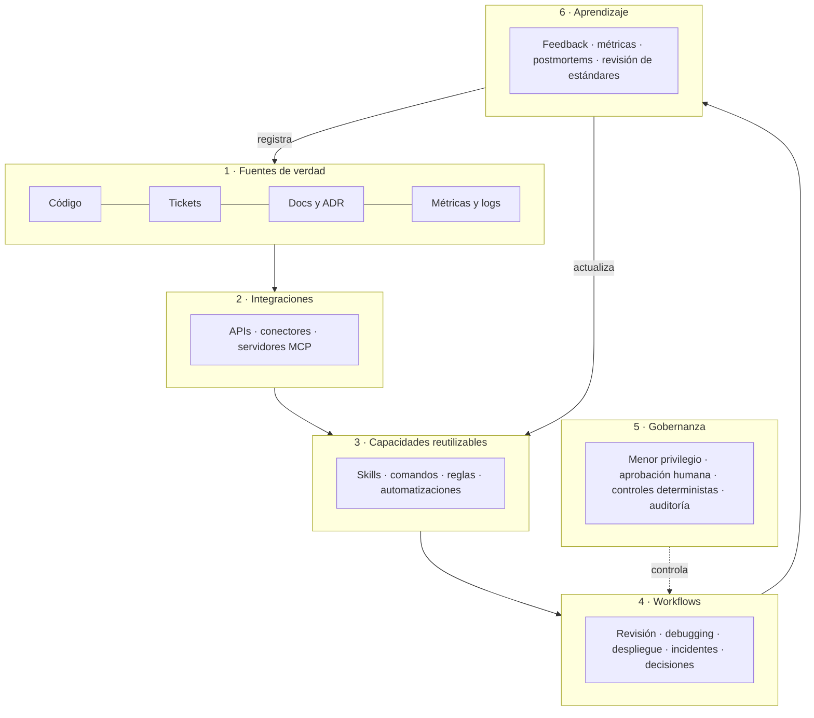
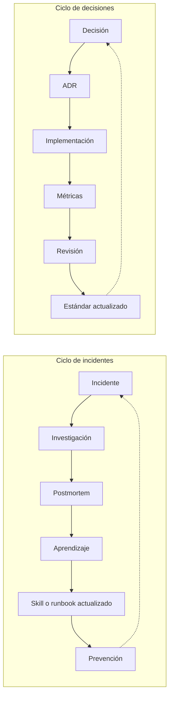

# Tooling para equipos de alto desempeño: de herramientas aisladas a sistemas de ingeniería aumentados por IA

_2026-11-14 · 15 min de lectura_

Un equipo trabaja con GitHub, Jira, Slack, Confluence, dashboards de observabilidad y pipelines de CI/CD. Tiene todas las herramientas que se esperan de un equipo moderno y, aun así, las decisiones quedan dispersas en hilos de chat, el standup consiste en reconstruir de memoria lo que pasó ayer, las revisiones de código dependen de dos personas que conocen el sistema y cada incidente produce información que rara vez se convierte en aprendizaje. Este artículo sostiene una tesis: un equipo de alto desempeño no es el que tiene más herramientas ni el que usa más inteligencia artificial, sino el que logra reducir el costo de coordinación, preservar el conocimiento, automatizar el trabajo repetitivo y mejorar la calidad de sus decisiones. Para desarrollarla, usa como caso de estudio el plugin de ingeniería que Anthropic publicó en su repositorio knowledge-work-plugins.

## El problema no es la falta de herramientas

Cada herramienta de ese equipo resuelve bien su parte: GitHub guarda el código, Jira el estado del trabajo, Slack las conversaciones, el sistema de monitoreo las métricas. El problema aparece entre ellas. La información necesaria para tomar una decisión casi nunca vive en un solo lugar, y alguien tiene que recorrer varias fuentes, reconstruir el contexto e interpretarlo. Ese trabajo de integración lo hacen las personas, a mano y de forma repetida.

Dos conceptos ayudan a nombrarlo. La **carga cognitiva**, que Team Topologies propone como una restricción de diseño de los equipos: cuanto más contexto ajeno a su tarea principal debe sostener un equipo, menos capacidad le queda para esa tarea. Y el **costo de coordinación**: el tiempo que se dedica a sincronizar, buscar información, esperar respuestas y reconstruir decisiones. Agregar herramientas sin integrarlas suele aumentar ambos, porque multiplica los lugares donde puede estar la información.

Por eso la cantidad de herramientas no predice el desempeño. Lo que importa es si el conjunto funciona como un sistema: si la información fluye entre las fuentes, si las prácticas del equipo están incorporadas en la forma de trabajar y si cada ciclo deja al equipo mejor preparado para el siguiente.

## Del tooling individual al sistema de trabajo del equipo

Para pasar de herramientas a sistema, resulta útil pensar en capas, cada una con una responsabilidad distinta. El modelo que sigue es una propuesta propia, no un estándar.

1. **Fuentes de verdad:** el código, los tickets, la documentación, las decisiones registradas y las métricas. Son los sistemas de registro.
2. **Integraciones:** APIs, conectores y servidores MCP que exponen esas fuentes a otras herramientas, incluidas las de IA.
3. **Capacidades reutilizables:** skills, comandos, reglas y automatizaciones que codifican cómo el equipo hace una tarea.
4. **Workflows:** secuencias orientadas a un resultado, como revisar un cambio, depurar un error, desplegar o gestionar un incidente.
5. **Gobernanza:** permisos, aprobaciones humanas, controles deterministas y trazabilidad.
6. **Aprendizaje:** feedback, métricas y revisión que modifican las capas anteriores.

_Arquitectura de un sistema de trabajo de ingeniería con IA_

Las capas interactúan en dos direcciones. Hacia arriba, cada workflow consume capacidades, que a su vez dependen de integraciones con las fuentes de verdad. Hacia abajo, el aprendizaje modifica las capacidades y deja registro en las fuentes. Un equipo que solo invierte en las capas 2 y 3, conectores y prompts, obtiene velocidad sin dirección; uno que descuida la capa 5 obtiene velocidad sin control.

## El plugin de ingeniería de Anthropic como caso de estudio

El repositorio [knowledge-work-plugins](https://github.com/anthropics/knowledge-work-plugins), con licencia Apache 2.0, contiene plugins para distintos tipos de trabajo. El de ingeniería, en su versión 1.2.0 al commit `e91a134`, se describe como diseñado principalmente para Cowork, la aplicación de escritorio de Anthropic, aunque también funciona en Claude Code. Su contenido es deliberadamente simple: diez skills escritas en Markdown, un archivo de conectores y una configuración de servidores MCP.

Seis de esas skills se invocan como comandos (`/standup`, revisión de código, `/architecture`, `/debug`, gestión de incidentes y `/deploy-checklist`) y cuatro se activan automáticamente cuando el tema es relevante: diseño de sistemas, deuda técnica, estrategia de testing y documentación. Cada skill tiene una descripción que indica cuándo usarla, un procedimiento, un formato de salida y una sección que explica qué hacer si hay conectores disponibles. Hay un detalle menor pero ilustrativo: el README presenta los comandos como `/review` e `/incident`, mientras que las skills se llaman `code-review` e `incident-response`. Incluso un catálogo pequeño necesita mantenimiento.

Dos decisiones de diseño son más interesantes que los comandos en sí. La primera es la **independencia de herramientas**: las skills no nombran productos, sino categorías mediante marcadores como `~~source control` o `~~monitoring`, y el archivo de conectores mapea cada categoría a servidores concretos. La configuración `.mcp.json` incluye servidores HTTP para Slack, Linear, Asana, Atlassian, Notion, GitHub, PagerDuty y Datadog, y no incluye ninguno para CI/CD. La segunda es el modo **standalone o supercharged**: cada comando funciona con lo que la persona describe o pega, y mejora cuando hay conectores. La práctica queda separada de la integración.

Lo que el plugin no hace también importa. No ejecuta controles deterministas ni impone aprobaciones: el checklist de despliegue es un documento que la persona completa, no un gate del pipeline. La gobernanza queda a cargo del entorno que lo ejecuta y del sistema de CI/CD del equipo. Es razonable que así sea, pero significa que adoptar el plugin no equivale a tener un proceso controlado.

_Workflows manuales frente a asistidos, a partir de las skills del plugin (el beneficio y la métrica son propuestas propias)_

| Workflow | Problema original | Qué aporta la skill | Responsabilidad humana | Riesgo principal | Métrica útil |
|---|---|---|---|---|---|
| Standup | Reconstruir de memoria commits, PRs y tickets | Formato ayer/hoy/bloqueos; con conectores, toma commits, PRs, tickets y conversaciones | Agregar matices, prioridades y bloqueos reales | Confundir actividad con progreso; uso como vigilancia | Tiempo de preparación; bloqueos detectados antes |
| Revisión de código | Dependencia de pocos revisores | Revisión estructurada en seguridad, performance, corrección y mantenibilidad, con veredicto | Aprobar o rechazar; juzgar diseño y contexto | Reviews superficiales que se aprueban por confianza | Defectos encontrados después del merge; tiempo de revisión |
| Decisiones de arquitectura | Decisiones sin registro ni alternativas | ADR con contexto, opciones, trade-offs, consecuencias y tareas | Elegir, firmar y asumir la decisión | ADR plausibles pero sin restricciones reales | Decisiones revisadas con su ADR; retrabajo por decisiones |
| Incidentes | Comunicación desordenada y postmortems que no se escriben | Severidad SEV1–4, roles, actualizaciones de estado y postmortem blameless con 5 porqués | Comandar el incidente y decidir mitigaciones | Diagnóstico confiado con contexto incompleto | Tiempo hasta el postmortem; incidentes recurrentes |
| Despliegue | Pasos olvidados y criterios de rollback improvisados | Checklist antes, durante y después, con disparadores de rollback definidos de antemano | Ejecutar el despliegue y decidir el rollback | Tratar un checklist como un control | Tasa de fallas de cambio; tiempo de recuperación |

## Tools, skills, MCP, workflows, agentes y harness

Estos términos se usan como sinónimos y no lo son. Distinguirlos ayuda a decidir en qué invertir.

- **Tool:** una capacidad para ejecutar o consultar una acción concreta, como leer un pull request o consultar una métrica.
- **Skill:** conocimiento e instrucciones reutilizables para hacer bien una tarea. Una skill no ejecuta nada por sí misma; orienta cómo se usan las tools.
- **MCP:** el [Model Context Protocol](https://modelcontextprotocol.io/), un protocolo abierto para conectar aplicaciones de IA con sistemas externos. Estandariza cómo se exponen las tools, no qué se hace con ellas.
- **Workflow:** una secuencia coordinada de pasos orientada a un resultado, con puntos de decisión.
- **Agente:** un sistema que razona sobre un objetivo y usa las capacidades disponibles dentro de límites definidos.
- **Harness:** el entorno que rodea al agente con contexto, herramientas, restricciones, evaluación y mecanismos de control, como se analiza en [este artículo sobre harness engineering](/blog/harness-engineering-agentes-codigo-guias-sensores/).

En una revisión de pull request, las piezas se combinan así: el servidor MCP de GitHub expone la tool que obtiene el diff; la skill de revisión indica qué dimensiones evaluar y qué formato entregar; el agente ejecuta el procedimiento; el workflow define que la revisión asistida ocurre después de que el pipeline pasa y antes de la revisión humana; y el harness aporta los controles deterministas, como tests, análisis estático y reglas de arquitectura, además de los permisos que impiden que el agente apruebe o fusione el cambio. Ninguna pieza sustituye a las otras.

## Golden paths para el trabajo diario

En Platform Engineering, un golden path es el camino recomendado y soportado para una tarea frecuente, normalmente crear un servicio o aprovisionar infraestructura. La idea se puede extender al trabajo diario: incorporar a una persona nueva, abrir y revisar un pull request, documentar una decisión, resolver un incidente, preparar un despliegue o gestionar deuda técnica. En cada caso, el estándar del equipo debería estar incorporado en la herramienta, no en una página de wiki que nadie consulta.

Las skills son un vehículo natural para esto, porque convierten una práctica implícita en una capacidad explícita y versionada. La skill de deuda técnica del plugin, por ejemplo, propone una fórmula de priorización explícita: impacto más riesgo, multiplicado por seis menos el esfuerzo. Se puede discutir la fórmula, pero tenerla escrita permite discutirla. Bajo el enfoque de Platform as a Product, estas capacidades deberían tratarse como un producto interno: con usuarios, feedback, versiones y la libertad de no usarlas cuando no aplican. Un golden path que se impone por obligación deja de ser un camino fácil y se convierte en burocracia.

## Alto desempeño sin burocracia

Buena parte del valor inmediato está en reducir trabajo administrativo: standups escritos y asíncronos que parten de un borrador generado a partir de la actividad real, reportes que se arman solos, documentación generada y luego revisada, y una conexión directa entre tickets, código y resultados que permite detectar bloqueos antes de la reunión semanal.

Conviene separar dos cosas que suelen mezclarse: automatizar la **recopilación** de información y automatizar la **interpretación** del trabajo humano. La primera es útil y de bajo riesgo. La segunda, como resumir el desempeño de una persona a partir de sus commits, es peligrosa: confunde actividad con aporte y convierte la herramienta en un mecanismo de vigilancia. Un standup generado debería ser un borrador para la persona, no un informe sobre ella. Si el equipo percibe que la herramienta lo observa, dejará de usarla o empezará a optimizar lo que mide.

## La IA como acelerador del aprendizaje organizacional

El aporte más duradero no es hacer más rápido una tarea, sino reducir el costo de convertir experiencia en conocimiento reutilizable. Dos ciclos lo muestran. En el primero, un incidente se investiga, se documenta en un postmortem, el aprendizaje se traduce en un runbook o una skill actualizada y eso previene o acorta el siguiente incidente. En el segundo, una decisión de arquitectura se registra en un ADR, se implementa, se observa con métricas y se revisa, y la revisión ajusta el estándar del equipo.

_Dos ciclos de aprendizaje organizacional_

La IA reduce el costo de cada paso: reconstruir la línea de tiempo, redactar el primer borrador del postmortem, proponer alternativas para un ADR. Lo que no puede hacer es decidir qué se aprendió. Es la misma lógica de [Loop Engineering](/blog/loop-engineering-agentic-loops/) aplicada a la organización: un ciclo solo mejora si tiene una señal de salida y alguien que la evalúe. Y es una cuestión de context engineering: el aprendizaje que no queda registrado en una fuente de verdad no está disponible para el próximo ciclo, ni para las personas ni para los agentes.

## Caso práctico: una alerta de latencia de extremo a extremo

El escenario es ficticio e ilustrativo. Nexo Logística, una empresa inventada, tiene un equipo de plataforma de cinco personas que mantiene servicios Java con Spring Boot desplegados en Kubernetes sobre AWS. Usa GitHub, Jira, GitHub Actions, SonarQube, New Relic y Backstage como portal interno, y Claude Code con servidores MCP para GitHub, Jira y su herramienta de monitoreo. Un martes a las 10:40, una alerta indica que la latencia p95 del servicio `order-pricing` subió de forma sostenida.

_Qué se asiste con IA, qué verifican los controles automáticos y qué decide una persona (escenario ficticio)_

| Paso | Asistido con IA | Verificación automática | Responsabilidad humana |
|---|---|---|---|
| Triage | Resume la alerta, las métricas del servicio y propone una severidad con la skill de incidentes | Umbrales de alerta y SLO definidos en el monitoreo | La persona de guardia confirma la severidad y asume el rol de incident commander |
| Contexto | Cruza despliegues recientes, PRs fusionados y tickets: un cambio de ayer agregó una consulta por cada ítem del pedido | Registro de despliegues de GitHub Actions y catálogo de Backstage | Validar que la correlación tiene sentido |
| Diagnóstico | Con la skill de debug, formula hipótesis y señala un patrón N+1 | Trazas distribuidas que confirman el aumento de llamadas a la base | Aceptar o descartar la causa raíz |
| Mitigación | Redacta las actualizaciones de estado | Rollback automatizado del despliegue | Decidir el rollback y comunicar |
| Decisión técnica | Borrador de ADR: consulta agregada frente a caché | Prueba de carga comparativa en staging | Elegir la opción y registrar el ADR |
| Corrección y revisión | Implementa el cambio y hace una primera revisión estructurada | Tests, cobertura y quality gate de SonarQube en el pipeline | Revisar y aprobar el pull request |
| Despliegue | Genera el checklist con disparadores de rollback a partir de las métricas actuales | Canary con análisis automático de error y latencia | Autorizar la promoción a producción |
| Aprendizaje | Redacta el postmortem y propone una regla nueva de revisión para consultas en bucles | Una regla de análisis estático que detecta el patrón | Aprobar el postmortem y la actualización del estándar |

El caso muestra el reparto que conviene diseñar. La IA reduce el tiempo de recopilar y redactar; los controles deterministas, como tests, quality gates y el análisis del canary, verifican; y las personas deciden en los puntos donde hay responsabilidad: la severidad, la causa, la mitigación, la decisión técnica y la aprobación. El último paso es el más valioso, porque convierte el incidente en un control nuevo.

## Medir el impacto del tooling

Las métricas fáciles de obtener son las menos útiles. La cantidad de prompts, los tokens consumidos, las líneas generadas o el número de pull requests miden actividad, no resultado, y pueden subir mientras la calidad baja. Las métricas relevantes provienen de marcos establecidos: [DORA](https://dora.dev/) para el flujo de entrega y [SPACE](https://queue.acm.org/detail.cfm?id=3454124) para recordar que la productividad tiene varias dimensiones, entre ellas la satisfacción y la colaboración.

_Matriz de métricas para evaluar un sistema de trabajo_

| Dimensión | Indicadores | Fuente |
|---|---|---|
| Flujo de entrega | Lead time for changes, frecuencia de despliegue, tasa de fallas de cambio, tiempo de recuperación de despliegues fallidos | CI/CD y control de versiones |
| Developer Experience | Tiempo dedicado a buscar información, carga cognitiva percibida, tiempo de onboarding, fricción en tareas frecuentes, satisfacción con herramientas internas | Encuestas breves y recurrentes |
| Calidad y operación | Defectos en producción, incidentes recurrentes, tiempo de recuperación, actualización de la documentación, retrabajo por requisitos ambiguos | Tracker, monitoreo y postmortems |
| Adopción | Uso efectivo de los workflows, tareas completadas sin asistencia manual innecesaria, utilidad percibida | Telemetría de uso y encuestas |

Para que la medición sirva, hace falta una línea de base antes del cambio, comparar períodos equivalentes y desconfiar de las atribuciones causales simples. Si el lead time baja en el trimestre en que se adoptó una herramienta, también pudo influir un cambio de prioridades, una contratación o una estacionalidad. Las métricas de adopción y las de resultado deben leerse juntas: una herramienta muy usada que no mejora ningún resultado es un costo.

## Los riesgos de automatizar prácticas de ingeniería

Automatizar una práctica no la mejora si la práctica es deficiente; la vuelve más rápida. Los riesgos más concretos son la dependencia excesiva de agentes y la pérdida gradual de conocimiento humano; las revisiones superficiales que se aprueban porque «ya lo revisó la IA»; las alucinaciones y el contexto incompleto; los conectores con permisos excesivos; la exposición de información sensible a través de integraciones; el prompt injection, especialmente cuando un agente lee contenido no confiable como issues, comentarios o logs; el aumento de la complejidad operativa y la dependencia de proveedores.

Los controles son conocidos, aunque se apliquen poco: **menor privilegio** en cada conector, empezando por accesos de solo lectura; **auditoría** de lo que hace cada agente; **evaluación continua** de la calidad de las salidas; preferencia por **acciones reversibles**; **controles deterministas** en los puntos críticos, en lugar de instrucciones; y **human-in-the-loop** en toda acción con efectos externos, como fusionar, desplegar, paginar a alguien o comunicar a clientes.

## Cómo implementarlo: una hoja de ruta de 90 días

La hoja de ruta que sigue es una propuesta. Su premisa es empezar por la fricción real del equipo, no por la herramienta.

- **Días 1–30, discovery.** Entrevistas breves, observación de tareas frecuentes y una línea de base de métricas. Se eligen dos workflows de alto impacto y bajo riesgo; el standup asíncrono y la revisión asistida de pull requests suelen ser buenos candidatos, porque son frecuentes y la decisión final sigue siendo humana.
- **Días 31–60, piloto.** Se configuran las integraciones con permisos de solo lectura, se adaptan las skills a las prácticas del equipo, se definen los controles y se mide la adopción con usuarios reales, recogiendo feedback cada semana.
- **Días 61–90, evolución.** Se comparan los resultados con la línea de base, se corrigen los problemas, se documentan los aprendizajes y se decide qué capacidades escalar, cuáles ajustar y cuáles abandonar.

_Matriz de priorización de workflows candidatos (valoraciones ilustrativas)_

| Workflow | Impacto | Frecuencia | Riesgo | Esfuerzo | Prioridad sugerida |
|---|---|---|---|---|---|
| Standup asíncrono | Medio | Diaria | Bajo | Bajo | Alta: piloto |
| Revisión asistida de PR | Alto | Diaria | Medio | Medio | Alta: piloto |
| ADR asistido | Alto | Mensual | Bajo | Bajo | Media |
| Postmortem asistido | Alto | Ocasional | Bajo | Bajo | Media |
| Checklist de despliegue | Medio | Semanal | Alto si reemplaza gates | Medio | Media, solo como complemento del pipeline |
| Respuesta a incidentes con acciones | Alto | Ocasional | Alto | Alto | Baja hasta tener controles maduros |

## El nuevo rol del Engineering Manager

Cuando una parte del trabajo de coordinación se automatiza, el rol del Engineering Manager no desaparece: se desplaza. Pasa de organizar y supervisar tareas a diseñar el sistema de trabajo en el que esas tareas ocurren. Eso implica identificar las fricciones antes de que se normalicen, crear condiciones para la autonomía, promover estándares útiles en lugar de procesos, reducir dependencias entre equipos, facilitar el aprendizaje continuo, proteger la calidad de las decisiones y asegurar que la adopción de IA sea responsable, con permisos acotados y criterios explícitos.

La IA no elimina la necesidad de liderazgo ni de coordinación humana. Cambia dónde se ejerce: menos en el seguimiento de tareas y más en las decisiones sobre qué automatizar, qué controlar y qué conocimiento preservar.

## Conclusión

El plugin de ingeniería de Anthropic es útil como caso de estudio precisamente por su simplicidad: muestra que una práctica de ingeniería puede escribirse como una capacidad explícita, reutilizable e independiente de la herramienta concreta, y que su valor crece cuando se conecta con las fuentes de verdad del equipo. También muestra sus límites: una skill orienta, pero no controla, y la gobernanza sigue siendo responsabilidad del sistema que la ejecuta.

El objetivo no es que la IA haga más cosas por el equipo, sino diseñar un entorno en el que el equipo pueda concentrar su capacidad en los problemas que requieren inteligencia, creatividad y criterio profesional. Un equipo de alto desempeño, en ese sentido, es sostenible: reduce su costo de coordinación, conserva lo que aprende y mejora sus decisiones con cada ciclo.

## Referencias

- Anthropic. [knowledge-work-plugins: engineering](https://github.com/anthropics/knowledge-work-plugins/tree/e91a134584eb798bac7fb0379358006a2b63b965/engineering), commit `e91a134`, versión 1.2.0 del plugin. Incluye [README](https://github.com/anthropics/knowledge-work-plugins/blob/e91a134584eb798bac7fb0379358006a2b63b965/engineering/README.md), [CONNECTORS.md](https://github.com/anthropics/knowledge-work-plugins/blob/e91a134584eb798bac7fb0379358006a2b63b965/engineering/CONNECTORS.md) y `.mcp.json`.
- Model Context Protocol. [Especificación y documentación](https://modelcontextprotocol.io/).
- DORA. [dora.dev](https://dora.dev/).
- Forsgren, N., Storey, M.-A., Maddila, C., Zimmermann, T., Houck, B. y Butler, J. (2021). [The SPACE of Developer Productivity](https://queue.acm.org/detail.cfm?id=3454124). ACM Queue.
- Skelton, M. y Pais, M. [Team Topologies](https://teamtopologies.com/).
- CNCF TAG App Delivery. [Platforms White Paper](https://tag-app-delivery.cncf.io/whitepapers/platforms/).
- Backstage. [backstage.io](https://backstage.io/).
- Nygard, M. (2011). [Documenting Architecture Decisions](https://www.cognitect.com/blog/2011/11/15/documenting-architecture-decisions).

---

**En síntesis: el desempeño de un equipo depende menos de la cantidad de herramientas que del sistema que forman. Convertir prácticas en capacidades explícitas, como hace el plugin de ingeniería de Anthropic, reduce el costo de coordinación y preserva conocimiento, pero solo genera valor si se integra con las fuentes de verdad, se gobierna con controles deterministas y aprobación humana, y se mide por resultados de entrega, calidad y experiencia, no por actividad.**

